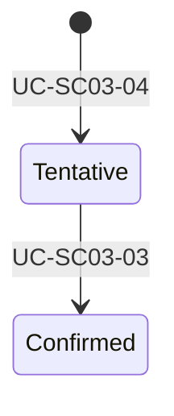

🏠 [Specs](../../../README.md) › 🏷️ [Sectors](../../README.md) › 💼 [SC03 Services](../README.md) › 🗃️ [Data](README.md) ›
🗃️ E-SC03-04 Staffing assignment

# 🗃️ E-SC03-04 Staffing assignment

**Status:** ✅ specified

## Purpose

A consultant on an engagement.

## Fields

| Name | Type | Required | Validation | Default | Example | Personal data | Custom fields |
|---|---|---|---|---|---|---|---|
| engagement, consultant | records | yes | - | - | E-207, S. B. | yes | no |
| role, dates, load | text, dates, percent | yes | BR-SC03-04 | 100 % | Senior, Nov, 60 % | no | no |
| state | tentative, confirmed | yes | - | tentative | confirmed | no | no |

## Relations

As its use cases.

## Lifecycle

## Indexes and search

By number, date, partner.

## Retention

Kept for the period of its kind of record in the country pack (D293), or else its kind's default in the
[retention schedule](../../../05-non-functional/data-retention.md).

## Audit

Every change.

## Import and export

CSV, FEC where relevant.

## Used by

- [UC-SC03-03](../use-cases/02-staff-and-plan/uc-sc03-03-staff-the-engagement.md)
- [UC-SC03-04](../use-cases/02-staff-and-plan/uc-sc03-04-plan-resources-and-utilisation.md)

## Open questions

None.

---

⬅️ [E-SC03-03 Rate card](e-sc03-03-rate-card.md) · ⬆️ [Up](README.md) ·
➡️ [E-SC03-05 Timesheet](e-sc03-05-timesheet.md)
