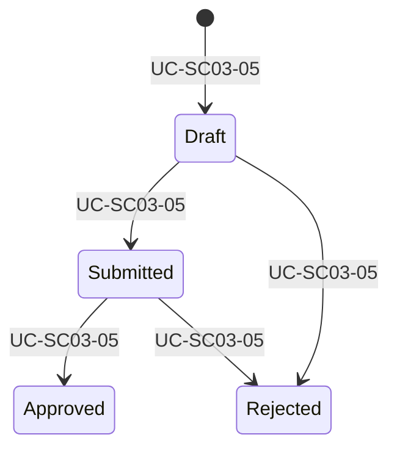

🏠 [Specs](../../../README.md) › 🏷️ [Sectors](../../README.md) › 💼 [SC03 Services](../README.md) › 🗃️ [Data](README.md) ›
🗃️ E-SC03-05 Timesheet

# 🗃️ E-SC03-05 Timesheet

**Status:** 🔄 waiting for the owner

## Purpose

A week of time.

## Fields

| Name | Type | Required | Validation | Default | Example | Personal data | Custom fields |
|---|---|---|---|---|---|---|---|
| consultant, week | records | yes | unique pair | - | S. B., W46 | yes | no |
| lines | engagement, day, hours | yes | - | - | E-207, Mon, 7 | no | no |
| state | draft, submitted, approved, rejected | yes | BR-SC03-05 | draft | approved | no | no |

## Relations

(Proposed) As its use cases.

## Lifecycle

## Indexes and search

(Proposed) By number, date, partner.

## Retention

As an accounting record:
[CR-FR-002 Accounting records kept 10 years](../../../10-country-packs/france/accounting/cr-fr-002-accounting-records-kept-ten-years.md).

## Audit

Every change.

## Import and export

(Proposed) CSV, FEC where relevant.

## Used by

- [UC-SC03-05](../use-cases/03-deliver-and-record/uc-sc03-05-record-and-approve-time-and-expenses.md)
- [UC-SC03-15](../use-cases/03-deliver-and-record/uc-sc03-15-ask-the-assistant-about-an-engagement.md)

## Open questions

None.

---

⬅️ [E-SC03-04 Staffing assignment](e-sc03-04-staffing-assignment.md) · ⬆️ [Up](README.md) ·
➡️ [E-SC03-06 Rebillable cost](e-sc03-06-rebillable-cost.md)
