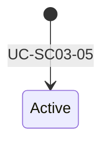

🏠 [Specs](../../../README.md) › 🏷️ [Sectors](../../README.md) › 💼 [SC03 Services](../README.md) › 🗃️ [Data](README.md) ›
🗃️ E-SC03-06 Rebillable cost

# 🗃️ E-SC03-06 Rebillable cost

**Status:** 🔄 waiting for the owner

## Purpose

A cost to rebill.

## Fields

| Name | Type | Required | Validation | Default | Example | Personal data | Custom fields |
|---|---|---|---|---|---|---|---|
| consultant, engagement | records | yes | - | - | S. B., E-207 | yes | no |
| amount, receipt | amount, file | yes | - | - | 84.00, train.pdf | no | no |
| rebillable | yes, no | yes | - | yes | yes | no | no |

## Relations

(Proposed) As its use cases.

## Lifecycle

## Indexes and search

(Proposed) By number, date, partner.

## Retention

As an accounting record:
[CR-FR-002 Accounting records kept 10 years](../../../10-country-packs/france/accounting/cr-fr-002-accounting-records-kept-ten-years.md).

## Audit

Every change.

## Import and export

(Proposed) CSV, FEC where relevant.

## Used by

- [UC-SC03-05](../use-cases/03-deliver-and-record/uc-sc03-05-record-and-approve-time-and-expenses.md)

## Open questions

None.

---

⬅️ [E-SC03-05 Timesheet](e-sc03-05-timesheet.md) · ⬆️ [Up](README.md) ·
➡️ [E-SC03-07 Billing proposal](e-sc03-07-billing-proposal.md)
