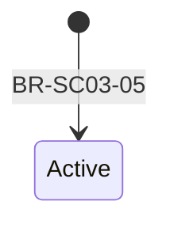

🏠 [Specs](../../../README.md) › 🏷️ [Sectors](../../README.md) › 💼 [SC03 Services](../README.md) › 🗃️ [Data](README.md) ›
🗃️ E-SC03-07 Billing proposal

# 🗃️ E-SC03-07 Billing proposal

**Status:** ✅ specified

## Purpose

What to bill this period.

## Fields

| Name | Type | Required | Validation | Default | Example | Personal data | Custom fields |
|---|---|---|---|---|---|---|---|
| engagement, period | records | yes | - | - | E-207, Nov | no | no |
| lines | time, expenses, milestones | yes | BR-SC03-05 | - | 18 days | no | no |
| write-offs | amount, reason | no | - | 0 | 1 day, rework | no | no |

## Relations

As its use cases.

## Lifecycle

## Indexes and search

By number, date, partner.

## Retention

As an accounting record:
[CR-FR-002 Accounting records kept 10 years](../../../10-country-packs/france/accounting/cr-fr-002-accounting-records-kept-ten-years.md).

## Audit

Every change.

## Import and export

CSV, FEC where relevant.

## Used by

- [UC-SC03-06](../use-cases/04-bill-and-recognise/uc-sc03-06-bill-time-and-materials.md)
- [UC-SC03-07](../use-cases/04-bill-and-recognise/uc-sc03-07-bill-fixed-price-by-milestones-and-retainers.md)
- [UC-SC03-14](../use-cases/04-bill-and-recognise/uc-sc03-14-bill-foreign-clients.md)

## Open questions

None.

---

⬅️ [E-SC03-06 Rebillable cost](e-sc03-06-rebillable-cost.md) · ⬆️ [Up](README.md) ·
➡️ [E-SC03-08 Milestone](e-sc03-08-milestone.md)
