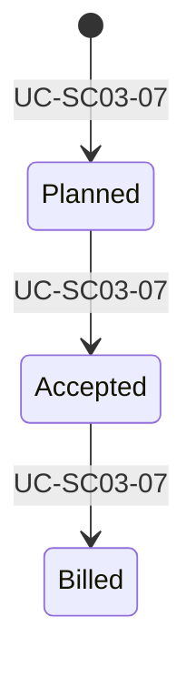

🏠 [Specs](../../../README.md) › 🏷️ [Sectors](../../README.md) › 💼 [SC03 Services](../README.md) › 🗃️ [Data](README.md) ›
🗃️ E-SC03-08 Milestone

# 🗃️ E-SC03-08 Milestone

**Status:** ✅ specified

## Purpose

A billable step of a fixed-price engagement.

## Fields

| Name | Type | Required | Validation | Default | Example | Personal data | Custom fields |
|---|---|---|---|---|---|---|---|
| engagement, name | records | yes | - | - | E-207, design | no | no |
| share | percent | yes | total 100 % | - | 30 % | no | no |
| state | planned, accepted, billed | yes | BR-SC03-06 | planned | billed | no | no |

## Relations

As its use cases.

## Lifecycle

## Indexes and search

By number, date, partner.

## Retention

Kept for the period of its kind of record in the country pack (D293), or else its kind's default in the
[retention schedule](../../../05-non-functional/data-retention.md).

## Audit

Every change.

## Import and export

CSV, FEC where relevant.

## Used by

- [UC-SC03-07](../use-cases/04-bill-and-recognise/uc-sc03-07-bill-fixed-price-by-milestones-and-retainers.md)

## Open questions

None.

---

⬅️ [E-SC03-07 Billing proposal](e-sc03-07-billing-proposal.md) · ⬆️ [Up](README.md) ·
➡️ [E-SC03-09 Revenue position](e-sc03-09-revenue-position.md)
