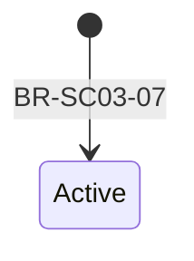

🏠 [Specs](../../../README.md) › 🏷️ [Sectors](../../README.md) › 💼 [SC03 Services](../README.md) › 🗃️ [Data](README.md) ›
🗃️ E-SC03-09 Revenue position

# 🗃️ E-SC03-09 Revenue position

**Status:** 🔄 waiting for the owner

## Purpose

Work in progress and deferred revenue of a month.

## Fields

| Name | Type | Required | Validation | Default | Example | Personal data | Custom fields |
|---|---|---|---|---|---|---|---|
| engagement, month | records | yes | - | - | E-207, Nov | no | no |
| progress, billed | percent, amount | yes | BR-SC03-07 | - | 60 %, 40 000 | no | no |
| work in progress, deferred | amounts | yes | - | - | 12 000, 0 | no | no |

## Relations

(Proposed) As its use cases.

## Lifecycle

## Indexes and search

(Proposed) By number, date, partner.

## Retention

As an accounting record:
[CR-FR-002 Accounting records kept 10 years](../../../10-country-packs/france/accounting/cr-fr-002-accounting-records-kept-ten-years.md).

## Audit

Every change.

## Import and export

(Proposed) CSV, FEC where relevant.

## Used by

- [UC-SC03-08](../use-cases/04-bill-and-recognise/uc-sc03-08-follow-work-in-progress-and-recognise-revenue.md)

## Open questions

None.

---

⬅️ [E-SC03-08 Milestone](e-sc03-08-milestone.md) · ⬆️ [Up](README.md) ·
➡️ [E-SC03-10 Freelance contract](e-sc03-10-freelance-contract.md)
