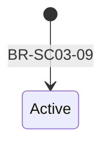

🏠 [Specs](../../../README.md) › 🏷️ [Sectors](../../README.md) › 💼 [SC03 Services](../README.md) › 🗃️ [Data](README.md) ›
🗃️ E-SC03-10 Freelance contract

# 🗃️ E-SC03-10 Freelance contract

**Status:** 🔄 waiting for the owner

## Purpose

A freelancer or subcontractor engaged.

## Fields

| Name | Type | Required | Validation | Default | Example | Personal data | Custom fields |
|---|---|---|---|---|---|---|---|
| supplier, engagement | records | yes | - | - | J. D. (freelance), E-207 | no | no |
| documents, vigilance date | files, date | yes | BR-SC03-09 | - | 2026-10-02 | no | no |
| lending | yes, no | yes | BR-SC03-08 | no | no | no | no |

## Relations

(Proposed) As its use cases.

## Lifecycle

## Indexes and search

(Proposed) By number, date, partner.

## Retention

Kept for the period of its kind of record in the country pack (D293), or else its kind's default in the
[retention schedule](../../../05-non-functional/data-retention.md).

## Audit

Every change.

## Import and export

(Proposed) CSV, FEC where relevant.

## Used by

- [UC-SC03-09](../use-cases/03-deliver-and-record/uc-sc03-09-engage-freelancers-and-subcontractors.md)

## Open questions

None.

---

⬅️ [E-SC03-09 Revenue position](e-sc03-09-revenue-position.md) · ⬆️ [Up](README.md) ·
➡️ [E-SC03-11 Skill](e-sc03-11-skill.md)
