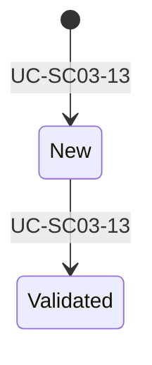

🏠 [Specs](../../../README.md) › 🏷️ [Sectors](../../README.md) › 💼 [SC03 Services](../README.md) › 🗃️ [Data](README.md) ›
🗃️ E-SC03-11 Skill

# 🗃️ E-SC03-11 Skill

**Status:** 🔄 waiting for the owner

## Purpose

A skill or certification of a consultant.

## Fields

| Name | Type | Required | Validation | Default | Example | Personal data | Custom fields |
|---|---|---|---|---|---|---|---|
| consultant, skill | records | yes | - | - | S. B., cloud architecture | yes | no |
| level, expiry | 1 to 5, date | no | BR-SC03-13 | - | 4, 2027-06-30 | no | no |

## Relations

(Proposed) As its use cases.

## Lifecycle

## Indexes and search

(Proposed) By number, date, partner.

## Retention

While the consultant is employed, then per
[CR-FR-047 HR records retention](../../../10-country-packs/france/labour/cr-fr-047-hr-records-retention.md).

## Audit

Every change.

## Import and export

(Proposed) CSV, FEC where relevant.

## Used by

- [UC-SC03-03](../use-cases/02-staff-and-plan/uc-sc03-03-staff-the-engagement.md)
- [UC-SC03-13](../use-cases/05-client-and-people/uc-sc03-13-manage-consultants-skills-and-certifications.md)

## Open questions

None.

---

⬅️ [E-SC03-10 Freelance contract](e-sc03-10-freelance-contract.md) · ⬆️ [Up](README.md) ·
➡️ [E-SC03-12 Shared item](e-sc03-12-shared-item.md)
