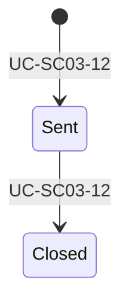

🏠 [Specs](../../../README.md) › 🏷️ [Sectors](../../README.md) › 💼 [SC03 Services](../README.md) › 🗃️ [Data](README.md) ›
🗃️ E-SC03-13 Satisfaction survey

# 🗃️ E-SC03-13 Satisfaction survey

**Status:** ✅ specified

## Purpose

A client's answers.

## Fields

| Name | Type | Required | Validation | Default | Example | Personal data | Custom fields |
|---|---|---|---|---|---|---|---|
| engagement, sent | records | yes | - | - | E-207, 12 Nov | no | no |
| score, comment | 0 to 10, text | no | - | - | 9, clear reports | yes | no |

## Relations

As its use cases.

## Lifecycle

## Indexes and search

By number, date, partner.

## Retention

Kept for the period of its kind of record in the country pack (D293), or else its kind's default in the
[retention schedule](../../../05-non-functional/data-retention.md).

## Audit

Every change.

## Import and export

CSV, FEC where relevant.

## Used by

- [UC-SC03-12](../use-cases/05-client-and-people/uc-sc03-12-measure-client-satisfaction.md)

## Open questions

None.

---

⬅️ [E-SC03-12 Shared item](e-sc03-12-shared-item.md) · ⬆️ [Up](README.md) ·
➡️ [E-SC03-14 Pricing model](e-sc03-14-pricing-model.md)
