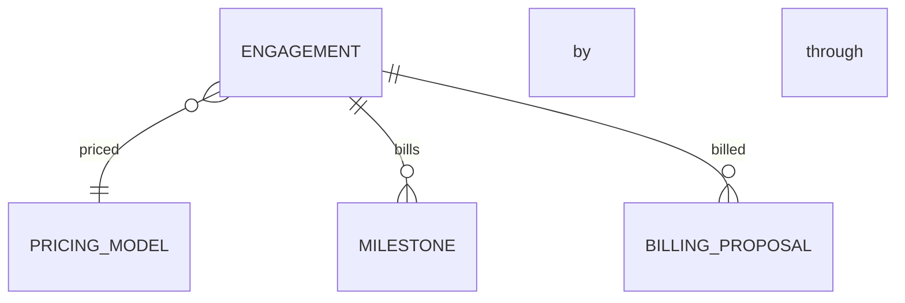
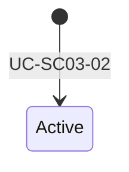

🏠 [Specs](../../../README.md) › 🏷️ [Sectors](../../README.md) › 💼 [SC03 Services](../README.md) › 🗃️ [Data](README.md) ›
🗃️ E-SC03-14 Pricing model

# 🗃️ E-SC03-14 Pricing model

**Status:** ✅ specified

## Purpose

The pricing model the flow charts name with the words "model"
([FL-SC03-01](../flows/fl-sc03-01-win-and-price.md)). The owner decided to create it
([D516](../../../06-decisions/foundations/d516-naming-rules-and-the-seven-classes-of-names.md)); its fields are derived
from the specifications and confirmed by the owner (D572).

## Fields

| Name | Type | Required | Validation | Default | Example | Personal data | Custom fields |
|---|---|---|---|---|---|---|---|
| name | text | yes | not empty | - | Retainer, monthly | no | no |
| kind | time and materials, fixed price, milestones, retainer | yes | BR-SC03-06 | time and materials | retainer | no | no |
| retainer period | period | no | set for a retainer only | - | month | no | no |
| state | Active | yes | the lifecycle below | Active | Active | no | no |

The engagement manager chooses each engagement's pricing model among time and materials, fixed price, milestones and
retainer ([UC-SC03-02](../use-cases/01-win-and-price/uc-sc03-02-set-rate-cards-and-pricing-models.md) step 3), and
billing follows it: approved time and expenses, accepted milestones, or the period with its balance
([BR-SC03-06](../business-rules/br-sc03-06-billing-follows-the-pricing-model.md)). The kinds and the default are those
of the engagement's model ([E-SC03-01 Engagement](e-sc03-01-engagement.md)). The name and the state are the columns of
[S-SC03-L14 Pricing models](../screens/00-lists/s-sc03-l14-pricing-models.md), whose example rows read "Time and
material 2026", "Fixed price, small" and "Retainer, monthly"; the models show on
[S-SC03-02 Rate cards](../screens/01-win-and-price/s-sc03-02-rate-cards.md).

## Relations

- [E-SC03-01 Engagement](e-sc03-01-engagement.md): the engagements that use the model
- [E-SC03-03 Rate card](e-sc03-03-rate-card.md): the day rates that price time and materials
  ([BR-SC03-03](../business-rules/br-sc03-03-rates-from-the-rate-card.md))
- [E-SC03-08 Milestone](e-sc03-08-milestone.md): billed once accepted under a fixed price or milestones model
- [E-SC03-07 Billing proposal](e-sc03-07-billing-proposal.md): built as the model says

## Lifecycle

## Indexes and search

By name and state, the sort and facet of
[S-SC03-L14 Pricing models](../screens/00-lists/s-sc03-l14-pricing-models.md); searched by name and kind.

## Retention

As the other records of its capability.

## Audit

Every change, as the other records of its capability.

## Import and export

CSV or XLSX export of the rows and columns the user may see, from
[S-SC03-L14 Pricing models](../screens/00-lists/s-sc03-l14-pricing-models.md), audited (T3); no import.

## Used by

- [UC-SC03-02 Set rate cards and pricing models](../use-cases/01-win-and-price/uc-sc03-02-set-rate-cards-and-pricing-models.md)

## Open questions

None.

---

⬅️ [E-SC03-13 Satisfaction survey](e-sc03-13-satisfaction-survey.md) · ⬆️ [Up](README.md) ·
➡️ [E-SC03-15 Resource plan](e-sc03-15-resource-plan.md)
