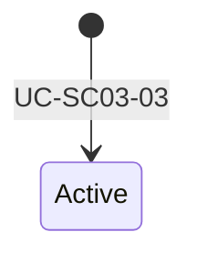

🏠 [Specs](../../../README.md) › 🏷️ [Sectors](../../README.md) › 💼 [SC03 Services](../README.md) › 🗃️ [Data](README.md) ›
🗃️ E-SC03-15 Resource plan

# 🗃️ E-SC03-15 Resource plan

**Status:** 🔄 waiting for the owner

## Purpose

(Proposed) The resource plan the flow charts name with the words "Resource plan"
([FL-SC03-02](../flows/fl-sc03-02-staff-and-plan.md)). The owner decided to create it
([D516](../../../06-decisions/foundations/d516-naming-rules-and-the-seven-classes-of-names.md)); what it holds waits for
the owner's confirmation.

## Fields

(Proposed) To define with the owner: the flow charts name the record, not its fields.

## Relations

(Proposed) To define with the owner, from the use cases below.

## Lifecycle

## Indexes and search

(Proposed) To define with the owner.

## Retention

(Proposed) As the other records of its capability, to confirm with the owner.

## Audit

(Proposed) Every change, as the other records of its capability.

## Import and export

(Proposed) To define with the owner.

## Used by

- [UC-SC03-03 Staff the engagement](../use-cases/02-staff-and-plan/uc-sc03-03-staff-the-engagement.md)

## Open questions

(Proposed) Its fields, relations and states wait for the owner (waiting list, step 36e).

---

⬅️ [E-SC03-14 Pricing model](e-sc03-14-pricing-model.md) · ⬆️ [Up](README.md) ·
➡️ [E-SC03-16 Staffing need](e-sc03-16-staffing-need.md)
