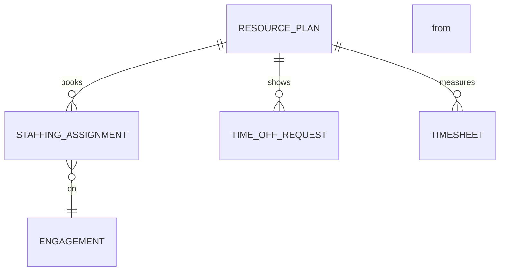
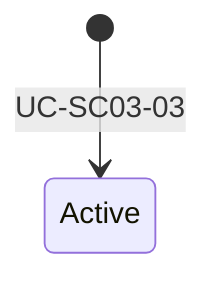

🏠 [Specs](../../../README.md) › 🏷️ [Sectors](../../README.md) › 💼 [SC03 Services](../README.md) › 🗃️ [Data](README.md) ›
🗃️ E-SC03-15 Resource plan

# 🗃️ E-SC03-15 Resource plan

**Status:** ✅ specified

## Purpose

The resource plan the flow charts name with the words "Resource plan"
([FL-SC03-02](../flows/fl-sc03-02-staff-and-plan.md)). The owner decided to create it
([D516](../../../06-decisions/foundations/d516-naming-rules-and-the-seven-classes-of-names.md)); its fields are derived
from the specifications and confirmed by the owner (D572).

## Fields

| Name | Type | Required | Validation | Default | Example | Personal data | Custom fields |
|---|---|---|---|---|---|---|---|
| name | text | yes | not empty | - | Plan Q4 2026 | no | no |
| from, to | dates | yes | from before to | - | 2026-10-01 to 2026-12-31 | no | no |
| bookings | staffing assignments (E-SC03-04) per consultant and week, computed | no | within availability, BR-SC03-04 | - | S. B., W47, E-207 60 % | yes | no |
| leave | time off per consultant and week, computed | no | - | - | S. B., W50, leave | yes | no |
| utilisation | percent per consultant, team and month, computed | no | BR-SC03-15 | - | November 78 % | no | no |
| utilisation target | percent | no | 0 % to 100 % | - | 75 % | no | no |
| bench | unbooked hours per month, computed | no | shown when over 20 % of available hours | - | 6 of 25 consultants in December | no | no |
| state | Active | yes | the lifecycle below | Active | Active | no | no |

The plan shows people per week with their bookings, tentative bookings apart, and leave; the engagement manager moves
bookings within availability and the owner follows utilisation and the bench
([UC-SC03-04](../use-cases/02-staff-and-plan/uc-sc03-04-plan-resources-and-utilisation.md) steps 1 to 4, alternative 2a,
error 3e, [BR-SC03-15](../business-rules/br-sc03-15-utilisation-from-approved-time.md)); a confirmed assignment shows in
it ([UC-SC03-03](../use-cases/02-staff-and-plan/uc-sc03-03-staff-the-engagement.md) step 4). The name and the state are
the columns of [S-SC03-L15 Resource plans](../screens/00-lists/s-sc03-l15-resource-plans.md), whose example rows read
"Plan Q4 2026"; the weeks, bookings, leave and the utilisation target are those of the
[S-SC03-04 Resource plan](../screens/02-staff-and-plan/s-sc03-04-resource-plan.md) mock-up.

## Relations

- [E-SC03-04 Staffing assignment](e-sc03-04-staffing-assignment.md): the bookings, tentative or confirmed
- [E-SC03-01 Engagement](e-sc03-01-engagement.md): the engagement of each booking
- [E-SC03-16 Staffing need](e-sc03-16-staffing-need.md): the open needs the bookings answer
- [E-F9-09 Time-off request](../../../02-functional/f09-hr-and-projects/data/e-f09-09-time-off-request.md): the leave
  shown in the weeks
- [E-SC03-05 Timesheet](e-sc03-05-timesheet.md): the approved time utilisation is computed from
- [UC-F9-29 Plan capacity across projects](../../../02-functional/f09-hr-and-projects/use-cases/11-capacity-rounds-and-partners/uc-f09-29-plan-capacity-across-projects.md):
  the available hours

## Lifecycle

## Indexes and search

By name and state, the sort and facet of
[S-SC03-L15 Resource plans](../screens/00-lists/s-sc03-l15-resource-plans.md); searched by name and period.

## Retention

As the other records of its capability.

## Audit

Every change, as the other records of its capability.

## Import and export

CSV or XLSX export of the rows and columns the user may see, from
[S-SC03-L15 Resource plans](../screens/00-lists/s-sc03-l15-resource-plans.md), audited (T3); no import.

## Used by

- [UC-SC03-03 Staff the engagement](../use-cases/02-staff-and-plan/uc-sc03-03-staff-the-engagement.md)

## Open questions

None.

---

⬅️ [E-SC03-14 Pricing model](e-sc03-14-pricing-model.md) · ⬆️ [Up](README.md) ·
➡️ [E-SC03-16 Staffing need](e-sc03-16-staffing-need.md)
