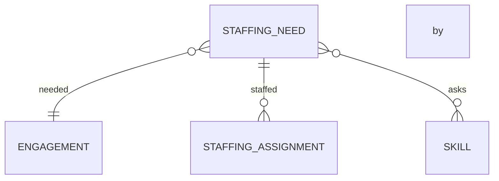
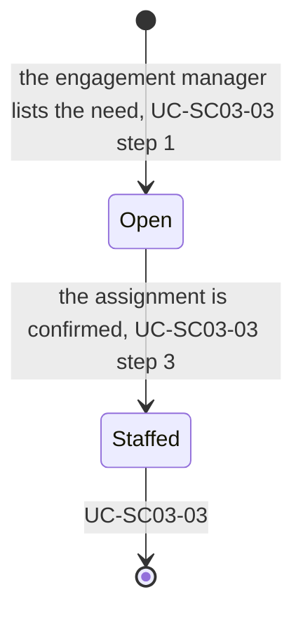

🏠 [Specs](../../../README.md) › 🏷️ [Sectors](../../README.md) › 💼 [SC03 Services](../README.md) › 🗃️ [Data](README.md) ›
🗃️ E-SC03-16 Staffing need

# 🗃️ E-SC03-16 Staffing need

**Status:** ✅ specified

## Purpose

The staffing need the flow charts name with the words "Needs"
([FL-SC03-02](../flows/fl-sc03-02-staff-and-plan.md)). The owner decided to create it
([D516](../../../06-decisions/foundations/d516-naming-rules-and-the-seven-classes-of-names.md)); its fields are derived
from the specifications and confirmed by the owner (D572).

## Fields

| Name | Type | Required | Validation | Default | Example | Personal data | Custom fields |
|---|---|---|---|---|---|---|---|
| title | text | yes | not empty | - | Cloud architect, Acme | no | no |
| engagement | engagement (E-SC03-01) | yes | an engagement of the company | - | E-207 | no | no |
| role | text | yes | not empty | - | Senior | no | no |
| skills asked | skills (E-SC03-11) with a level, and certifications | no | level 1 to 5, certification not expired, BR-SC03-13 | - | cloud architecture 4 | no | no |
| from, to | dates | yes | from before to | - | Nov to Jan | no | no |
| load | percent | yes | > 0 | 100 % | 60 % | no | no |
| staffed by | staffing assignments (E-SC03-04) | no | within availability, BR-SC03-04 | - | S. B., confirmed | yes | no |
| state | Open, Staffed | yes | the lifecycle below | Open | Staffed | no | no |

The engagement manager lists the needs by role, dates and load, searches consultants with current skills, level and
free time, and assigns them; a role nobody fills stays open and is shown as a need, and the staffing screen's empty
state reads "No need open"
([UC-SC03-03](../use-cases/02-staff-and-plan/uc-sc03-03-staff-the-engagement.md) steps 1 to 3, postconditions, error
2e and acceptance criterion 1). The role is priced from the rate card
([BR-SC03-03](../business-rules/br-sc03-03-rates-from-the-rate-card.md)); the load's default is the staffing
assignment's. The title and the state are the columns of
[S-SC03-L16 Staffing needs](../screens/00-lists/s-sc03-l16-staffing-needs.md), whose example rows read "Network
engineer, Acme"; the needs show on [S-SC03-03 Staffing](../screens/02-staff-and-plan/s-sc03-03-staffing.md) as
"Senior, Nov to Jan, 60 %".

## Relations

- [E-SC03-01 Engagement](e-sc03-01-engagement.md)
- [E-SC03-04 Staffing assignment](e-sc03-04-staffing-assignment.md): the consultant assigned to the need
- [E-SC03-11 Skill](e-sc03-11-skill.md): the skills and levels searched
- [E-SC03-10 Freelance contract](e-sc03-10-freelance-contract.md): when nobody fits, a freelancer is engaged
  ([UC-SC03-09](../use-cases/03-deliver-and-record/uc-sc03-09-engage-freelancers-and-subcontractors.md))
- [E-SC03-15 Resource plan](e-sc03-15-resource-plan.md): where the staffed need shows

## Lifecycle

## Indexes and search

By title and state, the sort and facet of
[S-SC03-L16 Staffing needs](../screens/00-lists/s-sc03-l16-staffing-needs.md); searched by title, engagement and role.

## Retention

As the other records of its capability.

## Audit

Every change, as the other records of its capability.

## Import and export

CSV or XLSX export of the rows and columns the user may see, from
[S-SC03-L16 Staffing needs](../screens/00-lists/s-sc03-l16-staffing-needs.md), audited (T3); no import.

## Used by

- [UC-SC03-03 Staff the engagement](../use-cases/02-staff-and-plan/uc-sc03-03-staff-the-engagement.md)

## Open questions

None.

---

⬅️ [E-SC03-15 Resource plan](e-sc03-15-resource-plan.md) · ⬆️ [Up](README.md) ·
➡️ [E-SC03-17 Assignment contract](e-sc03-17-assignment-contract.md)
