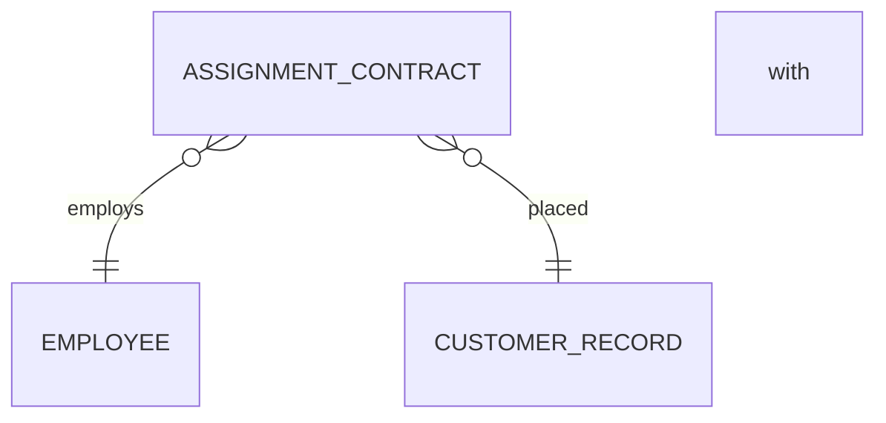
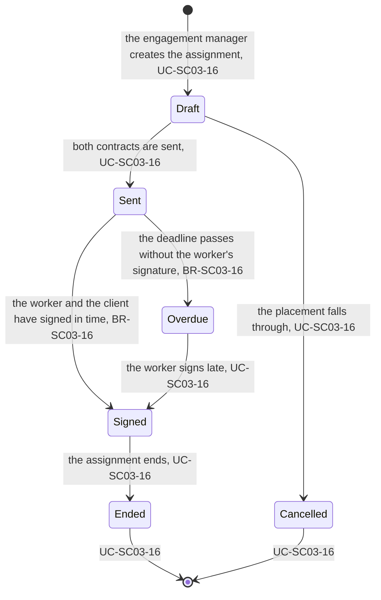

🏠 [Specs](../../../README.md) › 🏷️ [Sectors](../../README.md) › 💼 [SC03 Services](../README.md) › 🗃️ [Data](README.md) ›
🗃️ E-SC03-17 Assignment contract

# 🗃️ E-SC03-17 Assignment contract

**Status:** ✅ specified

## Purpose

The contracts of one temporary assignment: the worker's contract and the placement with the client, with their dates,
pay, signatures and the deadline ([D547](../../../06-decisions/sectors/d547-benchmark-gaps-sc03-services.md)). It is not
the freelance contract of an independent ([E-SC03-10 Freelance contract](e-sc03-10-freelance-contract.md)): the worker
here is the agency's employee, and it carries the staffing of a need
([E-SC03-04 Staffing assignment](e-sc03-04-staffing-assignment.md)).

## Fields

| Name | Type | Required | Validation | Default | Example | Personal data | Custom fields |
|---|---|---|---|---|---|---|---|
| worker | employee (E-F9-01) | yes | an employee of the agency | - | Karim D. | yes | no |
| client | customer (E-F6-01) | yes | a customer of the agency | - | Maison Lorrain | no | no |
| reason | replacement, increase of activity, seasonal | yes | one of the legal reasons | - | replacement | no | no |
| job | text | yes | with the client's pay for the job | - | warehouse operator | no | no |
| start date | date | yes | before the end date | - | 2026-11-16 | no | no |
| end date | date | yes | within the maximum length of the reason | - | 2026-12-18 | no | no |
| pay | amount per hour | yes | not below the client's pay for the job | - | 13.40 EUR | no | no |
| billing coefficient | number | yes | above 1 | 1.85 | 1.85 | no | no |
| sign by | date | yes | two working days after the start | computed | 2026-11-18 | no | no |
| worker signed on | date and time | no | set at signature | - | 2026-11-17 09:12 | no | no |
| client signed on | date and time | no | set at signature | - | 2026-11-16 15:40 | no | no |
| state | Draft, Sent, Signed, Overdue, Ended, Cancelled | yes | the lifecycle below | Draft | Sent | no | no |
| owner | user | yes | a user of the company | the creator | Claire P. | yes | no |

## Relations

- [E-F9-01](../../../02-functional/f09-hr-and-projects/data/e-f09-01-employee-record.md)
- [E-F9-02 Contract](../../../02-functional/f09-hr-and-projects/data/e-f09-02-contract.md)
- [E-F6-01](../../../02-functional/f06-customers-and-sales/data/e-f06-01-customer-record.md)
- [E-SC03-04 Staffing assignment](e-sc03-04-staffing-assignment.md)

## Lifecycle

## Indexes and search

By worker, client, state, start date and sign-by date.

## Retention

Kept with the worker's HR record, 5 years after the end, and the pay records 50 years
([CR-FR-047](../../../10-country-packs/france/labour/cr-fr-047-hr-records-retention.md)).

## Audit

Every send, signature, deadline miss, renewal and end, with who, when and the pay checked.

## Import and export

The contracts of a client are exported as PDF files for their records.

## Used by

- [UC-SC03-16](../use-cases/06-staffing-agencies-and-certification/uc-sc03-16-place-temporary-workers.md)
- [UC-SC03-03](../use-cases/02-staff-and-plan/uc-sc03-03-staff-the-engagement.md)

## Open questions

None.

---

⬅️ [E-SC03-16 Staffing need](e-sc03-16-staffing-need.md) · ⬆️ [Up](README.md) ·
➡️ [E-SC03-18 Creative proof](e-sc03-18-creative-proof.md)
