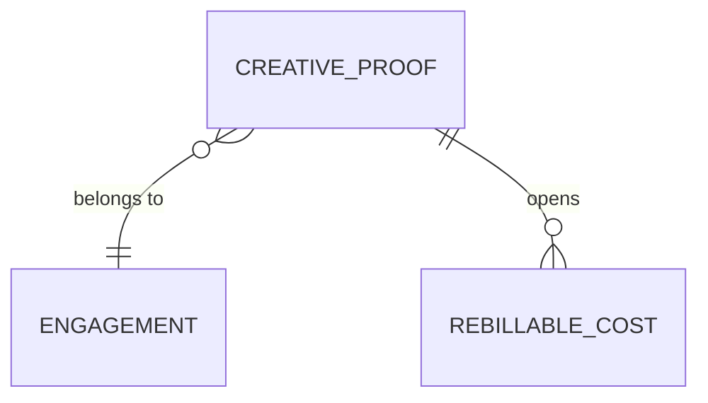
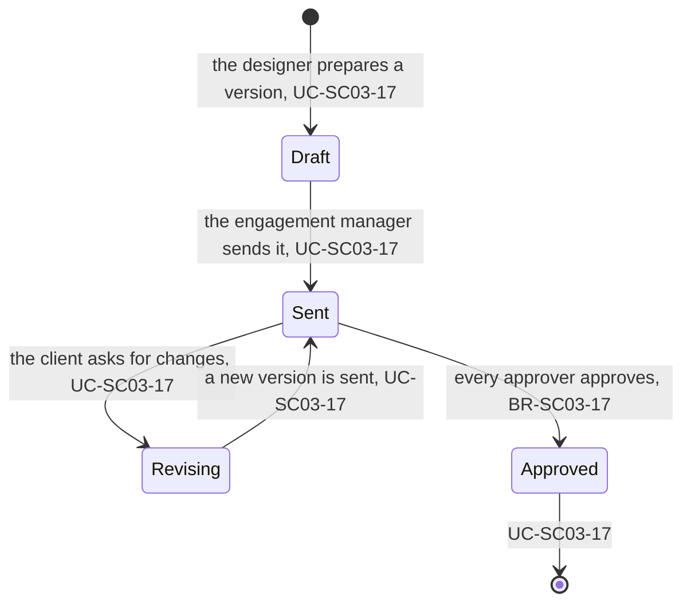

🏠 [Specs](../../../README.md) › 🏷️ [Sectors](../../README.md) › 💼 [SC03 Services](../README.md) › 🗃️ [Data](README.md) ›
🗃️ E-SC03-18 Creative proof

# 🗃️ E-SC03-18 Creative proof

**Status:** ✅ specified

## Purpose

A creative proof sent to a client for approval: the version, the file, the approvers and their answers
([D547](../../../06-decisions/sectors/d547-benchmark-gaps-sc03-services.md)). It is shared through the client portal
([E-SC03-12 Shared item](e-sc03-12-shared-item.md)) and, once approved, opens the production and media purchases.

## Fields

| Name | Type | Required | Validation | Default | Example | Personal data | Custom fields |
|---|---|---|---|---|---|---|---|
| engagement | engagement (E-SC03-01) | yes | an engagement of the agency | - | Spring campaign | no | no |
| deliverable | text | yes | from the statement of work | - | Poster 4x3 | no | no |
| version | number | yes | next number for the deliverable | 1 | 4 | no | no |
| file | file | yes | an image, film or document | - | poster-v4.pdf | no | no |
| sent on | date and time | no | set when sent | - | 2026-11-14 11:05 | no | no |
| approvers | persons at the client | yes | at least one | - | Julie M., Marc L. | yes | no |
| answers | person, answer, date | no | approve or changes asked | - | Marc L. approved | no | no |
| comments | text on the image | no | - | - | Headline too long | no | no |
| media cost | amount | no | with the supplier invoice attached | - | 12,400.00 EUR | no | no |
| media fee | percentage | no | from the statement of work | from it | 10 % | no | no |
| state | Draft, Sent, Revising, Approved | yes | the lifecycle below | Draft | Sent | no | no |
| owner | user | yes | a user of the company | the creator | Claire P. | yes | no |

## Relations

- [E-SC03-01 Engagement](e-sc03-01-engagement.md)
- [E-SC03-02 Statement of work](e-sc03-02-statement-of-work.md)
- [E-SC03-06 Rebillable cost](e-sc03-06-rebillable-cost.md)
- [E-SC03-12 Shared item](e-sc03-12-shared-item.md)

## Lifecycle

## Indexes and search

By engagement, deliverable, version, state and approver.

## Retention

Kept with the engagement for ten years, as proof of the client's agreement.

## Audit

Every version, answer and comment, with who, when and the text; every media cost rebilled with its fee.

## Import and export

The proofs of an engagement and their approvals are exported as one archive.

## Used by

- [UC-SC03-17](../use-cases/06-staffing-agencies-and-certification/uc-sc03-17-get-creative-work-approved-and-rebill-media.md)
- [UC-SC03-06](../use-cases/04-bill-and-recognise/uc-sc03-06-bill-time-and-materials.md)

## Open questions

None.

---

⬅️ [E-SC03-17 Assignment contract](e-sc03-17-assignment-contract.md) · ⬆️ [Up](README.md) ·
➡️ [E-SC03-19 Certificate](e-sc03-19-certificate.md)
