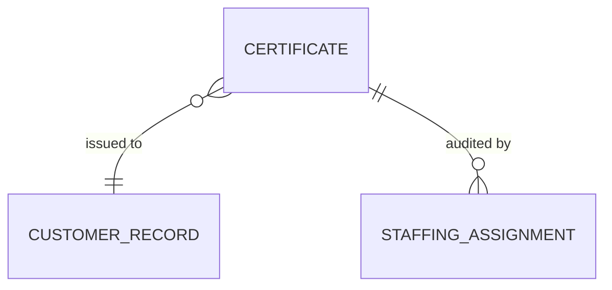
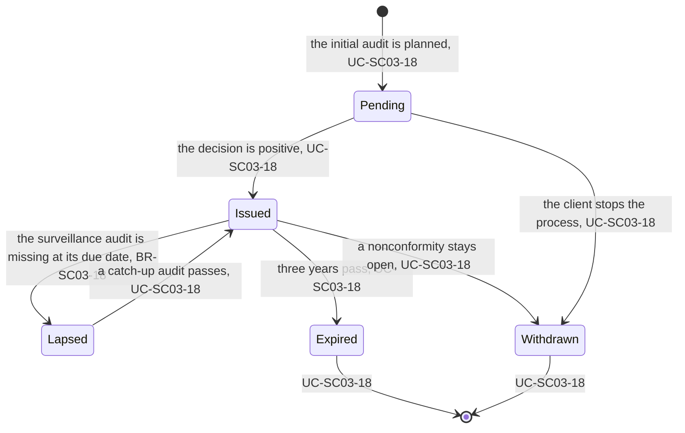

🏠 [Specs](../../../README.md) › 🏷️ [Sectors](../../README.md) › 💼 [SC03 Services](../README.md) › 🗃️ [Data](README.md) ›
🗃️ E-SC03-19 Certificate

# 🗃️ E-SC03-19 Certificate

**Status:** ✅ specified

## Purpose

A certificate issued to a client for a standard: its scope, validity, audits and surveillance dates
([D547](../../../06-decisions/sectors/d547-benchmark-gaps-sc03-services.md)). The auditors who hold the right
qualifications come from the skills records ([E-SC03-11 Skill](e-sc03-11-skill.md)); this record is the certificate's
own life.

## Fields

| Name | Type | Required | Validation | Default | Example | Personal data | Custom fields |
|---|---|---|---|---|---|---|---|
| client | customer (E-F6-01) | yes | a customer of the body | - | Atelier Roux SAS | no | no |
| standard | text | yes | from the body's scheme | - | quality management | no | no |
| scope | text | yes | - | - | manufacture of wooden furniture | no | no |
| issued on | date | no | set at the positive decision | - | 2026-02-01 | no | no |
| valid to | date | no | three years after the issue | computed | 2029-01-31 | no | no |
| surveillance dates | dates | yes | one a year before the end | computed | 2027-01-31 | no | no |
| audits | date, auditor, result | yes | the initial audit at least | - | 2026-01-12 | no | no |
| impartiality check | text and date | yes | before each assignment | - | 2026-01-05 | no | no |
| state | Pending, Issued, Lapsed, Expired, Withdrawn | yes | the lifecycle below | Pending | Issued | no | no |
| owner | user | yes | a user of the company | the creator | Claire P. | yes | no |

## Relations

- [E-F6-01](../../../02-functional/f06-customers-and-sales/data/e-f06-01-customer-record.md)
- [E-SC03-11 Skill](e-sc03-11-skill.md)
- [E-SC03-04 Staffing assignment](e-sc03-04-staffing-assignment.md)
- [E-SC03-01 Engagement](e-sc03-01-engagement.md)

## Lifecycle

## Indexes and search

By client, standard, state, valid-to date and next surveillance date.

## Retention

Kept for the body's accreditation period and at least ten years after the end of the certificate.

## Audit

Every audit, decision, lapse and withdrawal, with who, when and the reason.

## Import and export

The register of valid certificates is exported for a client who checks one.

## Used by

- [UC-SC03-18](../use-cases/06-staffing-agencies-and-certification/uc-sc03-18-run-certification-audits.md)
- [UC-SC03-13](../use-cases/05-client-and-people/uc-sc03-13-manage-consultants-skills-and-certifications.md)

## Open questions

None.

---

⬅️ [E-SC03-18 Creative proof](e-sc03-18-creative-proof.md) · ⬆️ [Up](README.md) ·
➡️ [E-SC03-20 Answer](e-sc03-20-answer.md)
