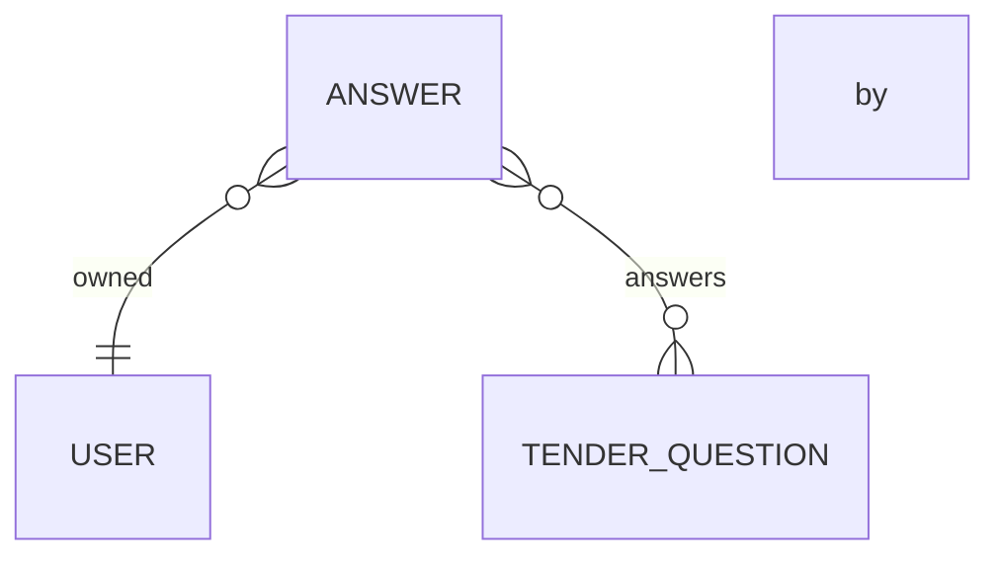
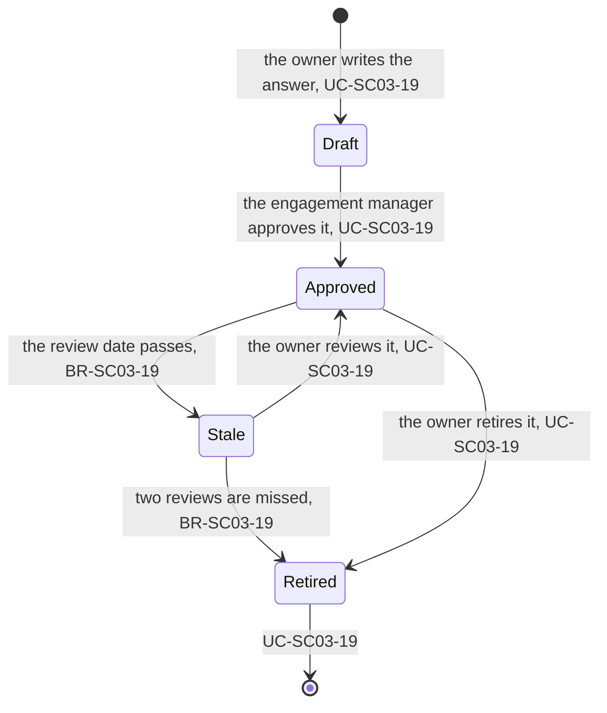

🏠 [Specs](../../../README.md) › 🏷️ [Sectors](../../README.md) › 💼 [SC03 Services](../README.md) › 🗃️ [Data](README.md) ›
🗃️ E-SC03-20 Answer

# 🗃️ E-SC03-20 Answer

**Status:** ✅ specified

## Purpose

A reusable answer of the tender library: its text, language, owner and review date
([D547](../../../06-decisions/sectors/d547-benchmark-gaps-sc03-services.md)). The tender's own answers are copies that
keep a link to it.

## Fields

| Name | Type | Required | Validation | Default | Example | Personal data | Custom fields |
|---|---|---|---|---|---|---|---|
| topic | text | yes | - | - | Quality system | no | no |
| text | text | yes | - | - | Our quality system is certified ... | no | no |
| language | language | yes | one of the firm's languages | English | English | no | no |
| tags | list of words | no | - | - | quality, certification | no | no |
| owner | user | yes | a user of the firm | the author | Sophie V. | yes | no |
| reviewed on | date | yes | not in the future | today | 2026-03-01 | no | no |
| review due | date | yes | after the review date | reviewed on plus 12 months | 2027-03-01 | no | no |
| confidential | yes or no | yes | - | no | no | no | no |
| used in | number | yes | 0 or more | 0 | 14 | no | no |
| state | Draft, Approved, Stale, Retired | yes | the lifecycle below | Draft | Approved | no | no |
| owner | user | yes | a user of the company | the creator | Claire P. | yes | no |

## Relations

- [E-SC03-02 Statement of work](e-sc03-02-statement-of-work.md)
- [E-SC03-01 Engagement](e-sc03-01-engagement.md)

## Lifecycle

## Indexes and search

By topic, language, tags, owner, state and review date.

## Retention

Kept while Approved or Stale; a Retired answer is kept five years for the tenders that used it, then deleted.

## Audit

Every edit, review, reuse and retirement, with who, when and the tender.

## Import and export

Import of existing answers from a document; export of the library as a file.

## Used by

- [UC-SC03-19](../use-cases/06-staffing-agencies-and-certification/uc-sc03-19-answer-a-tender-from-the-answer-library.md)
- [UC-SC03-01](../use-cases/01-win-and-price/uc-sc03-01-win-an-engagement-and-write-its-statement-of-work.md)

## Open questions

None.

---

⬅️ [E-SC03-19 Certificate](e-sc03-19-certificate.md) · ⬆️ [Up](README.md)
