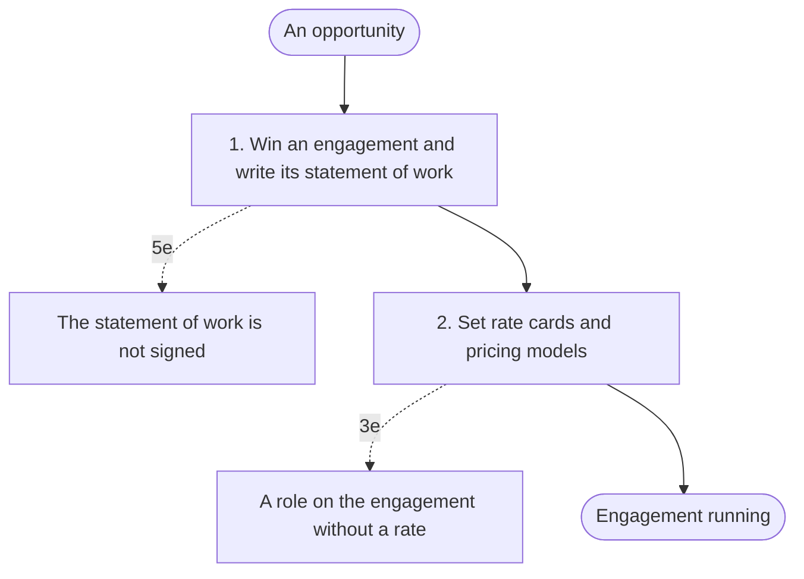

🏠 [Specs](../../../README.md) › 🏷️ [Sectors](../../README.md) › 💼 [SC03 Services](../README.md) › 🔀 [Flows](README.md) ›
🔀 FL-SC03-01 Win and price

# 🔀 FL-SC03-01 Win and price

**Status:** ✅ specified

## Summary

From an opportunity to a signed, priced statement of work. It covers
[UC-SC03-01 Win an engagement and write its statement of work](../use-cases/01-win-and-price/uc-sc03-01-win-an-engagement-and-write-its-statement-of-work.md),
[UC-SC03-02 Set rate cards and pricing models](../use-cases/01-win-and-price/uc-sc03-02-set-rate-cards-and-pricing-models.md).

## Personas

- [U03 Sales](../../../01-users/personas/u03-sales.md)
- [U09 Customer](../../../01-users/personas/u09-customer.md)
- [U13 Owner](../../../01-users/personas/u13-owner.md)
- [U24 Engagement manager](../../../01-users/personas/u24-engagement-manager.md)

## Flowchart

## Sequence diagram

See each use case.

## Steps

| Step | Persona | Screen | Use case | What happens |
|---|---|---|---|---|
| 1 | U03, U24, U09 | [S-SC03-01](../screens/01-win-and-price/s-sc03-01-statement-of-work.md) | [UC-SC03-01](../use-cases/01-win-and-price/uc-sc03-01-win-an-engagement-and-write-its-statement-of-work.md) | Sales and the engagement manager turn an opportunity into a statement of work with scope, deliverables, team, plan and price, and have the client sign it before any billable time |
| 2 | U24, U13 | [S-SC03-02](../screens/01-win-and-price/s-sc03-02-rate-cards.md) | [UC-SC03-02](../use-cases/01-win-and-price/uc-sc03-02-set-rate-cards-and-pricing-models.md) | The engagement manager and the owner set standard day rates per role, agree client rates, and choose each engagement's pricing model |

### Entities and screens

| Entity | States in this flow | Shown at step and screen | Aggregated view |
|---|---|---|---|
| [E-SC03-02 Statement of work](../data/e-sc03-02-statement-of-work.md) | Active | 1 [S-SC03-01](../screens/01-win-and-price/s-sc03-01-statement-of-work.md) | Statement of works |
| [E-SC03-03 Rate card](../data/e-sc03-03-rate-card.md) | Active | 2 [S-SC03-02](../screens/01-win-and-price/s-sc03-02-rate-cards.md) | Rate cards |
| [E-SC03-14 Pricing model](../data/e-sc03-14-pricing-model.md) | Active | 2 [S-SC03-02](../screens/01-win-and-price/s-sc03-02-rate-cards.md) | Pricing models |
| [E-F1-06 Role](../../../02-functional/f01-administration/data/e-f01-06-role.md) | Active | Shown elsewhere: [S-F1-06 Role editor](../../../02-functional/f01-administration/screens/04-edit-a-role/s-f01-06-role-editor.md) | Roles |

## Errors

- [UC-SC03-01](../use-cases/01-win-and-price/uc-sc03-01-win-an-engagement-and-write-its-statement-of-work.md) 5e. The
  statement of work is not signed: time cannot be recorded on the engagement except on an approved pre-sales budget
  ([BR-SC03-02](../business-rules/br-sc03-02-work-only-under-a-signed-statement.md)).
- [UC-SC03-01](../use-cases/01-win-and-price/uc-sc03-01-win-an-engagement-and-write-its-statement-of-work.md) 3e. A role
  without a rate: the price cannot be computed until a rate is set.
- [UC-SC03-02](../use-cases/01-win-and-price/uc-sc03-02-set-rate-cards-and-pricing-models.md) 3e. A role on the
  engagement without a rate: the engagement manager is warned and billing of that role waits.
- [UC-SC03-02](../use-cases/01-win-and-price/uc-sc03-02-set-rate-cards-and-pricing-models.md) 2e. A client rate dated
  before the standard card: the dates are shown and the client rate wins.

## Images

Every step and error, for each persona taking part, in light and dark mode (D120). Steps are numbered as in the Steps
table; E rows are the error cases.

| Step | Persona | Device | Light | Dark |
|---|---|---|---|---|
| 1 | U03 | desktop | [light](../images/01-win-and-price/u03-sales/1-statement-of-work-desktop-light.png) | [dark](../images/01-win-and-price/u03-sales/1-statement-of-work-desktop-dark.png) |
| 1 | U03 | phone | [light](../images/01-win-and-price/u03-sales/1-statement-of-work-phone-light.png) | [dark](../images/01-win-and-price/u03-sales/1-statement-of-work-phone-dark.png) |
| 1 | U03 | tablet | [light](../images/01-win-and-price/u03-sales/1-statement-of-work-tablet-light.png) | [dark](../images/01-win-and-price/u03-sales/1-statement-of-work-tablet-dark.png) |
| 1 | U09 | phone | [light](../images/01-win-and-price/u09-customer/1-statement-of-work-phone-light.png) | [dark](../images/01-win-and-price/u09-customer/1-statement-of-work-phone-dark.png) |
| 1 | U24 | desktop | [light](../images/01-win-and-price/u24-engagement-manager/1-statement-of-work-desktop-light.png) | [dark](../images/01-win-and-price/u24-engagement-manager/1-statement-of-work-desktop-dark.png) |
| 1 | U24 | phone | [light](../images/01-win-and-price/u24-engagement-manager/1-statement-of-work-phone-light.png) | [dark](../images/01-win-and-price/u24-engagement-manager/1-statement-of-work-phone-dark.png) |
| 2 | U24 | desktop | [light](../images/01-win-and-price/u24-engagement-manager/2-rate-card-desktop-light.png) | [dark](../images/01-win-and-price/u24-engagement-manager/2-rate-card-desktop-dark.png) |
| 2 | U24 | phone | [light](../images/01-win-and-price/u24-engagement-manager/2-rate-card-phone-light.png) | [dark](../images/01-win-and-price/u24-engagement-manager/2-rate-card-phone-dark.png) |
| 2 | U13 | desktop | [light](../images/01-win-and-price/u13-owner/2-rate-card-desktop-light.png) | [dark](../images/01-win-and-price/u13-owner/2-rate-card-desktop-dark.png) |
| 2 | U13 | phone | [light](../images/01-win-and-price/u13-owner/2-rate-card-phone-light.png) | [dark](../images/01-win-and-price/u13-owner/2-rate-card-phone-dark.png) |
| E1 | U16 | desktop | [light](../images/01-win-and-price/u16-office-worker/e1-unsigned-desktop-light.png) | [dark](../images/01-win-and-price/u16-office-worker/e1-unsigned-desktop-dark.png) |
| E1 | U16 | phone | [light](../images/01-win-and-price/u16-office-worker/e1-unsigned-phone-light.png) | [dark](../images/01-win-and-price/u16-office-worker/e1-unsigned-phone-dark.png) |

## Open questions

None.

---

⬆️ [Up](README.md) · ➡️ [FL-SC03-02 Staff and plan](fl-sc03-02-staff-and-plan.md)
