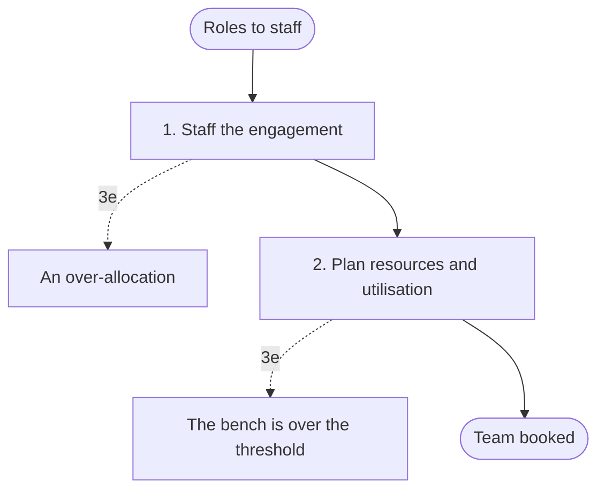

🏠 [Specs](../../../README.md) › 🏷️ [Sectors](../../README.md) › 💼 [SC03 Services](../README.md) › 🔀 [Flows](README.md) ›
🔀 FL-SC03-02 Staff and plan

# 🔀 FL-SC03-02 Staff and plan

**Status:** ✅ specified

## Summary

The right people on the engagement and the firm's capacity. It covers
[UC-SC03-03 Staff the engagement](../use-cases/02-staff-and-plan/uc-sc03-03-staff-the-engagement.md),
[UC-SC03-04 Plan resources and utilisation](../use-cases/02-staff-and-plan/uc-sc03-04-plan-resources-and-utilisation.md).

## Personas

- [U13 Owner](../../../01-users/personas/u13-owner.md)
- [U24 Engagement manager](../../../01-users/personas/u24-engagement-manager.md)

## Flowchart

## Sequence diagram

See each use case.

## Steps

| Step | Persona | Screen | Use case | What happens |
|---|---|---|---|---|
| 1 | U24 | [S-SC03-03](../screens/02-staff-and-plan/s-sc03-03-staffing.md), [S-SC03-04](../screens/02-staff-and-plan/s-sc03-04-resource-plan.md) | [UC-SC03-03](../use-cases/02-staff-and-plan/uc-sc03-03-staff-the-engagement.md) | The engagement manager lists the roles the engagement needs, searches consultants by skill, level and availability, and assigns them within their available hours |
| 2 | U24, U13 | [S-SC03-04](../screens/02-staff-and-plan/s-sc03-04-resource-plan.md) | [UC-SC03-04](../use-cases/02-staff-and-plan/uc-sc03-04-plan-resources-and-utilisation.md) | The engagement manager and the owner see the firm's capacity, bookings and utilisation, move bookings and follow the bench |

### Entities and screens

| Entity | States in this flow | Shown at step and screen | Aggregated view |
|---|---|---|---|
| [E-F1-06 Role](../../../02-functional/f01-administration/data/e-f01-06-role.md) | Active | Shown elsewhere: [S-F1-06 Role editor](../../../02-functional/f01-administration/screens/04-edit-a-role/s-f01-06-role-editor.md) | Roles |
| [E-F2-17 Bookable resource setting](../../../02-functional/f02-no-code-configuration/data/e-f02-17-bookable-resource-setting.md) | Draft, Published, Archived | Shown elsewhere: [S-F2-18 Booking settings](../../../02-functional/f02-no-code-configuration/screens/08-views-and-bookings/s-f02-18-booking-settings.md) | Bookable resource settings |

## Errors

- [UC-SC03-03](../use-cases/02-staff-and-plan/uc-sc03-03-staff-the-engagement.md) 3e. An over-allocation: the owner's
  approval is asked, [BR-SC03-04](../business-rules/br-sc03-04-staffing-respects-availability.md),
  [BR-F9-21](../../../02-functional/f09-hr-and-projects/business-rules/br-f09-21-planned-load-stays-within-available-hours.md).
- [UC-SC03-03](../use-cases/02-staff-and-plan/uc-sc03-03-staff-the-engagement.md) 2e. An expired certification asked by
  the role: the consultant is not proposed.
- [UC-SC03-04](../use-cases/02-staff-and-plan/uc-sc03-04-plan-resources-and-utilisation.md) 3e. The bench is over the
  threshold: it is shown to the owner.
- [UC-SC03-04](../use-cases/02-staff-and-plan/uc-sc03-04-plan-resources-and-utilisation.md) 2e. A move over a leave: it
  is refused with the leave's dates.

## Images

Every step and error, for each persona taking part, in light and dark mode (D120). Steps are numbered as in the Steps
table; E rows are the error cases.

| Step | Persona | Device | Light | Dark |
|---|---|---|---|---|
| 1 | U24 | desktop | [light](../images/02-staff-and-plan/u24-engagement-manager/1-staffing-desktop-light.png) | [dark](../images/02-staff-and-plan/u24-engagement-manager/1-staffing-desktop-dark.png) |
| 1 | U24 | phone | [light](../images/02-staff-and-plan/u24-engagement-manager/1-staffing-phone-light.png) | [dark](../images/02-staff-and-plan/u24-engagement-manager/1-staffing-phone-dark.png) |
| 2 | U24 | desktop | [light](../images/02-staff-and-plan/u24-engagement-manager/2-resource-plan-desktop-light.png) | [dark](../images/02-staff-and-plan/u24-engagement-manager/2-resource-plan-desktop-dark.png) |
| 2 | U24 | phone | [light](../images/02-staff-and-plan/u24-engagement-manager/2-resource-plan-phone-light.png) | [dark](../images/02-staff-and-plan/u24-engagement-manager/2-resource-plan-phone-dark.png) |
| 2 | U13 | desktop | [light](../images/02-staff-and-plan/u13-owner/2-resource-plan-desktop-light.png) | [dark](../images/02-staff-and-plan/u13-owner/2-resource-plan-desktop-dark.png) |
| 2 | U13 | phone | [light](../images/02-staff-and-plan/u13-owner/2-resource-plan-phone-light.png) | [dark](../images/02-staff-and-plan/u13-owner/2-resource-plan-phone-dark.png) |
| E1 | U24 | desktop | [light](../images/02-staff-and-plan/u24-engagement-manager/e1-over-allocated-desktop-light.png) | [dark](../images/02-staff-and-plan/u24-engagement-manager/e1-over-allocated-desktop-dark.png) |
| E1 | U24 | phone | [light](../images/02-staff-and-plan/u24-engagement-manager/e1-over-allocated-phone-light.png) | [dark](../images/02-staff-and-plan/u24-engagement-manager/e1-over-allocated-phone-dark.png) |

## Open questions

None.

---

⬅️ [FL-SC03-01 Win and price](fl-sc03-01-win-and-price.md) · ⬆️ [Up](README.md) ·
➡️ [FL-SC03-03 Deliver and record](fl-sc03-03-deliver-and-record.md)
