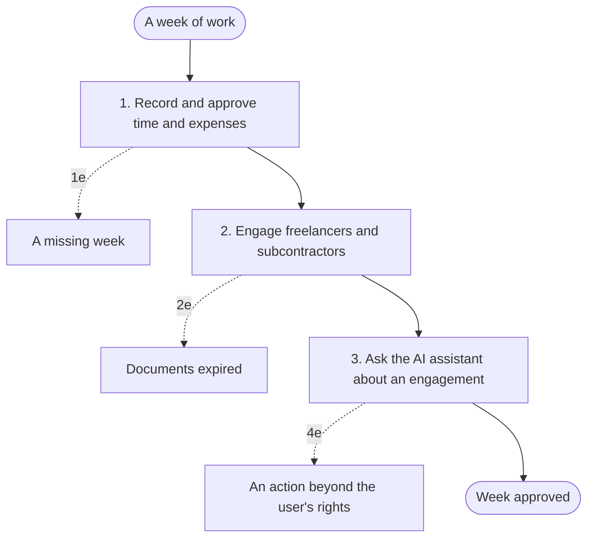

🏠 [Specs](../../../README.md) › 🏷️ [Sectors](../../README.md) › 💼 [SC03 Services](../README.md) › 🔀 [Flows](README.md) ›
🔀 FL-SC03-03 Deliver and record

# 🔀 FL-SC03-03 Deliver and record

**Status:** ✅ specified

## Summary

Delivery: time and expenses, freelancers, and the AI assistant. It covers
[UC-SC03-05 Record and approve time and expenses](../use-cases/03-deliver-and-record/uc-sc03-05-record-and-approve-time-and-expenses.md),
[UC-SC03-09 Engage freelancers and subcontractors](../use-cases/03-deliver-and-record/uc-sc03-09-engage-freelancers-and-subcontractors.md),
[UC-SC03-15 Ask the AI assistant about an engagement](../use-cases/03-deliver-and-record/uc-sc03-15-ask-the-assistant-about-an-engagement.md).

## Personas

- [U04 Purchasing and stock](../../../01-users/personas/u04-purchasing.md)
- [U16 Office worker](../../../01-users/personas/u16-office-worker.md)
- [U24 Engagement manager](../../../01-users/personas/u24-engagement-manager.md)

## Flowchart

## Sequence diagram

See each use case.

## Steps

| Step | Persona | Screen | Use case | What happens |
|---|---|---|---|---|
| 1 | U16, U24 | [S-SC03-05](../screens/03-deliver-and-record/s-sc03-05-timesheets.md) | [UC-SC03-05](../use-cases/03-deliver-and-record/uc-sc03-05-record-and-approve-time-and-expenses.md) | Consultants enter their weekly timesheet and expenses per engagement, the engagement manager approves or rejects them with a reason |
| 2 | U24, U04 | [S-SC03-09](../screens/03-deliver-and-record/s-sc03-09-freelancers.md) | [UC-SC03-09](../use-cases/03-deliver-and-record/uc-sc03-09-engage-freelancers-and-subcontractors.md) | The engagement manager and purchasing contract a freelancer or subcontractor, collect their documents, approve their time and pay their bills, lending staff stays within the law |
| 3 | U24, U16 | [S-SC03-15](../screens/03-deliver-and-record/s-sc03-15-engagement-assistant.md) | [UC-SC03-15](../use-cases/03-deliver-and-record/uc-sc03-15-ask-the-assistant-about-an-engagement.md) | The engagement manager or a consultant asks the AI assistant about budget, who is free, missing time, or asks it to draft a status report, within their role's rights |

### Entities and screens

| Entity | States in this flow | Shown at step and screen | Aggregated view |
|---|---|---|---|
| [E-SC03-05 Timesheet](../data/e-sc03-05-timesheet.md) | Draft, Submitted, Approved | 1 [S-SC03-05](../screens/03-deliver-and-record/s-sc03-05-timesheets.md); 3 [S-SC03-15](../screens/03-deliver-and-record/s-sc03-15-engagement-assistant.md) | Timesheets |
| [E-SC03-06 Rebillable cost](../data/e-sc03-06-rebillable-cost.md) | Active | 1 [S-SC03-05](../screens/03-deliver-and-record/s-sc03-05-timesheets.md) | Rebillable costs |
| [E-SC03-10 Freelance contract](../data/e-sc03-10-freelance-contract.md) | Active | 2 [S-SC03-09](../screens/03-deliver-and-record/s-sc03-09-freelancers.md) | Freelance contracts |
| [E-F2-13 Document](../../../02-functional/f02-no-code-configuration/data/e-f02-13-document.md) | To sort, To validate, Done | Shown elsewhere: [S-F2-13 Documents workspace](../../../02-functional/f02-no-code-configuration/screens/07-benchmark-additions/s-f02-13-documents-workspace.md) | Documents |
| [E-F3-04 Assistant change batch](../../../02-functional/f03-assistant/data/e-f03-04-assistant-change-batch.md) | Proposed, Cancelled, Done, Partly done, Undone | Shown elsewhere: [S-F3-01 Assistant panel](../../../02-functional/f03-assistant/screens/01-ask-the-assistant/s-f03-01-assistant-panel.md) | Assistant change batches |
| [E-F1-03 User](../../../02-functional/f01-administration/data/e-f01-03-user.md) | Invited, Active, Deactivated | Shown elsewhere: [S-F1-03 Users](../../../02-functional/f01-administration/screens/03-user-lifecycle/s-f01-03-users.md) | Users |
| [E-F1-06 Role](../../../02-functional/f01-administration/data/e-f01-06-role.md) | Active | Shown elsewhere: [S-F1-06 Role editor](../../../02-functional/f01-administration/screens/04-edit-a-role/s-f01-06-role-editor.md) | Roles |

## Errors

- [UC-SC03-05](../use-cases/03-deliver-and-record/uc-sc03-05-record-and-approve-time-and-expenses.md) 1e. A missing
  week: the consultant is reminded.
- [UC-SC03-05](../use-cases/03-deliver-and-record/uc-sc03-05-record-and-approve-time-and-expenses.md) 1f. Time on an
  engagement without a signed statement of work: the line is refused
  ([BR-SC03-02](../business-rules/br-sc03-02-work-only-under-a-signed-statement.md)).
- [UC-SC03-09](../use-cases/03-deliver-and-record/uc-sc03-09-engage-freelancers-and-subcontractors.md) 2e. Documents
  expired: the freelancer is blocked from time and staffing
  ([BR-SC03-09](../business-rules/br-sc03-09-freelancers-checked.md)).
- [UC-SC03-09](../use-cases/03-deliver-and-record/uc-sc03-09-engage-freelancers-and-subcontractors.md) 4e. A bill above
  the approved time: the difference is held.
- [UC-SC03-15](../use-cases/03-deliver-and-record/uc-sc03-15-ask-the-assistant-about-an-engagement.md) 4e. An action
  beyond the user's rights: the AI assistant refuses and says which role can do it.
- [UC-SC03-15](../use-cases/03-deliver-and-record/uc-sc03-15-ask-the-assistant-about-an-engagement.md) 2e. No data to
  answer: the AI assistant says so and does not guess.

## Images

Every step and error, for each persona taking part, in light and dark mode (D120). Steps are numbered as in the Steps
table; E rows are the error cases.

| Step | Persona | Device | Light | Dark |
|---|---|---|---|---|
| 1 | U16 | phone | [light](../images/03-deliver-and-record/u16-office-worker/1-timesheet-phone-light.png) | [dark](../images/03-deliver-and-record/u16-office-worker/1-timesheet-phone-dark.png) |
| 1 | U16 | desktop | [light](../images/03-deliver-and-record/u16-office-worker/1-timesheet-desktop-light.png) | [dark](../images/03-deliver-and-record/u16-office-worker/1-timesheet-desktop-dark.png) |
| 1 | U24 | desktop | [light](../images/03-deliver-and-record/u24-engagement-manager/1-timesheet-desktop-light.png) | [dark](../images/03-deliver-and-record/u24-engagement-manager/1-timesheet-desktop-dark.png) |
| 1 | U24 | phone | [light](../images/03-deliver-and-record/u24-engagement-manager/1-timesheet-phone-light.png) | [dark](../images/03-deliver-and-record/u24-engagement-manager/1-timesheet-phone-dark.png) |
| 2 | U24 | desktop | [light](../images/03-deliver-and-record/u24-engagement-manager/2-approve-desktop-light.png) | [dark](../images/03-deliver-and-record/u24-engagement-manager/2-approve-desktop-dark.png) |
| 2 | U24 | phone | [light](../images/03-deliver-and-record/u24-engagement-manager/2-approve-phone-light.png) | [dark](../images/03-deliver-and-record/u24-engagement-manager/2-approve-phone-dark.png) |
| 2 | U04 | desktop | [light](../images/03-deliver-and-record/u04-purchasing/2-approve-desktop-light.png) | [dark](../images/03-deliver-and-record/u04-purchasing/2-approve-desktop-dark.png) |
| 3 | U24 | desktop | [light](../images/03-deliver-and-record/u24-engagement-manager/3-freelancer-desktop-light.png) | [dark](../images/03-deliver-and-record/u24-engagement-manager/3-freelancer-desktop-dark.png) |
| 3 | U24 | phone | [light](../images/03-deliver-and-record/u24-engagement-manager/3-freelancer-phone-light.png) | [dark](../images/03-deliver-and-record/u24-engagement-manager/3-freelancer-phone-dark.png) |
| 3 | U16 | desktop | [light](../images/03-deliver-and-record/u16-office-worker/3-freelancer-desktop-light.png) | [dark](../images/03-deliver-and-record/u16-office-worker/3-freelancer-desktop-dark.png) |
| 3 | U16 | phone | [light](../images/03-deliver-and-record/u16-office-worker/3-freelancer-phone-light.png) | [dark](../images/03-deliver-and-record/u16-office-worker/3-freelancer-phone-dark.png) |
| 4 | U24 | phone | [light](../images/03-deliver-and-record/u24-engagement-manager/4-assistant-phone-light.png) | [dark](../images/03-deliver-and-record/u24-engagement-manager/4-assistant-phone-dark.png) |
| E1 | U24 | desktop | [light](../images/03-deliver-and-record/u24-engagement-manager/e1-freelancer-blocked-desktop-light.png) | [dark](../images/03-deliver-and-record/u24-engagement-manager/e1-freelancer-blocked-desktop-dark.png) |
| E1 | U24 | phone | [light](../images/03-deliver-and-record/u24-engagement-manager/e1-freelancer-blocked-phone-light.png) | [dark](../images/03-deliver-and-record/u24-engagement-manager/e1-freelancer-blocked-phone-dark.png) |

## Open questions

None.

---

⬅️ [FL-SC03-02 Staff and plan](fl-sc03-02-staff-and-plan.md) · ⬆️ [Up](README.md) ·
➡️ [FL-SC03-04 Bill and recognise](fl-sc03-04-bill-and-recognise.md)
