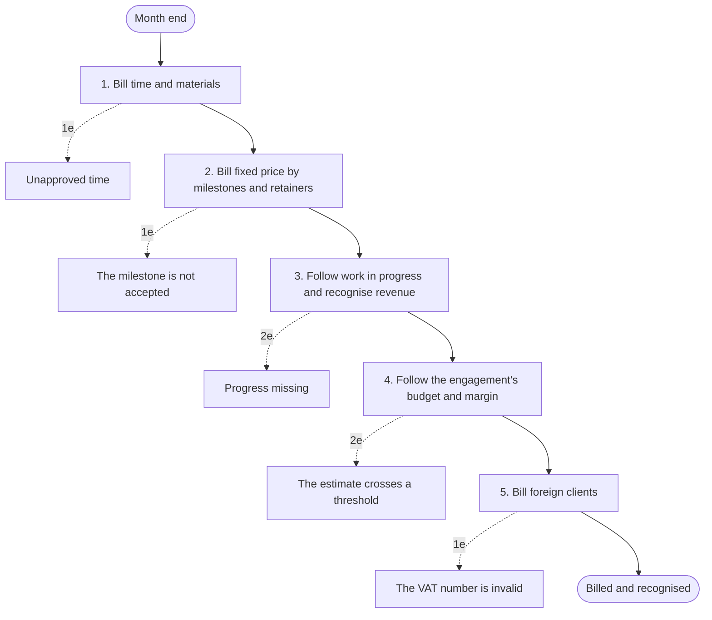

🏠 [Specs](../../../README.md) › 🏷️ [Sectors](../../README.md) › 💼 [SC03 Services](../README.md) › 🔀 [Flows](README.md) ›
🔀 FL-SC03-04 Bill and recognise

# 🔀 FL-SC03-04 Bill and recognise

**Status:** ✅ specified

## Summary

Billing by model, revenue at month end, margins and foreign clients. It covers
[UC-SC03-06 Bill time and materials](../use-cases/04-bill-and-recognise/uc-sc03-06-bill-time-and-materials.md),
[UC-SC03-07 Bill fixed price by milestones and retainers](../use-cases/04-bill-and-recognise/uc-sc03-07-bill-fixed-price-by-milestones-and-retainers.md),
[UC-SC03-08 Follow work in progress and recognise revenue](../use-cases/04-bill-and-recognise/uc-sc03-08-follow-work-in-progress-and-recognise-revenue.md),
[UC-SC03-10 Follow the engagement's budget and margin](../use-cases/04-bill-and-recognise/uc-sc03-10-follow-the-engagement-s-budget-and-margin.md),
[UC-SC03-14 Bill foreign clients](../use-cases/04-bill-and-recognise/uc-sc03-14-bill-foreign-clients.md).

## Personas

- [U05 Accounting](../../../01-users/personas/u05-accounting.md)
- [U13 Owner](../../../01-users/personas/u13-owner.md)
- [U24 Engagement manager](../../../01-users/personas/u24-engagement-manager.md)

## Flowchart

## Sequence diagram

See each use case.

## Steps

| Step | Persona | Screen | Use case | What happens |
|---|---|---|---|---|
| 1 | U24, U05 | [S-SC03-06](../screens/04-bill-and-recognise/s-sc03-06-t-m-billing.md) | [UC-SC03-06](../use-cases/04-bill-and-recognise/uc-sc03-06-bill-time-and-materials.md) | Each month simple-ERP proposes the bill of a time-and-materials engagement from approved time and expenses, the engagement manager adjusts write-offs and accounting sends it |
| 2 | U24, U05 | [S-SC03-07](../screens/04-bill-and-recognise/s-sc03-07-milestones.md) | [UC-SC03-07](../use-cases/04-bill-and-recognise/uc-sc03-07-bill-fixed-price-by-milestones-and-retainers.md) | The engagement manager marks a milestone accepted, its share of the fixed price is billed, retainers bill the period and track the balance |
| 3 | U05, U24 | [S-SC03-08](../screens/04-bill-and-recognise/s-sc03-08-revenue.md) | [UC-SC03-08](../use-cases/04-bill-and-recognise/uc-sc03-08-follow-work-in-progress-and-recognise-revenue.md) | At month end accounting computes each engagement's progress, work in progress and deferred revenue, reviews them with the engagement manager and posts the entries |
| 4 | U24, U13 | [S-SC03-10](../screens/04-bill-and-recognise/s-sc03-10-engagement-margin.md) | [UC-SC03-10](../use-cases/04-bill-and-recognise/uc-sc03-10-follow-the-engagement-s-budget-and-margin.md) | The engagement manager and the owner follow budget, consumed, estimate at completion and margin, and act on alerts |
| 5 | U05, U24 | [S-SC03-14](../screens/04-bill-and-recognise/s-sc03-14-foreign-billing.md) | [UC-SC03-14](../use-cases/04-bill-and-recognise/uc-sc03-14-bill-foreign-clients.md) | Accounting checks a foreign client's VAT number, bills in its currency with the place-of-supply rules and mentions, and declares the services in the European statement |

### Entities and screens

| Entity | States in this flow | Shown at step and screen | Aggregated view |
|---|---|---|---|
| [E-SC01-04 Site time and material entry](../../sc01-construction/data/e-sc01-04-site-time-and-material-entry.md) | Recorded | Shown elsewhere: [S-SC01-04 Site time](../../sc01-construction/screens/03-run-the-site/s-sc01-04-site-time.md) | Site time and material entries |
| [E-SC03-05 Timesheet](../data/e-sc03-05-timesheet.md) | Approved | Shown elsewhere: [S-SC03-05 Timesheets](../screens/03-deliver-and-record/s-sc03-05-timesheets.md) | Timesheets |
| [E-SC03-08 Milestone](../data/e-sc03-08-milestone.md) | Planned, Accepted, Billed | 2 [S-SC03-07](../screens/04-bill-and-recognise/s-sc03-07-milestones.md) | Milestones |
| [E-SC03-09 Revenue position](../data/e-sc03-09-revenue-position.md) | Active | 3 [S-SC03-08](../screens/04-bill-and-recognise/s-sc03-08-revenue.md) | Revenue positions |
| [E-F8-08 Accounting budget](../../../02-functional/f08-accounting/data/e-f08-08-accounting-budget.md) | Active | Shown elsewhere: [S-F8-09 Analytics and budgets](../../../02-functional/f08-accounting/screens/04-tax-assets-and-analytics/s-f08-09-analytics-and-budgets.md) | Accounting budgets |

## Errors

- [UC-SC03-06](../use-cases/04-bill-and-recognise/uc-sc03-06-bill-time-and-materials.md) 1e. Unapproved time: it is left
  out and listed.
- [UC-SC03-06](../use-cases/04-bill-and-recognise/uc-sc03-06-bill-time-and-materials.md) 3e. Payment terms over the
  legal cap: the bill is refused until fixed.
- [UC-SC03-07](../use-cases/04-bill-and-recognise/uc-sc03-07-bill-fixed-price-by-milestones-and-retainers.md) 1e. The
  milestone is not accepted: it is not billed.
- [UC-SC03-07](../use-cases/04-bill-and-recognise/uc-sc03-07-bill-fixed-price-by-milestones-and-retainers.md) 2e. Shares
  over 100 %: the milestones are refused.
- [UC-SC03-08](../use-cases/04-bill-and-recognise/uc-sc03-08-follow-work-in-progress-and-recognise-revenue.md) 2e.
  Progress missing: the engagement manager is asked before posting.
- [UC-SC03-08](../use-cases/04-bill-and-recognise/uc-sc03-08-follow-work-in-progress-and-recognise-revenue.md) 3e. A
  closed period: the entries go to the next open period.
- [UC-SC03-10](../use-cases/04-bill-and-recognise/uc-sc03-10-follow-the-engagement-s-budget-and-margin.md) 2e. The
  estimate crosses a threshold: the engagement manager and the owner are alerted
  ([BR-SC03-11](../business-rules/br-sc03-11-budget-alerts.md)).
- [UC-SC03-10](../use-cases/04-bill-and-recognise/uc-sc03-10-follow-the-engagement-s-budget-and-margin.md) 1e. Time not
  yet approved: the figure says it excludes it.
- [UC-SC03-14](../use-cases/04-bill-and-recognise/uc-sc03-14-bill-foreign-clients.md) 1e. The VAT number is invalid:
  French VAT is applied until a valid number is given.
- [UC-SC03-14](../use-cases/04-bill-and-recognise/uc-sc03-14-bill-foreign-clients.md) 2e. No exchange rate for the day:
  the last known rate is proposed.

## Images

Every step and error, for each persona taking part, in light and dark mode (D120). Steps are numbered as in the Steps
table; E rows are the error cases.

| Step | Persona | Device | Light | Dark |
|---|---|---|---|---|
| 1 | U24 | desktop | [light](../images/04-bill-and-recognise/u24-engagement-manager/1-billing-proposal-desktop-light.png) | [dark](../images/04-bill-and-recognise/u24-engagement-manager/1-billing-proposal-desktop-dark.png) |
| 1 | U24 | phone | [light](../images/04-bill-and-recognise/u24-engagement-manager/1-billing-proposal-phone-light.png) | [dark](../images/04-bill-and-recognise/u24-engagement-manager/1-billing-proposal-phone-dark.png) |
| 1 | U05 | desktop | [light](../images/04-bill-and-recognise/u05-accounting/1-billing-proposal-desktop-light.png) | [dark](../images/04-bill-and-recognise/u05-accounting/1-billing-proposal-desktop-dark.png) |
| 2 | U24 | desktop | [light](../images/04-bill-and-recognise/u24-engagement-manager/2-milestone-desktop-light.png) | [dark](../images/04-bill-and-recognise/u24-engagement-manager/2-milestone-desktop-dark.png) |
| 2 | U24 | phone | [light](../images/04-bill-and-recognise/u24-engagement-manager/2-milestone-phone-light.png) | [dark](../images/04-bill-and-recognise/u24-engagement-manager/2-milestone-phone-dark.png) |
| 2 | U05 | desktop | [light](../images/04-bill-and-recognise/u05-accounting/2-milestone-desktop-light.png) | [dark](../images/04-bill-and-recognise/u05-accounting/2-milestone-desktop-dark.png) |
| 3 | U05 | desktop | [light](../images/04-bill-and-recognise/u05-accounting/3-revenue-desktop-light.png) | [dark](../images/04-bill-and-recognise/u05-accounting/3-revenue-desktop-dark.png) |
| 3 | U24 | desktop | [light](../images/04-bill-and-recognise/u24-engagement-manager/3-revenue-desktop-light.png) | [dark](../images/04-bill-and-recognise/u24-engagement-manager/3-revenue-desktop-dark.png) |
| 3 | U24 | phone | [light](../images/04-bill-and-recognise/u24-engagement-manager/3-revenue-phone-light.png) | [dark](../images/04-bill-and-recognise/u24-engagement-manager/3-revenue-phone-dark.png) |
| 4 | U05 | desktop | [light](../images/04-bill-and-recognise/u05-accounting/4-foreign-client-desktop-light.png) | [dark](../images/04-bill-and-recognise/u05-accounting/4-foreign-client-desktop-dark.png) |
| 4 | U13 | desktop | [light](../images/04-bill-and-recognise/u13-owner/4-foreign-client-desktop-light.png) | [dark](../images/04-bill-and-recognise/u13-owner/4-foreign-client-desktop-dark.png) |
| 4 | U13 | phone | [light](../images/04-bill-and-recognise/u13-owner/4-foreign-client-phone-light.png) | [dark](../images/04-bill-and-recognise/u13-owner/4-foreign-client-phone-dark.png) |
| 4 | U24 | desktop | [light](../images/04-bill-and-recognise/u24-engagement-manager/4-foreign-client-desktop-light.png) | [dark](../images/04-bill-and-recognise/u24-engagement-manager/4-foreign-client-desktop-dark.png) |
| 4 | U24 | phone | [light](../images/04-bill-and-recognise/u24-engagement-manager/4-foreign-client-phone-light.png) | [dark](../images/04-bill-and-recognise/u24-engagement-manager/4-foreign-client-phone-dark.png) |
| 5 | U13 | desktop | [light](../images/04-bill-and-recognise/u13-owner/5-margin-desktop-light.png) | [dark](../images/04-bill-and-recognise/u13-owner/5-margin-desktop-dark.png) |
| 5 | U05 | desktop | [light](../images/04-bill-and-recognise/u05-accounting/5-margin-desktop-light.png) | [dark](../images/04-bill-and-recognise/u05-accounting/5-margin-desktop-dark.png) |
| 5 | U24 | desktop | [light](../images/04-bill-and-recognise/u24-engagement-manager/5-margin-desktop-light.png) | [dark](../images/04-bill-and-recognise/u24-engagement-manager/5-margin-desktop-dark.png) |
| 5 | U24 | phone | [light](../images/04-bill-and-recognise/u24-engagement-manager/5-margin-phone-light.png) | [dark](../images/04-bill-and-recognise/u24-engagement-manager/5-margin-phone-dark.png) |
| E1 | U24 | desktop | [light](../images/04-bill-and-recognise/u24-engagement-manager/e1-milestone-not-accepted-desktop-light.png) | [dark](../images/04-bill-and-recognise/u24-engagement-manager/e1-milestone-not-accepted-desktop-dark.png) |
| E1 | U24 | phone | [light](../images/04-bill-and-recognise/u24-engagement-manager/e1-milestone-not-accepted-phone-light.png) | [dark](../images/04-bill-and-recognise/u24-engagement-manager/e1-milestone-not-accepted-phone-dark.png) |

## Open questions

None.

---

⬅️ [FL-SC03-03 Deliver and record](fl-sc03-03-deliver-and-record.md) · ⬆️ [Up](README.md) ·
➡️ [FL-SC03-05 Client and people](fl-sc03-05-client-and-people.md)
