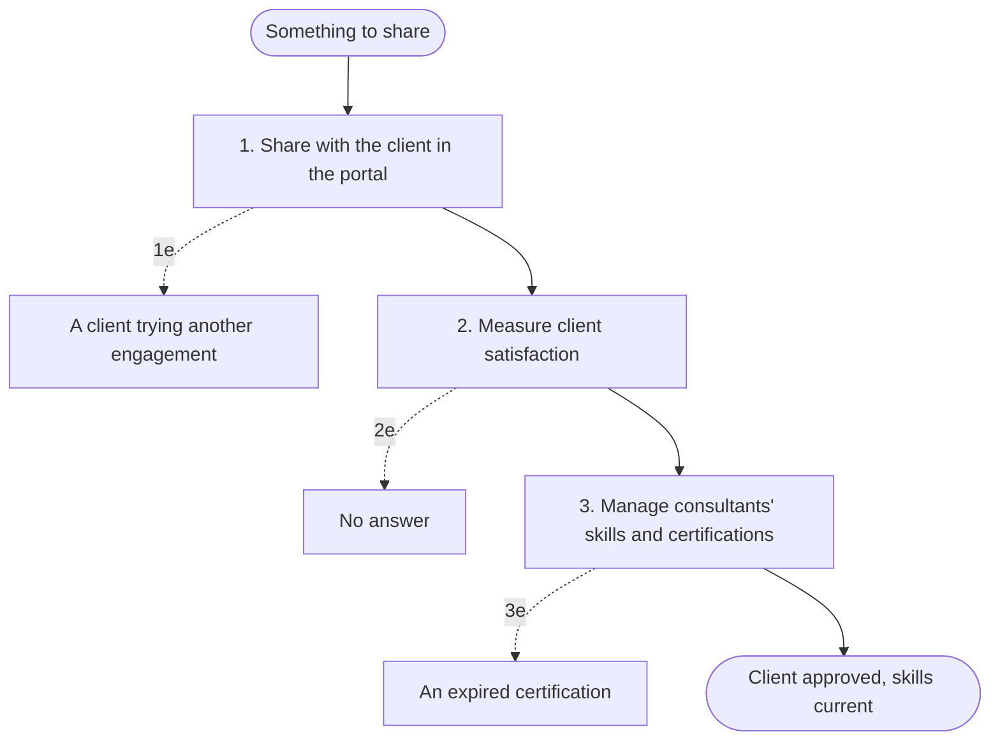

🏠 [Specs](../../../README.md) › 🏷️ [Sectors](../../README.md) › 💼 [SC03 Services](../README.md) › 🔀 [Flows](README.md) ›
🔀 FL-SC03-05 Client and people

# 🔀 FL-SC03-05 Client and people

**Status:** ✅ specified

## Summary

The client in the portal, satisfaction and consultants' skills. It covers
[UC-SC03-11 Share with the client in the portal](../use-cases/05-client-and-people/uc-sc03-11-share-with-the-client-in-the-portal.md),
[UC-SC03-12 Measure client satisfaction](../use-cases/05-client-and-people/uc-sc03-12-measure-client-satisfaction.md),
[UC-SC03-13 Manage consultants' skills and certifications](../use-cases/05-client-and-people/uc-sc03-13-manage-consultants-skills-and-certifications.md).

## Personas

- [U06 Human resources](../../../01-users/personas/u06-hr.md)
- [U09 Customer](../../../01-users/personas/u09-customer.md)
- [U13 Owner](../../../01-users/personas/u13-owner.md)
- [U16 Office worker](../../../01-users/personas/u16-office-worker.md)
- [U24 Engagement manager](../../../01-users/personas/u24-engagement-manager.md)

## Flowchart

## Sequence diagram

See each use case.

## Steps

| Step | Persona | Screen | Use case | What happens |
|---|---|---|---|---|
| 1 | U09, U24 | [S-SC03-11](../screens/05-client-and-people/s-sc03-11-client-portal.md) | [UC-SC03-11](../use-cases/05-client-and-people/uc-sc03-11-share-with-the-client-in-the-portal.md) | The engagement manager shares reports and deliverables with the client in the portal, the client approves deliverables and timesheets, it is recorded on the engagement |
| 2 | U24, U13, U09 | [S-SC03-12](../screens/05-client-and-people/s-sc03-12-satisfaction.md) | [UC-SC03-12](../use-cases/05-client-and-people/uc-sc03-12-measure-client-satisfaction.md) | The engagement manager sends a survey at milestones and closing, the owner reads the answers and follows up |
| 3 | U16, U06, U24 | [S-SC03-13](../screens/05-client-and-people/s-sc03-13-skills.md), [S-SC03-03](../screens/02-staff-and-plan/s-sc03-03-staffing.md) | [UC-SC03-13](../use-cases/05-client-and-people/uc-sc03-13-manage-consultants-skills-and-certifications.md) | Consultants update their skills, HR validates levels and plans the renewal of certifications so that staffing uses only current ones |

### Entities and screens

| Entity | States in this flow | Shown at step and screen | Aggregated view |
|---|---|---|---|
| [E-F1-17 Portal account](../../../02-functional/f01-administration/data/e-f01-17-portal-account.md) | Invited, Active, Blocked, Deactivated | Shown elsewhere: [S-F1-19 Portal accounts](../../../02-functional/f01-administration/screens/12-portal-accounts-and-integrations/s-f01-19-portal-accounts.md) | Portal accounts |
| [E-SC03-13 Satisfaction survey](../data/e-sc03-13-satisfaction-survey.md) | Sent | 2 [S-SC03-12](../screens/05-client-and-people/s-sc03-12-satisfaction.md) | Satisfaction surveys |
| [E-SC03-11 Skill](../data/e-sc03-11-skill.md) | New, Validated | 3 [S-SC03-13](../screens/05-client-and-people/s-sc03-13-skills.md); 3 [S-SC03-03](../screens/02-staff-and-plan/s-sc03-03-staffing.md) | Skills |
| [E-F9-12 Qualification](../../../02-functional/f09-hr-and-projects/data/e-f09-12-certification.md) | Expired | Shown elsewhere: [S-F9-35 Employee qualifications](../../../02-functional/f09-hr-and-projects/screens/13-keep-qualifications/s-f09-35-employee-qualifications.md) | Certifications |

## Errors

- [UC-SC03-11](../use-cases/05-client-and-people/uc-sc03-11-share-with-the-client-in-the-portal.md) 1e. A client trying
  another engagement: it is not shown, [BR-SC03-12](../business-rules/br-sc03-12-client-sees-only-their-engagements.md),
  [BR-F6-03](../../../02-functional/f06-customers-and-sales/business-rules/br-f06-03-portal-shows-only-the-customer-s-own.md).
- [UC-SC03-11](../use-cases/05-client-and-people/uc-sc03-11-share-with-the-client-in-the-portal.md) 2e. No answer: the
  client is reminded.
- [UC-SC03-12](../use-cases/05-client-and-people/uc-sc03-12-measure-client-satisfaction.md) 2e. No answer: one reminder
  is sent, then the survey closes.
- [UC-SC03-12](../use-cases/05-client-and-people/uc-sc03-12-measure-client-satisfaction.md) 1e. The client contact left:
  the engagement manager chooses another contact.
- [UC-SC03-13](../use-cases/05-client-and-people/uc-sc03-13-manage-consultants-skills-and-certifications.md) 3e. An
  expired certification: the consultant is not staffed on roles asking for it
  ([BR-SC03-13](../business-rules/br-sc03-13-skills-kept-current.md)).
- [UC-SC03-13](../use-cases/05-client-and-people/uc-sc03-13-manage-consultants-skills-and-certifications.md) 2e. A level
  without evidence: HR asks for it.

## Images

Every step and error, for each persona taking part, in light and dark mode (D120). Steps are numbered as in the Steps
table; E rows are the error cases.

| Step | Persona | Device | Light | Dark |
|---|---|---|---|---|
| 1 | U09 | phone | [light](../images/05-client-and-people/u09-customer/1-portal-phone-light.png) | [dark](../images/05-client-and-people/u09-customer/1-portal-phone-dark.png) |
| 1 | U24 | desktop | [light](../images/05-client-and-people/u24-engagement-manager/1-portal-desktop-light.png) | [dark](../images/05-client-and-people/u24-engagement-manager/1-portal-desktop-dark.png) |
| 1 | U24 | phone | [light](../images/05-client-and-people/u24-engagement-manager/1-portal-phone-light.png) | [dark](../images/05-client-and-people/u24-engagement-manager/1-portal-phone-dark.png) |
| 2 | U24 | desktop | [light](../images/05-client-and-people/u24-engagement-manager/2-satisfaction-desktop-light.png) | [dark](../images/05-client-and-people/u24-engagement-manager/2-satisfaction-desktop-dark.png) |
| 2 | U24 | phone | [light](../images/05-client-and-people/u24-engagement-manager/2-satisfaction-phone-light.png) | [dark](../images/05-client-and-people/u24-engagement-manager/2-satisfaction-phone-dark.png) |
| 2 | U09 | phone | [light](../images/05-client-and-people/u09-customer/2-satisfaction-phone-light.png) | [dark](../images/05-client-and-people/u09-customer/2-satisfaction-phone-dark.png) |
| 2 | U13 | desktop | [light](../images/05-client-and-people/u13-owner/2-satisfaction-desktop-light.png) | [dark](../images/05-client-and-people/u13-owner/2-satisfaction-desktop-dark.png) |
| 2 | U13 | phone | [light](../images/05-client-and-people/u13-owner/2-satisfaction-phone-light.png) | [dark](../images/05-client-and-people/u13-owner/2-satisfaction-phone-dark.png) |
| 3 | U06 | desktop | [light](../images/05-client-and-people/u06-hr/3-skills-desktop-light.png) | [dark](../images/05-client-and-people/u06-hr/3-skills-desktop-dark.png) |
| 3 | U16 | desktop | [light](../images/05-client-and-people/u16-office-worker/3-skills-desktop-light.png) | [dark](../images/05-client-and-people/u16-office-worker/3-skills-desktop-dark.png) |
| 3 | U16 | phone | [light](../images/05-client-and-people/u16-office-worker/3-skills-phone-light.png) | [dark](../images/05-client-and-people/u16-office-worker/3-skills-phone-dark.png) |
| 3 | U24 | desktop | [light](../images/05-client-and-people/u24-engagement-manager/3-skills-desktop-light.png) | [dark](../images/05-client-and-people/u24-engagement-manager/3-skills-desktop-dark.png) |
| 3 | U24 | phone | [light](../images/05-client-and-people/u24-engagement-manager/3-skills-phone-light.png) | [dark](../images/05-client-and-people/u24-engagement-manager/3-skills-phone-dark.png) |
| E1 | U24 | desktop | [light](../images/05-client-and-people/u24-engagement-manager/e1-survey-unanswered-desktop-light.png) | [dark](../images/05-client-and-people/u24-engagement-manager/e1-survey-unanswered-desktop-dark.png) |
| E1 | U24 | phone | [light](../images/05-client-and-people/u24-engagement-manager/e1-survey-unanswered-phone-light.png) | [dark](../images/05-client-and-people/u24-engagement-manager/e1-survey-unanswered-phone-dark.png) |

## Open questions

None.

---

⬅️ [FL-SC03-04 Bill and recognise](fl-sc03-04-bill-and-recognise.md) · ⬆️ [Up](README.md) ·
➡️ [FL-SC03-06](fl-sc03-06-staffing-agencies-and-certification.md)
