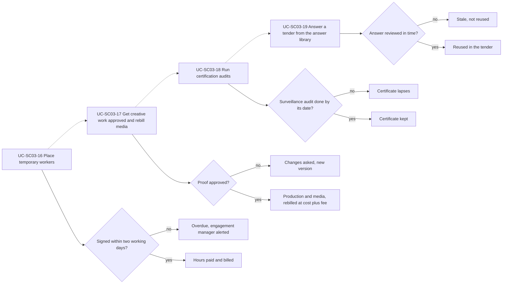
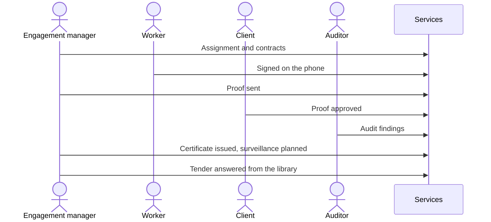

🏠 [Specs](../../../README.md) › 🏷️ [Sectors](../../README.md) › 💼 [SC03 Services](../README.md) › 🔀 [Flows](README.md) ›
🔀 FL-SC03-06 Staffing, agencies, certification and tender library

# 🔀 FL-SC03-06 Staffing, agencies, certification and tender library

**Status:** 🔄 waiting for the owner

## Summary

Four situations of service firms that their suites handle: placing temporary workers under contracts signed in time,
getting creative work approved and rebilling media at cost plus a fee, running certification audits with certificates
that lapse without their surveillance audit, and answering tenders from a library of reviewed answers
([D547](../../../06-decisions/sectors/d547-benchmark-gaps-sc03-services.md)).

## Personas

- [U24 Engagement manager](../../../01-users/personas/u24-engagement-manager.md), who places, sends, plans and decides
- [U14 Field worker](../../../01-users/personas/u14-field-worker.md), who signs and declares hours on the phone
- [U09 Customer](../../../01-users/personas/u09-customer.md), who approves the proofs
- [U36 Professional](../../../01-users/personas/u36-professional.md), who audits
- [U03 Sales](../../../01-users/personas/u03-sales.md), who reuses the answers

## Flowchart

## Sequence diagram

## Steps

| Step | Persona | Screen | Use case | What happens |
|---|---|---|---|---|
| 1 | [U24](../../../01-users/personas/u24-engagement-manager.md) | [S-SC03-16](../screens/06-staffing-agencies-and-certification/s-sc03-16-staffing-assignments.md) | [UC-SC03-16](../use-cases/06-staffing-agencies-and-certification/uc-sc03-16-place-temporary-workers.md) | The engagement manager sends the worker's and the client's contracts and follows the signature against the two-day deadline |
| 2 | [U24](../../../01-users/personas/u24-engagement-manager.md) | [S-SC03-17](../screens/06-staffing-agencies-and-certification/s-sc03-17-agency-approvals.md) | [UC-SC03-17](../use-cases/06-staffing-agencies-and-certification/uc-sc03-17-get-creative-work-approved-and-rebill-media.md) | The engagement manager sends a proof, the client approves on the phone and the media bought is rebilled at cost plus the fee |
| 3 | [U24](../../../01-users/personas/u24-engagement-manager.md) | [S-SC03-18](../screens/06-staffing-agencies-and-certification/s-sc03-18-certification-audits.md) | [UC-SC03-18](../use-cases/06-staffing-agencies-and-certification/uc-sc03-18-run-certification-audits.md) | The engagement manager plans the audit with qualified auditors and issues a certificate that lapses without its surveillance audit |
| 4 | [U24](../../../01-users/personas/u24-engagement-manager.md) | [S-SC03-19](../screens/06-staffing-agencies-and-certification/s-sc03-19-answer-library.md) | [UC-SC03-19](../use-cases/06-staffing-agencies-and-certification/uc-sc03-19-answer-a-tender-from-the-answer-library.md) | Sales and the engagement manager answer a tender from the library and send stale answers for review |

### Entities and screens

| Entity | States in this flow | Shown at step and screen | Aggregated view |
|---|---|---|---|
| [E-SC03-17 Assignment contract](../data/e-sc03-17-assignment-contract.md) | Draft, Sent, Signed, Overdue, Ended, Cancelled | 1 [S-SC03-16](../screens/06-staffing-agencies-and-certification/s-sc03-16-staffing-assignments.md) | Assignment contracts |
| [E-SC03-18 Creative proof](../data/e-sc03-18-creative-proof.md) | Draft, Sent, Revising, Approved | 2 [S-SC03-17](../screens/06-staffing-agencies-and-certification/s-sc03-17-agency-approvals.md) | Creative proofs |
| [E-SC03-19 Certificate](../data/e-sc03-19-certificate.md) | Pending, Issued, Lapsed, Expired, Withdrawn | 3 [S-SC03-18](../screens/06-staffing-agencies-and-certification/s-sc03-18-certification-audits.md) | Certificates |
| [E-SC03-20 Answer](../data/e-sc03-20-answer.md) | Draft, Approved, Stale, Retired | 4 [S-SC03-19](../screens/06-staffing-agencies-and-certification/s-sc03-19-answer-library.md) | Answers |
| [E-SC03-11 Skill](../data/e-sc03-11-skill.md) | New, Validated | Shown elsewhere: [S-SC03-13 Skills](../screens/05-client-and-people/s-sc03-13-skills.md) | Skills |

## Errors

- **E1 The contract is late.** The worker's contract is not signed by the second working day; it becomes Overdue and the
  engagement manager is alerted
  ([BR-SC03-16](../business-rules/br-sc03-16-assignment-contracts-are-signed-in-two-working-days.md), step 1).

## Images

Every step and error, for each persona taking part, in light and dark mode (D120). Steps are numbered as in the Steps
table; E rows are the error cases.

| Step | Persona | Device | Light | Dark |
|---|---|---|---|---|
| 1 | U24 | desktop | [light](../images/06-staffing-agencies-and-certification/u24-engagement-manager/1-staffing-assignments-desktop-light.png) | [dark](../images/06-staffing-agencies-and-certification/u24-engagement-manager/1-staffing-assignments-desktop-dark.png) |
| 1 | U14 | phone | [light](../images/06-staffing-agencies-and-certification/u14-field-worker/1-staffing-assignments-phone-light.png) | [dark](../images/06-staffing-agencies-and-certification/u14-field-worker/1-staffing-assignments-phone-dark.png) |
| 1 | U24 | phone | [light](../images/06-staffing-agencies-and-certification/u24-engagement-manager/1-staffing-assignments-phone-light.png) | [dark](../images/06-staffing-agencies-and-certification/u24-engagement-manager/1-staffing-assignments-phone-dark.png) |
| 2 | U24 | desktop | [light](../images/06-staffing-agencies-and-certification/u24-engagement-manager/2-agency-approvals-desktop-light.png) | [dark](../images/06-staffing-agencies-and-certification/u24-engagement-manager/2-agency-approvals-desktop-dark.png) |
| 2 | U09 | phone | [light](../images/06-staffing-agencies-and-certification/u09-customer/2-agency-approvals-phone-light.png) | [dark](../images/06-staffing-agencies-and-certification/u09-customer/2-agency-approvals-phone-dark.png) |
| 2 | U24 | phone | [light](../images/06-staffing-agencies-and-certification/u24-engagement-manager/2-agency-approvals-phone-light.png) | [dark](../images/06-staffing-agencies-and-certification/u24-engagement-manager/2-agency-approvals-phone-dark.png) |
| 3 | U24 | desktop | [light](../images/06-staffing-agencies-and-certification/u24-engagement-manager/3-certification-audits-desktop-light.png) | [dark](../images/06-staffing-agencies-and-certification/u24-engagement-manager/3-certification-audits-desktop-dark.png) |
| 3 | U36 | desktop | [light](../images/06-staffing-agencies-and-certification/u36-professional/3-certification-audits-desktop-light.png) | [dark](../images/06-staffing-agencies-and-certification/u36-professional/3-certification-audits-desktop-dark.png) |
| 3 | U24 | phone | [light](../images/06-staffing-agencies-and-certification/u24-engagement-manager/3-certification-audits-phone-light.png) | [dark](../images/06-staffing-agencies-and-certification/u24-engagement-manager/3-certification-audits-phone-dark.png) |
| 4 | U24 | desktop | [light](../images/06-staffing-agencies-and-certification/u24-engagement-manager/4-answer-library-desktop-light.png) | [dark](../images/06-staffing-agencies-and-certification/u24-engagement-manager/4-answer-library-desktop-dark.png) |
| 4 | U03 | desktop | [light](../images/06-staffing-agencies-and-certification/u03-sales/4-answer-library-desktop-light.png) | [dark](../images/06-staffing-agencies-and-certification/u03-sales/4-answer-library-desktop-dark.png) |
| 4 | U24 | phone | [light](../images/06-staffing-agencies-and-certification/u24-engagement-manager/4-answer-library-phone-light.png) | [dark](../images/06-staffing-agencies-and-certification/u24-engagement-manager/4-answer-library-phone-dark.png) |
| E1 | U24 | desktop | [light](../images/06-staffing-agencies-and-certification/u24-engagement-manager/e1-the-contract-is-late-desktop-light.png) | [dark](../images/06-staffing-agencies-and-certification/u24-engagement-manager/e1-the-contract-is-late-desktop-dark.png) |
| E1 | U24 | phone | [light](../images/06-staffing-agencies-and-certification/u24-engagement-manager/e1-the-contract-is-late-phone-light.png) | [dark](../images/06-staffing-agencies-and-certification/u24-engagement-manager/e1-the-contract-is-late-phone-dark.png) |

## Open questions

None.

---

⬅️ [FL-SC03-05 Client and people](fl-sc03-05-client-and-people.md) · ⬆️ [Up](README.md)
