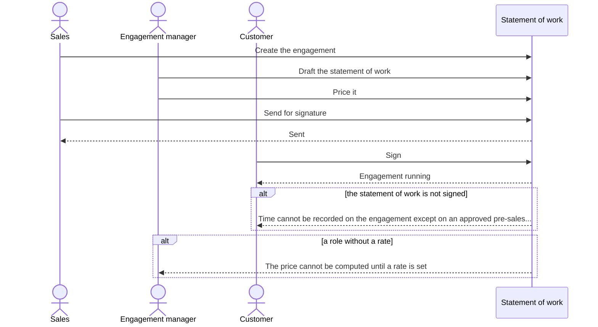

🏠 [Specs](../../../../README.md) › 🏷️ [Sectors](../../../README.md) › 💼 [SC03 Services](../../README.md) ›
📝 [Use cases](../README.md) › 📝 [Use cases: FL-SC03-01 Win and price](README.md) ›
📝 UC-SC03-01 Win an engagement and write its statement of work

# 📝 UC-SC03-01 Win an engagement and write its statement of work

**Status:** ✅ specified

## Summary

Sales and the engagement manager turn an opportunity into a statement of work with scope, deliverables, team, plan and
price, and have the client sign it before any billable time.

## Personas

- [U03 Sales](../../../../01-users/personas/u03-sales.md)
- [U24 Engagement manager](../../../../01-users/personas/u24-engagement-manager.md)
- [U09 Customer](../../../../01-users/personas/u09-customer.md)

## Goal

A signed statement of work that opens the engagement for time and billing.

## Trigger

An opportunity reaches the proposal stage.

## Frequency

A few a month.

## Preconditions

- The SC03 sector pack is installed for the company,
  [UC-F14-02](../../../../02-functional/f14-plugin-store/use-cases/01-find-and-install/uc-f14-02-install-a-plugin-or-sector-pack.md),
  and its users have their roles,
  [UC-F1-06](../../../../02-functional/f01-administration/use-cases/04-edit-a-role/uc-f01-06-edit-a-role-and-its-record-rules.md).
- The opportunity exists in the pipeline,
  [UC-F6-02](../../../../02-functional/f06-customers-and-sales/use-cases/01-lead-to-quote/uc-f06-02-manage-the-pipeline-and-forecast.md).

## Postconditions

- **Success:** the statement of work is signed and the engagement is running.
- **Failed:** the engagement stays in pre-sales; only an approved pre-sales budget takes time.

## Main flow

1. Sales creates the engagement on
   [S-SC03-01 Statement of work](../../screens/01-win-and-price/s-sc03-01-statement-of-work.md) from the opportunity,
   with the client and the pricing model.
2. The engagement manager drafts the scope, deliverables, team and plan, or has the AI assistant draft them,
   [UC-F3-04](../../../../02-functional/f03-assistant/use-cases/04-summarise-or-draft/uc-f03-04-summarise-and-draft.md).
3. The engagement manager prices it from the rate card ([UC-SC03-02](uc-sc03-02-set-rate-cards-and-pricing-models.md)).
4. Sales sends it for e-signature,
   [UC-F2-14](../../../../02-functional/f02-no-code-configuration/use-cases/07-benchmark-additions/uc-f02-14-send-documents-for-e-signature.md).
5. The client signs; the engagement is running
   ([BR-SC03-02](../../business-rules/br-sc03-02-work-only-under-a-signed-statement.md)).

## Alternative flows

- 2a. A framework contract with call-offs: each call-off is a statement of work under the framework's rates.
- 4a. A new version after the client's comments: version 2 replaces version 1, which is kept.

## Error flows

- 5e. The statement of work is not signed: time cannot be recorded on the engagement except on an approved pre-sales
  budget ([BR-SC03-02](../../business-rules/br-sc03-02-work-only-under-a-signed-statement.md)).
- 3e. A role without a rate: the price cannot be computed until a rate is set.
- Any step: a call to a service or an outside system fails: it is retried first
  ([BR-F3-32](../../../../02-functional/f03-assistant/business-rules/br-f03-32-retry-before-an-error.md)), then the
  error message pattern ([D122](../../../../06-decisions/ux/d122-error-message-standard.md)) says what failed; what was
  typed is kept.

## Business rules

- [BR-SC03-02 Work only under a signed statement of work](../../business-rules/br-sc03-02-work-only-under-a-signed-statement.md)

## Entities

- [E-SC03-01 Engagement](../../data/e-sc03-01-engagement.md)
- [E-SC03-02 Statement of work](../../data/e-sc03-02-statement-of-work.md)

## Permissions

The sales, engagement manager and customer roles; the record rules of their role and site apply,
[UC-F1-06](../../../../02-functional/f01-administration/use-cases/04-edit-a-role/uc-f01-06-edit-a-role-and-its-record-rules.md).

## Notifications

- The engagement manager is told when the client signs.

## Audit events

Every creation, change and state change of engagement, statement of work records, with who, when and the values before
and after (T3).

## AI involvement

The AI assistant answers questions on the engagement, statement of work records of this use case, with links, and
prepares them as drafts the user confirms. It works within the user's rights,
[BR-F3-34](../../../../02-functional/f03-assistant/business-rules/br-f03-34-every-capability-is-reachable-from-the-assistant.md),
and never deletes or does anything irreversible without the user's confirmation,
[BR-F3-07](../../../../02-functional/f03-assistant/business-rules/br-f03-07-no-deletes-no-irreversible-acts.md).

## API, MCP and A2A exposure

Through the API and webhooks (T5) and the MCP and A2A gateway (T6), with the caller's rights,
[BR-F3-34](../../../../02-functional/f03-assistant/business-rules/br-f03-34-every-capability-is-reachable-from-the-assistant.md),
reading, creating and changing the records of this use case; nothing irreversible without a person's confirmation.

## Screens

- [S-SC03-01 Statement of work](../../screens/01-win-and-price/s-sc03-01-statement-of-work.md)

## Flowchart

See [FL-SC03-01 Win and price](../../flows/fl-sc03-01-win-and-price.md#flowchart).

## Sequence diagram

## Acceptance criteria

1. **Given** the example consulting firm's engagement E-207 for Acme, fixed price 120,000 EUR, statement of work v2
   signed on 3 November **when** S. B. records time on it **then** the time is accepted on E-207.
2. **Given** engagement E-207 for Acme with an unsigned v2 **when** S. B. records 7 hours on it **then** time cannot be
   recorded on the engagement except on an approved pre-sales budget
   ([BR-SC03-02](../../business-rules/br-sc03-02-work-only-under-a-signed-statement.md)).

## Non-functional notes

[D408](../../../../06-decisions/technical/d408-performance-and-profiles.md)'s targets
([performance](../../../../05-non-functional/performance.md)): 95 % of screens within 1 second; lists paged on the
server, the first page within 1 second; reports within 5 seconds or in the background. WCAG 2.2 AA and RGAA
([D46](../../../../06-decisions/ux/d46-accessibility-standard.md)).

## Regulatory references

None specific to this use case; the sector's legal rules are listed in [SC03 regulatory](../../regulatory.md).

## Related use cases

- [UC-SC03-02 Set rate cards and pricing models](uc-sc03-02-set-rate-cards-and-pricing-models.md)
- [UC-SC03-03 Staff the engagement](../02-staff-and-plan/uc-sc03-03-staff-the-engagement.md)

## Open questions

None.

---

⬆️ [Up](README.md) ·
➡️ [UC-SC03-02 Set rate cards and pricing models](uc-sc03-02-set-rate-cards-and-pricing-models.md)
