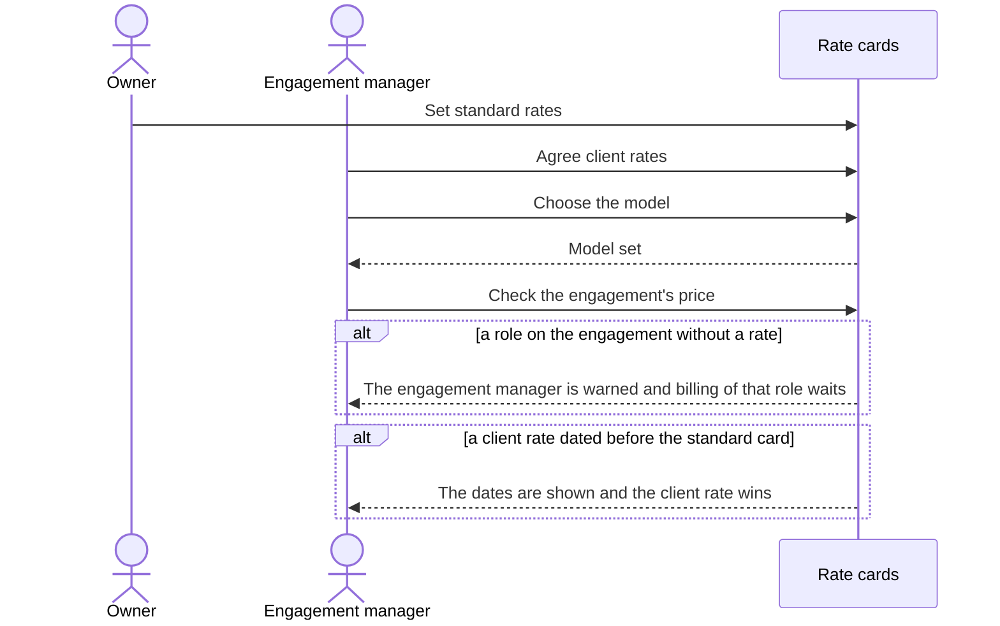

🏠 [Specs](../../../../README.md) › 🏷️ [Sectors](../../../README.md) › 💼 [SC03 Services](../../README.md) ›
📝 [Use cases](../README.md) › 📝 [Use cases: FL-SC03-01 Win and price](README.md) ›
📝 UC-SC03-02 Set rate cards and pricing models

# 📝 UC-SC03-02 Set rate cards and pricing models

**Status:** ✅ specified

## Summary

The engagement manager and the owner set standard day rates per role, agree client rates, and choose each engagement's
pricing model: time and materials, fixed price, milestones or retainer.

## Personas

- [U24 Engagement manager](../../../../01-users/personas/u24-engagement-manager.md)
- [U13 Owner](../../../../01-users/personas/u13-owner.md)

## Goal

Every billable hour priced the same way everywhere.

## Trigger

The yearly rate review, or a new client contract.

## Frequency

Yearly, plus each client agreement.

## Preconditions

- The SC03 sector pack is installed for the company,
  [UC-F14-02](../../../../02-functional/f14-plugin-store/use-cases/01-find-and-install/uc-f14-02-install-a-plugin-or-sector-pack.md),
  and its users have their roles,
  [UC-F1-06](../../../../02-functional/f01-administration/use-cases/04-edit-a-role/uc-f01-06-edit-a-role-and-its-record-rules.md).

## Postconditions

- **Success:** the rate card is active and the engagement's model set.
- **Failed:** the old rates stay in force.

## Main flow

1. The owner sets the standard day rates per role on
   [S-SC03-02 Rate cards](../../screens/01-win-and-price/s-sc03-02-rate-cards.md),
   [UC-F6-12](../../../../02-functional/f06-customers-and-sales/use-cases/01-lead-to-quote/uc-f06-12-manage-price-lists-and-discounts.md).
2. The engagement manager records the client's agreed rates, which win over the standard ones
   ([BR-SC03-03](../../business-rules/br-sc03-03-rates-from-the-rate-card.md)).
3. The engagement manager chooses the pricing model of the engagement
   ([BR-SC03-06](../../business-rules/br-sc03-06-billing-follows-the-pricing-model.md)).
4. The engagement manager sees the engagement's price computed again from the new rates before the next bill.

## Alternative flows

- 2a. A discount for a volume of days: the rate drops once the volume is reached.

## Error flows

- 3e. A role on the engagement without a rate: the engagement manager is warned and billing of that role waits.
- 2e. A client rate dated before the standard card: the dates are shown and the client rate wins.
- Any step: a call to a service or an outside system fails: it is retried first
  ([BR-F3-32](../../../../02-functional/f03-assistant/business-rules/br-f03-32-retry-before-an-error.md)), then the
  error message pattern ([D122](../../../../06-decisions/ux/d122-error-message-standard.md)) says what failed; what was
  typed is kept.

## Business rules

- [BR-SC03-03 Rates from the rate card](../../business-rules/br-sc03-03-rates-from-the-rate-card.md)
- [BR-SC03-06 Billing follows the pricing model](../../business-rules/br-sc03-06-billing-follows-the-pricing-model.md)

## Entities

- [E-SC03-03 Rate card](../../data/e-sc03-03-rate-card.md)
- [E-SC03-14 Pricing model](../../data/e-sc03-14-pricing-model.md)

## Permissions

The engagement manager and owner roles; the record rules of their role and site apply,
[UC-F1-06](../../../../02-functional/f01-administration/use-cases/04-edit-a-role/uc-f01-06-edit-a-role-and-its-record-rules.md).

## Notifications

None beyond the in-app updates of the records concerned.

## Audit events

Every creation, change and state change of rate card records, with who, when and the values before and after (T3).

## AI involvement

The AI assistant answers questions on the rate card records of this use case, with links, and prepares them as drafts
the user confirms. It works within the user's rights,
[BR-F3-34](../../../../02-functional/f03-assistant/business-rules/br-f03-34-every-capability-is-reachable-from-the-assistant.md),
and never deletes or does anything irreversible without the user's confirmation,
[BR-F3-07](../../../../02-functional/f03-assistant/business-rules/br-f03-07-no-deletes-no-irreversible-acts.md).

## API, MCP and A2A exposure

Through the API and webhooks (T5) and the MCP and A2A gateway (T6), with the caller's rights,
[BR-F3-34](../../../../02-functional/f03-assistant/business-rules/br-f03-34-every-capability-is-reachable-from-the-assistant.md),
reading, creating and changing the records of this use case; nothing irreversible without a person's confirmation.

## Screens

- [S-SC03-02 Rate cards](../../screens/01-win-and-price/s-sc03-02-rate-cards.md)

## Flowchart

See [FL-SC03-01 Win and price](../../flows/fl-sc03-01-win-and-price.md#flowchart).

## Sequence diagram

## Acceptance criteria

1. **Given** the example consulting firm's standard Senior rate of 1,000 EUR and Acme's agreed 950 EUR **when** S. B.,
   Senior, bills a day to Acme **then** the day is priced 950 EUR.
2. **Given** Acme's rate of 950 EUR dropping to 900 EUR after 100 days **when** day 101 is billed **then** the rate
   drops once the volume is reached.
3. **Given** a Junior on E-207 with no Junior rate **when** billing is proposed **then** the engagement manager is
   warned and billing of that role waits.

## Non-functional notes

[D408](../../../../06-decisions/technical/d408-performance-and-profiles.md)'s targets
([performance](../../../../05-non-functional/performance.md)): 95 % of screens within 1 second; lists paged on the
server, the first page within 1 second; reports within 5 seconds or in the background. WCAG 2.2 AA and RGAA
([D46](../../../../06-decisions/ux/d46-accessibility-standard.md)).

## Regulatory references

None specific to this use case; the sector's legal rules are listed in [SC03 regulatory](../../regulatory.md).

## Related use cases

- [UC-SC03-01 Win an engagement and write its statement of work](uc-sc03-01-win-an-engagement-and-write-its-statement-of-work.md)
- [UC-SC03-06 Bill time and materials](../04-bill-and-recognise/uc-sc03-06-bill-time-and-materials.md)

## Open questions

None.

---

⬅️ [UC-SC03-01](uc-sc03-01-win-an-engagement-and-write-its-statement-of-work.md) · ⬆️ [Up](README.md) ·
➡️ [UC-SC03-03 Staff the engagement](../02-staff-and-plan/uc-sc03-03-staff-the-engagement.md)
