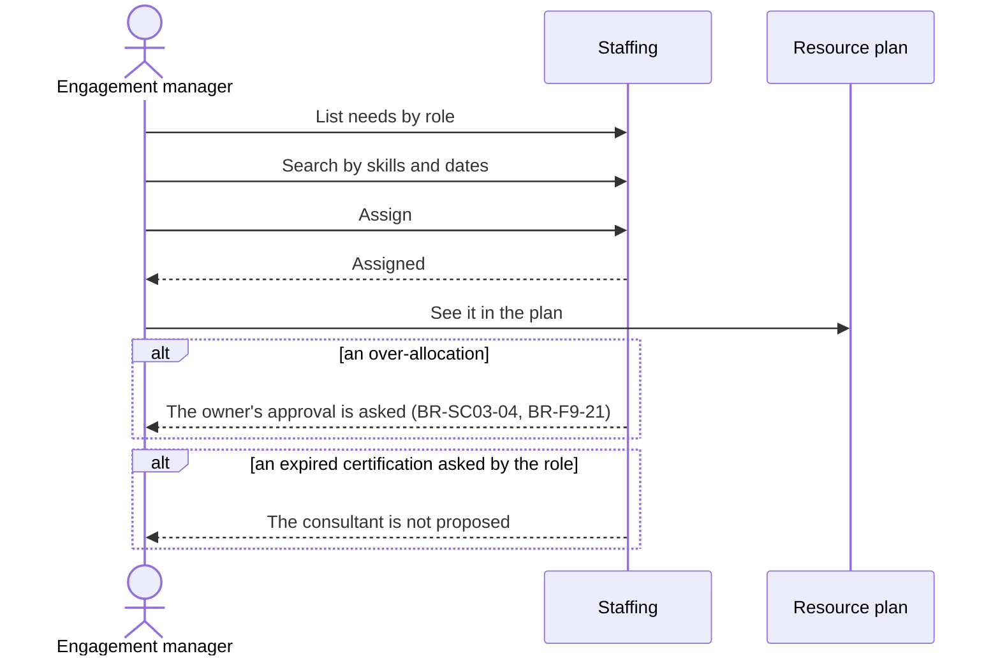

🏠 [Specs](../../../../README.md) › 🏷️ [Sectors](../../../README.md) › 💼 [SC03 Services](../../README.md) ›
📝 [Use cases](../README.md) › 📝 [Use cases: FL-SC03-02 Staff and plan](README.md) › 📝 UC-SC03-03 Staff the engagement

# 📝 UC-SC03-03 Staff the engagement

**Status:** ✅ specified

## Summary

The engagement manager lists the roles the engagement needs, searches consultants by skill, level and availability, and
assigns them within their available hours.

## Personas

- [U24 Engagement manager](../../../../01-users/personas/u24-engagement-manager.md)

## Goal

The right people, available, on the engagement.

## Trigger

A signed statement of work, or a change in the team.

## Frequency

At each engagement start; adjustments weekly.

## Preconditions

- The SC03 sector pack is installed for the company,
  [UC-F14-02](../../../../02-functional/f14-plugin-store/use-cases/01-find-and-install/uc-f14-02-install-a-plugin-or-sector-pack.md),
  and its users have their roles,
  [UC-F1-06](../../../../02-functional/f01-administration/use-cases/04-edit-a-role/uc-f01-06-edit-a-role-and-its-record-rules.md).

## Postconditions

- **Success:** the assignments are confirmed and show in the resource plan.
- **Failed:** the role stays open and is shown as a need.

## Main flow

1. The engagement manager lists the needs by role, dates and load on
   [S-SC03-03 Staffing](../../screens/02-staff-and-plan/s-sc03-03-staffing.md).
2. SimpleERP lists consultants with current skills
   ([BR-SC03-13](../../business-rules/br-sc03-13-skills-kept-current.md)) and free time,
   [UC-F9-29](../../../../02-functional/f09-hr-and-projects/use-cases/11-capacity-rounds-and-partners/uc-f09-29-plan-capacity-across-projects.md).
3. The engagement manager assigns; the assignment is confirmed.
4. The assignment shows in the resource plan ([UC-SC03-04](uc-sc03-04-plan-resources-and-utilisation.md)) and the
   consultant's timesheet opens the engagement.

## Alternative flows

- 2a. Nobody fits: a freelancer is engaged
  ([UC-SC03-09](../03-deliver-and-record/uc-sc03-09-engage-freelancers-and-subcontractors.md)).

## Error flows

- 3e. An over-allocation: the owner's approval is asked,
  [BR-SC03-04](../../business-rules/br-sc03-04-staffing-respects-availability.md),
  [BR-F9-21](../../../../02-functional/f09-hr-and-projects/business-rules/br-f09-21-planned-load-stays-within-available-hours.md).
- 2e. An expired certification asked by the role: the consultant is not proposed.
- Any step: a call to a service or an outside system fails: it is retried first
  ([BR-F3-32](../../../../02-functional/f03-assistant/business-rules/br-f03-32-retry-before-an-error.md)), then the
  error message pattern ([D122](../../../../06-decisions/ux/d122-error-message-standard.md)) says what failed; what was
  typed is kept.

## Business rules

- [BR-SC03-04 Staffing respects availability](../../business-rules/br-sc03-04-staffing-respects-availability.md)
- [BR-SC03-13 Skills kept current](../../business-rules/br-sc03-13-skills-kept-current.md)
- [BR-F9-21 Planned load stays within available hours](../../../../02-functional/f09-hr-and-projects/business-rules/br-f09-21-planned-load-stays-within-available-hours.md)

## Entities

- [E-SC03-04 Staffing assignment](../../data/e-sc03-04-staffing-assignment.md)
- [E-SC03-11 Skill](../../data/e-sc03-11-skill.md)
- [E-SC03-15 Resource plan](../../data/e-sc03-15-resource-plan.md)
- [E-SC03-16 Staffing need](../../data/e-sc03-16-staffing-need.md)

## Permissions

The engagement manager roles; the record rules of their role and site apply,
[UC-F1-06](../../../../02-functional/f01-administration/use-cases/04-edit-a-role/uc-f01-06-edit-a-role-and-its-record-rules.md).

## Notifications

- The consultant is told of the assignment.

## Audit events

Every creation, change and state change of staffing assignment, skill records, with who, when and the values before and
after (T3).

## AI involvement

The AI assistant answers questions on the staffing assignment, skill records of this use case, with links, and prepares
them as drafts the user confirms. It works within the user's rights,
[BR-F3-34](../../../../02-functional/f03-assistant/business-rules/br-f03-34-every-capability-is-reachable-from-the-assistant.md),
and never deletes or does anything irreversible without the user's confirmation,
[BR-F3-07](../../../../02-functional/f03-assistant/business-rules/br-f03-07-no-deletes-no-irreversible-acts.md).

## API, MCP and A2A exposure

Through the API and webhooks (T5) and the MCP and A2A gateway (T6), with the caller's rights,
[BR-F3-34](../../../../02-functional/f03-assistant/business-rules/br-f03-34-every-capability-is-reachable-from-the-assistant.md),
reading, creating and changing the records of this use case; nothing irreversible without a person's confirmation.

## Screens

- [S-SC03-03 Staffing](../../screens/02-staff-and-plan/s-sc03-03-staffing.md)
- [S-SC03-04 Resource plan](../../screens/02-staff-and-plan/s-sc03-04-resource-plan.md)

## Flowchart

See [FL-SC03-02 Staff and plan](../../flows/fl-sc03-02-staff-and-plan.md#flowchart).

## Sequence diagram

## Acceptance criteria

1. **Given** the example consulting firm's need for a Senior cloud architect at 60 % in November **when** the search
   runs **then** S. B., level 4 until 2027-06-30 and 40 % free, is not proposed as free for 60 %.
2. **Given** S. B. at 60 % on E-207 and 60 % elsewhere in November **when** she is assigned **then** the owner's
   approval is asked, [BR-SC03-04](../../business-rules/br-sc03-04-staffing-respects-availability.md),
   [BR-F9-21](../../../../02-functional/f09-hr-and-projects/business-rules/br-f09-21-planned-load-stays-within-available-hours.md).

## Non-functional notes

[D408](../../../../06-decisions/technical/d408-performance-and-profiles.md)'s targets
([performance](../../../../05-non-functional/performance.md)): 95 % of screens within 1 second; lists paged on the
server, the first page within 1 second; reports within 5 seconds or in the background. WCAG 2.2 AA and RGAA
([D46](../../../../06-decisions/ux/d46-accessibility-standard.md)).

## Regulatory references

Legal values from the France country pack:
[CR-FR-042 Working time and rest](../../../../10-country-packs/france/labour/cr-fr-042-working-time-and-rest.md),
[CR-FR-099 Day-based working time (forfait jours)](../../../../10-country-packs/france/labour/cr-fr-099-day-based-working-time.md).

## Related use cases

- [UC-SC03-04 Plan resources and utilisation](uc-sc03-04-plan-resources-and-utilisation.md)

## Open questions

None.

---

⬅️ [UC-SC03-02 Set rate cards and pricing models](../01-win-and-price/uc-sc03-02-set-rate-cards-and-pricing-models.md) ·
⬆️ [Up](README.md) · ➡️ [UC-SC03-04 Plan resources and utilisation](uc-sc03-04-plan-resources-and-utilisation.md)
