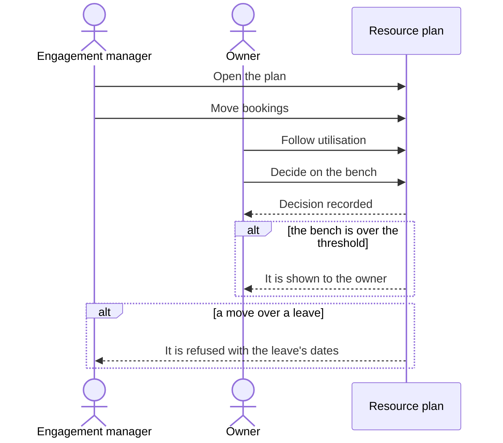

🏠 [Specs](../../../../README.md) › 🏷️ [Sectors](../../../README.md) › 💼 [SC03 Services](../../README.md) ›
📝 [Use cases](../README.md) › 📝 [Use cases: FL-SC03-02 Staff and plan](README.md) ›
📝 UC-SC03-04 Plan resources and utilisation

# 📝 UC-SC03-04 Plan resources and utilisation

**Status:** ✅ specified

## Summary

The engagement manager and the owner see the firm's capacity, bookings and utilisation, move bookings and follow the
bench.

## Personas

- [U24 Engagement manager](../../../../01-users/personas/u24-engagement-manager.md)
- [U13 Owner](../../../../01-users/personas/u13-owner.md)

## Goal

High utilisation without overload.

## Trigger

The weekly staffing meeting.

## Frequency

Weekly.

## Preconditions

- The SC03 sector pack is installed for the company,
  [UC-F14-02](../../../../02-functional/f14-plugin-store/use-cases/01-find-and-install/uc-f14-02-install-a-plugin-or-sector-pack.md),
  and its users have their roles,
  [UC-F1-06](../../../../02-functional/f01-administration/use-cases/04-edit-a-role/uc-f01-06-edit-a-role-and-its-record-rules.md).

## Postconditions

- **Success:** bookings are adjusted and utilisation is known per consultant, team and month.
- **Failed:** the plan is unchanged.

## Main flow

1. The engagement manager opens [S-SC03-04 Resource plan](../../screens/02-staff-and-plan/s-sc03-04-resource-plan.md):
   people per week with bookings and leave.
2. The engagement manager moves bookings within availability
   ([BR-SC03-04](../../business-rules/br-sc03-04-staffing-respects-availability.md)).
3. The owner follows utilisation from approved time
   ([BR-SC03-15](../../business-rules/br-sc03-15-utilisation-from-approved-time.md)).
4. The owner decides on the bench: staffing on the pipeline, training or internal work.

## Alternative flows

- 2a. Tentative bookings for the pipeline: they show apart and do not count in utilisation.

## Error flows

- 3e. The bench is over the threshold: it is shown to the owner (over 20 % of available hours in the month).
- 2e. A move over a leave: it is refused with the leave's dates.
- Any step: a call to a service or an outside system fails: it is retried first
  ([BR-F3-32](../../../../02-functional/f03-assistant/business-rules/br-f03-32-retry-before-an-error.md)), then the
  error message pattern ([D122](../../../../06-decisions/ux/d122-error-message-standard.md)) says what failed; what was
  typed is kept.

## Business rules

- [BR-SC03-15 Utilisation from approved time](../../business-rules/br-sc03-15-utilisation-from-approved-time.md)
- [BR-SC03-04 Staffing respects availability](../../business-rules/br-sc03-04-staffing-respects-availability.md)

## Entities

- [E-SC03-04 Staffing assignment](../../data/e-sc03-04-staffing-assignment.md)

## Permissions

The engagement manager and owner roles; the record rules of their role and site apply,
[UC-F1-06](../../../../02-functional/f01-administration/use-cases/04-edit-a-role/uc-f01-06-edit-a-role-and-its-record-rules.md).

## Notifications

None beyond the in-app updates of the records concerned.

## Audit events

Every creation, change and state change of staffing assignment records, with who, when and the values before and after
(T3).

## AI involvement

The AI assistant answers questions on the staffing assignment records of this use case, with links, and prepares them as
drafts the user confirms. It works within the user's rights,
[BR-F3-34](../../../../02-functional/f03-assistant/business-rules/br-f03-34-every-capability-is-reachable-from-the-assistant.md),
and never deletes or does anything irreversible without the user's confirmation,
[BR-F3-07](../../../../02-functional/f03-assistant/business-rules/br-f03-07-no-deletes-no-irreversible-acts.md).

## API, MCP and A2A exposure

Through the API and webhooks (T5) and the MCP and A2A gateway (T6), with the caller's rights,
[BR-F3-34](../../../../02-functional/f03-assistant/business-rules/br-f03-34-every-capability-is-reachable-from-the-assistant.md),
reading, creating and changing the records of this use case; nothing irreversible without a person's confirmation.

## Screens

- [S-SC03-04 Resource plan](../../screens/02-staff-and-plan/s-sc03-04-resource-plan.md)

## Flowchart

See [FL-SC03-02 Staff and plan](../../flows/fl-sc03-02-staff-and-plan.md#flowchart).

## Sequence diagram

## Acceptance criteria

1. **Given** the example consulting firm's S. B. with 120 available hours and 96 approved billable hours in November
   **when** utilisation is computed **then** it is 80 %.
2. **Given** 6 of 25 consultants unbooked in December **when** the owner opens the plan **then** it is shown to the
   owner (over 20 % of available hours in the month).

## Non-functional notes

[D408](../../../../06-decisions/technical/d408-performance-and-profiles.md)'s targets
([performance](../../../../05-non-functional/performance.md)): 95 % of screens within 1 second; lists paged on the
server, the first page within 1 second; reports within 5 seconds or in the background. WCAG 2.2 AA and RGAA
([D46](../../../../06-decisions/ux/d46-accessibility-standard.md)).

## Regulatory references

None specific to this use case; the sector's legal rules are listed in [SC03 regulatory](../../regulatory.md).

## Related use cases

- [UC-SC03-03 Staff the engagement](uc-sc03-03-staff-the-engagement.md)

## Open questions

None open.

---

⬅️ [UC-SC03-03 Staff the engagement](uc-sc03-03-staff-the-engagement.md) · ⬆️ [Up](README.md) ·
➡️ [UC-SC03-05](../03-deliver-and-record/uc-sc03-05-record-and-approve-time-and-expenses.md)
