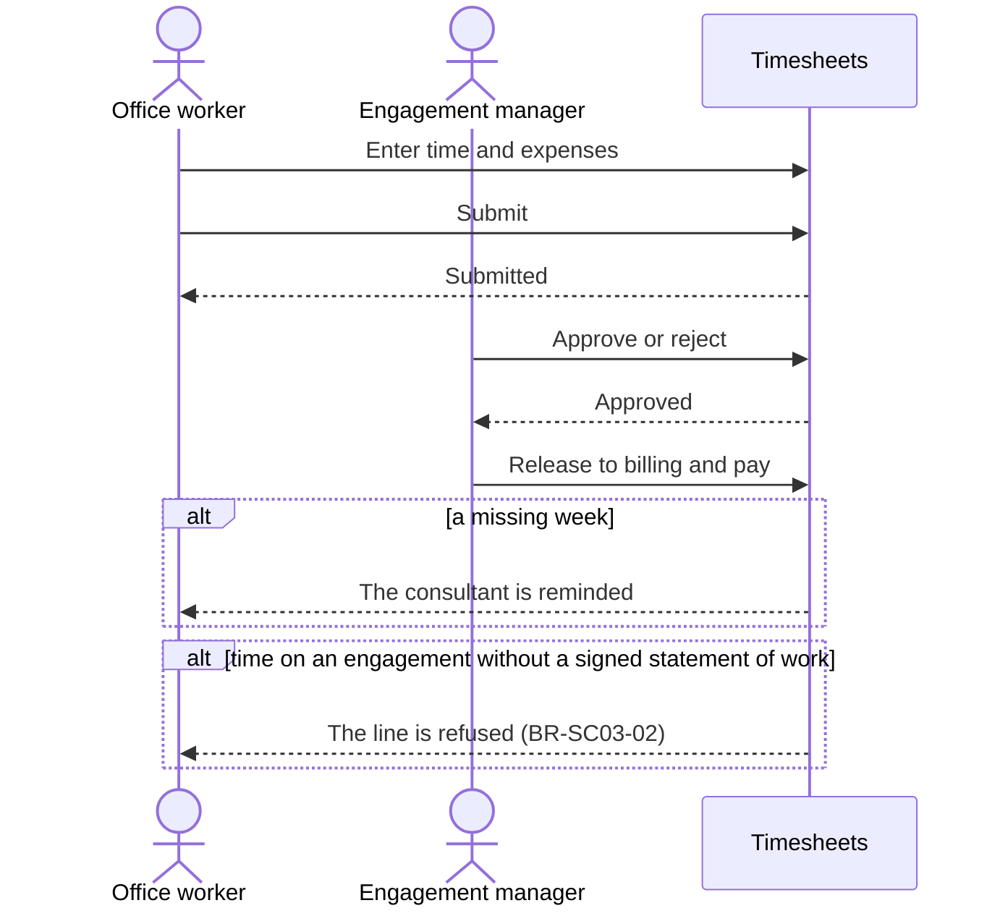

🏠 [Specs](../../../../README.md) › 🏷️ [Sectors](../../../README.md) › 💼 [SC03 Services](../../README.md) ›
📝 [Use cases](../README.md) › 📝 [Use cases: FL-SC03-03 Deliver and record](README.md) ›
📝 UC-SC03-05 Record and approve time and expenses

# 📝 UC-SC03-05 Record and approve time and expenses

**Status:** 🔄 waiting for the owner

## Summary

Consultants enter their weekly timesheet and expenses per engagement; the engagement manager approves or rejects them
with a reason.

## Personas

- [U16 Office worker](../../../../01-users/personas/u16-office-worker.md)
- [U24 Engagement manager](../../../../01-users/personas/u24-engagement-manager.md)

## Goal

Approved time and expenses, ready for billing and pay.

## Trigger

The end of each week.

## Frequency

Weekly per consultant.

## Preconditions

- The SC03 sector pack is installed for the company,
  [UC-F14-02](../../../../02-functional/f14-plugin-store/use-cases/01-find-and-install/uc-f14-02-install-a-plugin-or-sector-pack.md),
  and its users have their roles,
  [UC-F1-06](../../../../02-functional/f01-administration/use-cases/04-edit-a-role/uc-f01-06-edit-a-role-and-its-record-rules.md).

## Postconditions

- **Success:** the week is approved and ready for billing and revenue.
- **Failed:** rejected lines go back to the consultant with the reason.

## Main flow

1. The consultant enters hours per engagement and day on
   [S-SC03-05 Timesheets](../../screens/03-deliver-and-record/s-sc03-05-timesheets.md),
   [UC-F9-16](../../../../02-functional/f09-hr-and-projects/use-cases/03-time/uc-f09-16-record-and-validate-timesheets.md),
   and expenses with receipts,
   [UC-F8-12](../../../../02-functional/f08-accounting/use-cases/02-purchase-to-pay/uc-f08-12-submit-and-approve-expenses.md).
2. The consultant submits the week.
3. The engagement manager approves or rejects each line with a reason
   ([BR-SC03-05](../../business-rules/br-sc03-05-time-approved-before-billing.md)).
4. Approved lines go to billing ([UC-SC03-06](../04-bill-and-recognise/uc-sc03-06-bill-time-and-materials.md)) and
   expenses to reimbursement,
   [UC-F8-12](../../../../02-functional/f08-accounting/use-cases/02-purchase-to-pay/uc-f08-12-submit-and-approve-expenses.md).

## Alternative flows

- 3a. Client approval too: the client approves the timesheet on the portal
  ([UC-SC03-11](../05-client-and-people/uc-sc03-11-share-with-the-client-in-the-portal.md)).

## Error flows

- 1e. A missing week: the consultant is reminded ((Proposed) on Monday morning).
- 1f. Time on an engagement without a signed statement of work: the line is refused
  ([BR-SC03-02](../../business-rules/br-sc03-02-work-only-under-a-signed-statement.md)).
- Any step: a call to a service or an outside system fails: it is retried first
  ([BR-F3-32](../../../../02-functional/f03-assistant/business-rules/br-f03-32-retry-before-an-error.md)), then the
  error message pattern ([D122](../../../../06-decisions/ux/d122-error-message-standard.md)) says what failed; what was
  typed is kept.

## Business rules

- [BR-SC03-05 Time approved before billing](../../business-rules/br-sc03-05-time-approved-before-billing.md)
- [BR-SC03-02 Work only under a signed statement of work](../../business-rules/br-sc03-02-work-only-under-a-signed-statement.md)

## Entities

- [E-SC03-05 Timesheet](../../data/e-sc03-05-timesheet.md)
- [E-SC03-06 Rebillable cost](../../data/e-sc03-06-rebillable-cost.md)

## Permissions

The office worker and engagement manager roles; the record rules of their role and site apply,
[UC-F1-06](../../../../02-functional/f01-administration/use-cases/04-edit-a-role/uc-f01-06-edit-a-role-and-its-record-rules.md).

## Notifications

- The engagement manager is told of weeks to approve.
- The consultant is told of rejected lines.

## Audit events

Every creation, change and state change of timesheet, expense records, with who, when and the values before and after
(T3).

## AI involvement

The AI assistant answers questions on the timesheet, expense records of this use case, with links, and prepares them as
drafts the user confirms. It works within the user's rights,
[BR-F3-34](../../../../02-functional/f03-assistant/business-rules/br-f03-34-every-capability-is-reachable-from-the-assistant.md),
and never deletes or does anything irreversible without the user's confirmation,
[BR-F3-07](../../../../02-functional/f03-assistant/business-rules/br-f03-07-no-deletes-no-irreversible-acts.md).

## API, MCP and A2A exposure

Through the API and webhooks (T5) and the MCP and A2A gateway (T6), with the caller's rights,
[BR-F3-34](../../../../02-functional/f03-assistant/business-rules/br-f03-34-every-capability-is-reachable-from-the-assistant.md),
reading, creating and changing the records of this use case; nothing irreversible without a person's confirmation.

## Screens

- [S-SC03-05 Timesheets](../../screens/03-deliver-and-record/s-sc03-05-timesheets.md)

## Flowchart

See [FL-SC03-03 Deliver and record](../../flows/fl-sc03-03-deliver-and-record.md#flowchart).

## Sequence diagram

## Acceptance criteria

1. **Given** the example consulting firm's S. B. with 7 hours on E-207 on Monday of W46 and a train ticket of 84.00 EUR
   **when** the engagement manager approves **then** both lines are ready to bill, the ticket as rebillable.
2. **Given** S. B. without a timesheet for W46 **when** it is Monday of W47 **then** the consultant is reminded
   ((Proposed) on Monday morning).

## Non-functional notes

[D408](../../../../06-decisions/technical/d408-performance-and-profiles.md)'s targets
([performance](../../../../05-non-functional/performance.md)): 95 % of screens within 1 second; lists paged on the
server, the first page within 1 second; reports within 5 seconds or in the background. WCAG 2.2 AA and RGAA
([D46](../../../../06-decisions/ux/d46-accessibility-standard.md)).

## Regulatory references

None specific to this use case; the sector's legal rules are listed in [SC03 regulatory](../../regulatory.md).

## Related use cases

- [UC-SC03-06 Bill time and materials](../04-bill-and-recognise/uc-sc03-06-bill-time-and-materials.md)

## Open questions

None open; the items marked (Proposed) wait for the owner in the [waiting list](../../../../09-waiting/README.md).

---

⬅️ [UC-SC03-04 Plan resources and utilisation](../02-staff-and-plan/uc-sc03-04-plan-resources-and-utilisation.md) ·
⬆️ [Up](README.md) ·
➡️ [UC-SC03-06 Bill time and materials](../04-bill-and-recognise/uc-sc03-06-bill-time-and-materials.md)
