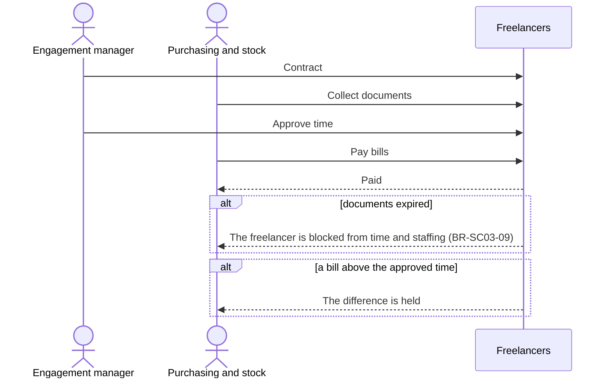

🏠 [Specs](../../../../README.md) › 🏷️ [Sectors](../../../README.md) › 💼 [SC03 Services](../../README.md) ›
📝 [Use cases](../README.md) › 📝 [Use cases: FL-SC03-03 Deliver and record](README.md) ›
📝 UC-SC03-09 Engage freelancers and subcontractors

# 📝 UC-SC03-09 Engage freelancers and subcontractors

**Status:** ✅ specified

## Summary

The engagement manager and purchasing contract a freelancer or subcontractor, collect their documents, approve their
time and pay their bills; lending staff stays within the law.

## Personas

- [U24 Engagement manager](../../../../01-users/personas/u24-engagement-manager.md)
- [U04 Purchasing and stock](../../../../01-users/personas/u04-purchasing.md)

## Goal

Outside help that works legally and is paid on approved time.

## Trigger

Nobody in the firm fits a role.

## Frequency

A few a month.

## Preconditions

- The SC03 sector pack is installed for the company,
  [UC-F14-02](../../../../02-functional/f14-plugin-store/use-cases/01-find-and-install/uc-f14-02-install-a-plugin-or-sector-pack.md),
  and its users have their roles,
  [UC-F1-06](../../../../02-functional/f01-administration/use-cases/04-edit-a-role/uc-f01-06-edit-a-role-and-its-record-rules.md).

## Postconditions

- **Success:** the contract is signed, the documents valid, time approved and bills paid.
- **Failed:** the freelancer cannot record time.

## Main flow

1. The engagement manager contracts the freelancer on
   [S-SC03-09 Freelancers](../../screens/03-deliver-and-record/s-sc03-09-freelancers.md),
   [UC-F9-32](../../../../02-functional/f09-hr-and-projects/use-cases/11-capacity-rounds-and-partners/uc-f09-32-work-with-subcontractors-and-freelancers-on-projects.md).
2. Purchasing collects registration and vigilance documents,
   [BR-SC03-09](../../business-rules/br-sc03-09-freelancers-checked.md),
   [BR-F9-24](../../../../02-functional/f09-hr-and-projects/business-rules/br-f09-24-no-work-without-vigilance-documents.md).
3. The engagement manager approves the freelancer's time.
4. Purchasing matches and pays the bills,
   [UC-F7-04](../../../../02-functional/f07-purchasing-and-stock/use-cases/01-procure/uc-f07-04-capture-and-match-supplier-invoices.md).

## Alternative flows

- 1a. Through a platform or umbrella company: the contract and bills are with the platform, the person is named on it.
- 1b. A consultant lent to a client's team: it is lent at cost under an agreement and the consultant's consent
  ([BR-SC03-08](../../business-rules/br-sc03-08-lending-staff-only-at-cost.md)).

## Error flows

- 2e. Documents expired: the freelancer is blocked from time and staffing
  ([BR-SC03-09](../../business-rules/br-sc03-09-freelancers-checked.md)).
- 4e. A bill above the approved time: the difference is held.
- Any step: a call to a service or an outside system fails: it is retried first
  ([BR-F3-32](../../../../02-functional/f03-assistant/business-rules/br-f03-32-retry-before-an-error.md)), then the
  error message pattern ([D122](../../../../06-decisions/ux/d122-error-message-standard.md)) says what failed; what was
  typed is kept.

## Business rules

- [BR-SC03-08 Lending staff only at cost](../../business-rules/br-sc03-08-lending-staff-only-at-cost.md)
- [BR-SC03-09 Freelancers checked](../../business-rules/br-sc03-09-freelancers-checked.md)
- [BR-F9-24 No work without vigilance documents](../../../../02-functional/f09-hr-and-projects/business-rules/br-f09-24-no-work-without-vigilance-documents.md)

## Entities

- [E-SC03-10 Freelance contract](../../data/e-sc03-10-freelance-contract.md)

## Permissions

The engagement manager and purchasing and stock roles; the record rules of their role and site apply,
[UC-F1-06](../../../../02-functional/f01-administration/use-cases/04-edit-a-role/uc-f01-06-edit-a-role-and-its-record-rules.md).

## Notifications

None beyond the in-app updates of the records concerned.

## Audit events

Every creation, change and state change of freelance contract records, with who, when and the values before and after
(T3).

## AI involvement

The AI assistant answers questions on the freelance contract records of this use case, with links, and prepares them as
drafts the user confirms. It works within the user's rights,
[BR-F3-34](../../../../02-functional/f03-assistant/business-rules/br-f03-34-every-capability-is-reachable-from-the-assistant.md),
and never deletes or does anything irreversible without the user's confirmation,
[BR-F3-07](../../../../02-functional/f03-assistant/business-rules/br-f03-07-no-deletes-no-irreversible-acts.md).

## API, MCP and A2A exposure

Through the API and webhooks (T5) and the MCP and A2A gateway (T6), with the caller's rights,
[BR-F3-34](../../../../02-functional/f03-assistant/business-rules/br-f03-34-every-capability-is-reachable-from-the-assistant.md),
reading, creating and changing the records of this use case; nothing irreversible without a person's confirmation.

## Screens

- [S-SC03-09 Freelancers](../../screens/03-deliver-and-record/s-sc03-09-freelancers.md)

## Flowchart

See [FL-SC03-03 Deliver and record](../../flows/fl-sc03-03-deliver-and-record.md#flowchart).

## Sequence diagram

## Acceptance criteria

1. **Given** the example consulting firm's freelancer J. D. on E-207 with documents dated 2026-10-02 **when** he records
   time in November **then** the time is accepted.
2. **Given** J. D. with a vigilance certificate dated 2026-04-02 **when** it is 4 November **then** the freelancer is
   blocked from time and staffing ([BR-SC03-09](../../business-rules/br-sc03-09-freelancers-checked.md)).

## Non-functional notes

[D408](../../../../06-decisions/technical/d408-performance-and-profiles.md)'s targets
([performance](../../../../05-non-functional/performance.md)): 95 % of screens within 1 second; lists paged on the
server, the first page within 1 second; reports within 5 seconds or in the background. WCAG 2.2 AA and RGAA
([D46](../../../../06-decisions/ux/d46-accessibility-standard.md)).

## Regulatory references

Legal values from the France country pack:
[CR-FR-085 Vigilance over subcontractors](../../../../10-country-packs/france/construction/cr-fr-085-subcontractor-vigilance.md),
[CR-FR-098 Lending staff to another company](../../../../10-country-packs/france/labour/cr-fr-098-lawful-staff-lending.md),
[CR-FR-101 Undeclared work](../../../../10-country-packs/france/labour/cr-fr-101-undeclared-work.md).

## Related use cases

- [UC-SC03-03 Staff the engagement](../02-staff-and-plan/uc-sc03-03-staff-the-engagement.md)

## Open questions

None.

---

⬅️ [UC-SC03-08](../04-bill-and-recognise/uc-sc03-08-follow-work-in-progress-and-recognise-revenue.md) ·
⬆️ [Up](README.md) · ➡️ [UC-SC03-10](../04-bill-and-recognise/uc-sc03-10-follow-the-engagement-s-budget-and-margin.md)
