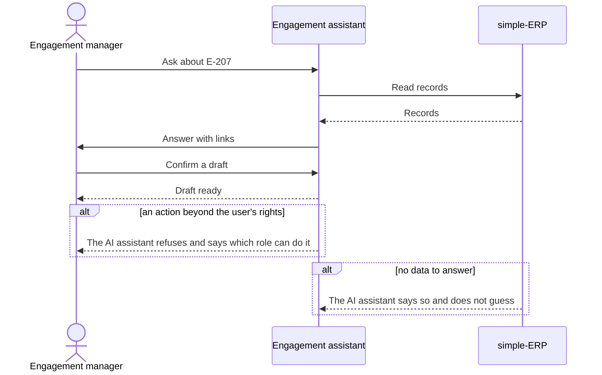

🏠 [Specs](../../../../README.md) › 🏷️ [Sectors](../../../README.md) › 💼 [SC03 Services](../../README.md) ›
📝 [Use cases](../README.md) › 📝 [Use cases: FL-SC03-03 Deliver and record](README.md) ›
📝 UC-SC03-15 Ask the AI assistant about an engagement

# 📝 UC-SC03-15 Ask the AI assistant about an engagement

**Status:** ✅ specified

## Summary

The engagement manager or a consultant asks the AI assistant about budget, who is free, missing time, or asks it to
draft a status report, within their role's rights.

## Personas

- [U24 Engagement manager](../../../../01-users/personas/u24-engagement-manager.md)
- [U16 Office worker](../../../../01-users/personas/u16-office-worker.md)

## Goal

Answers and drafts without hunting through screens.

## Trigger

A question to the AI assistant.

## Frequency

Daily.

## Preconditions

- The SC03 sector pack is installed for the company,
  [UC-F14-02](../../../../02-functional/f14-plugin-store/use-cases/01-find-and-install/uc-f14-02-install-a-plugin-or-sector-pack.md),
  and its users have their roles,
  [UC-F1-06](../../../../02-functional/f01-administration/use-cases/04-edit-a-role/uc-f01-06-edit-a-role-and-its-record-rules.md).

## Postconditions

- **Success:** the answer cites the records, or the draft is confirmed.
- **Failed:** the AI assistant says it cannot answer or act, and why.

## Main flow

1. The engagement manager asks on
   [S-SC03-15 Engagement assistant](../../screens/03-deliver-and-record/s-sc03-15-engagement-assistant.md): "Where is
   E-207's budget?",
   [UC-F3-01](../../../../02-functional/f03-assistant/use-cases/01-ask-the-assistant/uc-f03-01-ask-a-question-about-the-company-s-data.md).
2. The AI assistant reads the engagement's records within the user's rights.
3. The AI assistant answers with the consumed budget and the estimate at completion, linked.
4. The engagement manager asks for the weekly status report; the AI assistant drafts it to edit and share,
   [UC-F3-04](../../../../02-functional/f03-assistant/use-cases/04-summarise-or-draft/uc-f03-04-summarise-and-draft.md).

## Alternative flows

- 1a. A consultant asks which time is missing: the AI assistant lists the missing days.

## Error flows

- 4e. An action beyond the user's rights: the AI assistant refuses and says which role can do it.
- 2e. No data to answer: the AI assistant says so and does not guess.
- Any step: a call to a service or an outside system fails: it is retried first
  ([BR-F3-32](../../../../02-functional/f03-assistant/business-rules/br-f03-32-retry-before-an-error.md)), then the
  error message pattern ([D122](../../../../06-decisions/ux/d122-error-message-standard.md)) says what failed; what was
  typed is kept.

## Business rules

- [BR-SC03-01 Services follow the country pack](../../business-rules/br-sc03-01-services-follow-the-country-pack.md)
- [BR-F3-34 All capabilities via the AI assistant](../../../../02-functional/f03-assistant/business-rules/br-f03-34-every-capability-is-reachable-from-the-assistant.md)
- [BR-F3-07 No deletes, no irreversible acts](../../../../02-functional/f03-assistant/business-rules/br-f03-07-no-deletes-no-irreversible-acts.md)

## Entities

- [E-SC03-01 Engagement](../../data/e-sc03-01-engagement.md)
- [E-SC03-05 Timesheet](../../data/e-sc03-05-timesheet.md)

## Permissions

The engagement manager and office worker roles; the record rules of their role and site apply,
[UC-F1-06](../../../../02-functional/f01-administration/use-cases/04-edit-a-role/uc-f01-06-edit-a-role-and-its-record-rules.md).

## Notifications

None beyond the in-app updates of the records concerned.

## Audit events

Every creation, change and state change of engagement, timesheet records, with who, when and the values before and after
(T3).

## AI involvement

The AI assistant answers questions on the engagement, timesheet records of this use case, with links, and prepares them
as drafts the user confirms. It works within the user's rights,
[BR-F3-34](../../../../02-functional/f03-assistant/business-rules/br-f03-34-every-capability-is-reachable-from-the-assistant.md),
and never deletes or does anything irreversible without the user's confirmation,
[BR-F3-07](../../../../02-functional/f03-assistant/business-rules/br-f03-07-no-deletes-no-irreversible-acts.md).

## API, MCP and A2A exposure

Through the API and webhooks (T5) and the MCP and A2A gateway (T6), with the caller's rights,
[BR-F3-34](../../../../02-functional/f03-assistant/business-rules/br-f03-34-every-capability-is-reachable-from-the-assistant.md),
reading, creating and changing the records of this use case; nothing irreversible without a person's confirmation.

## Screens

- [S-SC03-15 Engagement assistant](../../screens/03-deliver-and-record/s-sc03-15-engagement-assistant.md)

## Flowchart

See [FL-SC03-03 Deliver and record](../../flows/fl-sc03-03-deliver-and-record.md#flowchart).

## Sequence diagram

## Acceptance criteria

1. **Given** the example consulting firm's E-207 with 120,000 EUR budget and 128,000 EUR estimate at completion **when**
   the manager asks where its budget is **then** the AI assistant answers 8,000 EUR over, with links.
2. **Given** S. B. with Thursday of W46 empty **when** she asks **then** the AI assistant lists the missing days.
3. **Given** a consultant asking for E-207's margin **when** he asks **then** the AI assistant refuses and says which
   role can do it.

## Non-functional notes

[D408](../../../../06-decisions/technical/d408-performance-and-profiles.md)'s targets
([performance](../../../../05-non-functional/performance.md)): 95 % of screens within 1 second; lists paged on the
server, the first page within 1 second; reports within 5 seconds or in the background. WCAG 2.2 AA and RGAA
([D46](../../../../06-decisions/ux/d46-accessibility-standard.md)).

## Regulatory references

None specific to this use case; the sector's legal rules are listed in [SC03 regulatory](../../regulatory.md).

## Related use cases

- [UC-SC03-10 Follow the engagement's budget and margin](../04-bill-and-recognise/uc-sc03-10-follow-the-engagement-s-budget-and-margin.md)

## Open questions

None.

---

⬅️ [UC-SC03-14 Bill foreign clients](../04-bill-and-recognise/uc-sc03-14-bill-foreign-clients.md) · ⬆️ [Up](README.md) ·
➡️ [UC-SC03-16](../06-staffing-agencies-and-certification/uc-sc03-16-place-temporary-workers.md)
