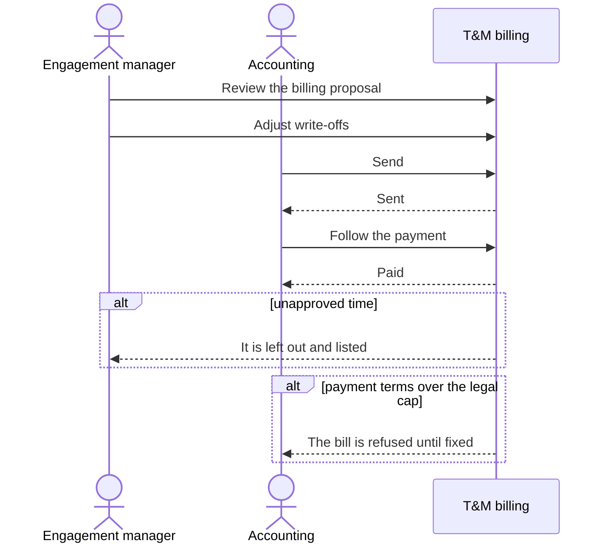

🏠 [Specs](../../../../README.md) › 🏷️ [Sectors](../../../README.md) › 💼 [SC03 Services](../../README.md) ›
📝 [Use cases](../README.md) › 📝 [Use cases: FL-SC03-04 Bill and recognise](README.md) ›
📝 UC-SC03-06 Bill time and materials

# 📝 UC-SC03-06 Bill time and materials

**Status:** ✅ specified

## Summary

Each month simple-ERP proposes the bill of a time-and-materials engagement from approved time and expenses; the
engagement manager adjusts write-offs and accounting sends it.

## Personas

- [U24 Engagement manager](../../../../01-users/personas/u24-engagement-manager.md)
- [U05 Accounting](../../../../01-users/personas/u05-accounting.md)

## Goal

Bills that match approved work, sent on time.

## Trigger

Month end.

## Frequency

Monthly per engagement.

## Preconditions

- The SC03 sector pack is installed for the company,
  [UC-F14-02](../../../../02-functional/f14-plugin-store/use-cases/01-find-and-install/uc-f14-02-install-a-plugin-or-sector-pack.md),
  and its users have their roles,
  [UC-F1-06](../../../../02-functional/f01-administration/use-cases/04-edit-a-role/uc-f01-06-edit-a-role-and-its-record-rules.md).

## Postconditions

- **Success:** the bill is sent and posted.
- **Failed:** the proposal stays open.

## Main flow

1. The engagement manager reviews the proposal on
   [S-SC03-06 T&M billing](../../screens/04-bill-and-recognise/s-sc03-06-t-m-billing.md): approved days and rebillable
   expenses ([BR-SC03-05](../../business-rules/br-sc03-05-time-approved-before-billing.md)).
2. The engagement manager writes off days with a reason.
3. Accounting sends the bill with payment terms within the cap,
   [BR-SC03-14](../../business-rules/br-sc03-14-payment-terms-in-the-law.md),
   [UC-F6-16](../../../../02-functional/f06-customers-and-sales/use-cases/05-benchmark-additions/uc-f06-16-bill-usage-commitments-and-milestones.md).
4. Accounting follows the payment and reminders,
   [UC-F6-08](../../../../02-functional/f06-customers-and-sales/use-cases/03-invoice-and-get-paid/uc-f06-08-remind-late-payers.md).

## Alternative flows

- 1a. A cap reached: the overrun is shown and not billed.

## Error flows

- 1e. Unapproved time: it is left out and listed.
- 3e. Payment terms over the legal cap: the bill is refused until fixed.
- Any step: a call to a service or an outside system fails: it is retried first
  ([BR-F3-32](../../../../02-functional/f03-assistant/business-rules/br-f03-32-retry-before-an-error.md)), then the
  error message pattern ([D122](../../../../06-decisions/ux/d122-error-message-standard.md)) says what failed; what was
  typed is kept.

## Business rules

- [BR-SC03-05 Time approved before billing](../../business-rules/br-sc03-05-time-approved-before-billing.md)
- [BR-SC03-06 Billing follows the pricing model](../../business-rules/br-sc03-06-billing-follows-the-pricing-model.md)
- [BR-SC03-14 Payment terms within the law](../../business-rules/br-sc03-14-payment-terms-in-the-law.md)

## Entities

- [E-SC03-07 Billing proposal](../../data/e-sc03-07-billing-proposal.md)

## Permissions

The engagement manager and accounting roles; the record rules of their role and site apply,
[UC-F1-06](../../../../02-functional/f01-administration/use-cases/04-edit-a-role/uc-f01-06-edit-a-role-and-its-record-rules.md).

## Notifications

None beyond the in-app updates of the records concerned.

## Audit events

Every creation, change and state change of billing proposal records, with who, when and the values before and after
(T3).

## AI involvement

The AI assistant answers questions on the billing proposal records of this use case, with links, and prepares them as
drafts the user confirms. It works within the user's rights,
[BR-F3-34](../../../../02-functional/f03-assistant/business-rules/br-f03-34-every-capability-is-reachable-from-the-assistant.md),
and never deletes or does anything irreversible without the user's confirmation,
[BR-F3-07](../../../../02-functional/f03-assistant/business-rules/br-f03-07-no-deletes-no-irreversible-acts.md).

## API, MCP and A2A exposure

Through the API and webhooks (T5) and the MCP and A2A gateway (T6), with the caller's rights,
[BR-F3-34](../../../../02-functional/f03-assistant/business-rules/br-f03-34-every-capability-is-reachable-from-the-assistant.md),
reading, creating and changing the records of this use case; nothing irreversible without a person's confirmation.

## Screens

- [S-SC03-06 T&M billing](../../screens/04-bill-and-recognise/s-sc03-06-t-m-billing.md)

## Flowchart

See [FL-SC03-04 Bill and recognise](../../flows/fl-sc03-04-bill-and-recognise.md#flowchart).

## Sequence diagram

## Acceptance criteria

1. **Given** the example consulting firm's E-207 with 18 approved days in November at 950 EUR and 1 day written off for
   rework **when** the bill is built **then** it bills 17 days, 16,150 EUR excluding VAT.
2. **Given** a capped engagement at 50 days with 52 approved **when** the proposal is built **then** the overrun is
   shown and not billed.
3. **Given** 2 days of W48 not approved **when** November is proposed **then** it is left out and listed.

## Non-functional notes

[D408](../../../../06-decisions/technical/d408-performance-and-profiles.md)'s targets
([performance](../../../../05-non-functional/performance.md)): 95 % of screens within 1 second; lists paged on the
server, the first page within 1 second; reports within 5 seconds or in the background. WCAG 2.2 AA and RGAA
([D46](../../../../06-decisions/ux/d46-accessibility-standard.md)).

## Regulatory references

Legal values from the France country pack:
[CR-FR-018 Payment terms cap](../../../../10-country-packs/france/invoicing/cr-fr-018-payment-terms-cap.md),
[CR-FR-019 Late-payment penalties](../../../../10-country-packs/france/invoicing/cr-fr-019-late-payment-penalties.md).

## Related use cases

- [UC-SC03-05 Record and approve time and expenses](../03-deliver-and-record/uc-sc03-05-record-and-approve-time-and-expenses.md)
- [UC-SC03-08 Follow work in progress and recognise revenue](uc-sc03-08-follow-work-in-progress-and-recognise-revenue.md)

## Open questions

None.

---

⬅️ [UC-SC03-05](../03-deliver-and-record/uc-sc03-05-record-and-approve-time-and-expenses.md) · ⬆️ [Up](README.md) ·
➡️ [UC-SC03-07](uc-sc03-07-bill-fixed-price-by-milestones-and-retainers.md)
