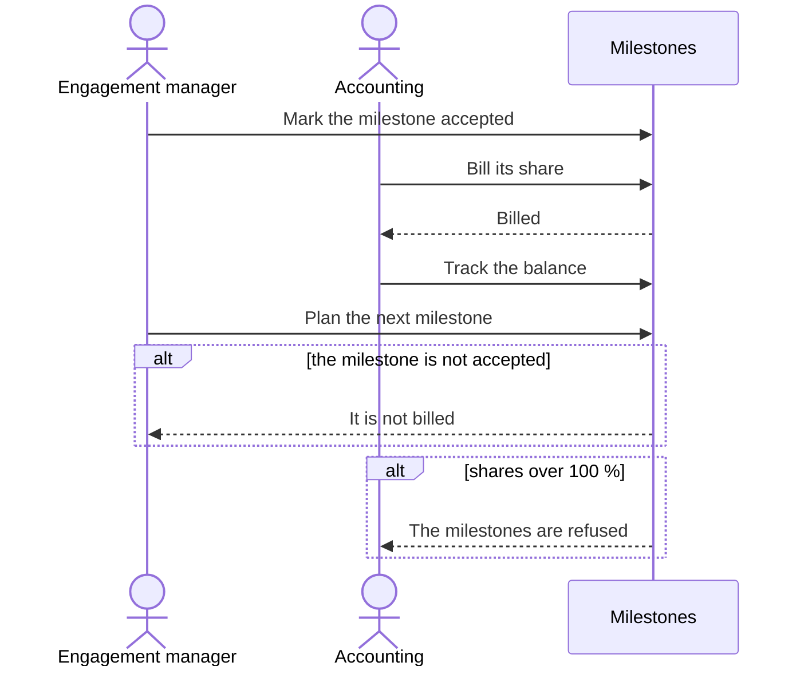

🏠 [Specs](../../../../README.md) › 🏷️ [Sectors](../../../README.md) › 💼 [SC03 Services](../../README.md) ›
📝 [Use cases](../README.md) › 📝 [Use cases: FL-SC03-04 Bill and recognise](README.md) ›
📝 UC-SC03-07 Bill fixed price by milestones and retainers

# 📝 UC-SC03-07 Bill fixed price by milestones and retainers

**Status:** ✅ specified

## Summary

The engagement manager marks a milestone accepted; its share of the fixed price is billed; retainers bill the period and
track the balance.

## Personas

- [U24 Engagement manager](../../../../01-users/personas/u24-engagement-manager.md)
- [U05 Accounting](../../../../01-users/personas/u05-accounting.md)

## Goal

Fixed-price work billed at accepted milestones, retainers billed each period.

## Trigger

A milestone accepted, or a retainer period starts.

## Frequency

At milestones; monthly for retainers.

## Preconditions

- The SC03 sector pack is installed for the company,
  [UC-F14-02](../../../../02-functional/f14-plugin-store/use-cases/01-find-and-install/uc-f14-02-install-a-plugin-or-sector-pack.md),
  and its users have their roles,
  [UC-F1-06](../../../../02-functional/f01-administration/use-cases/04-edit-a-role/uc-f01-06-edit-a-role-and-its-record-rules.md).

## Postconditions

- **Success:** the milestone or period is billed and the balance updated.
- **Failed:** nothing is billed.

## Main flow

1. The engagement manager marks the milestone accepted on
   [S-SC03-07 Milestones](../../screens/04-bill-and-recognise/s-sc03-07-milestones.md), with the client's approval from
   the portal.
2. Accounting bills the milestone's share,
   [UC-F6-16](../../../../02-functional/f06-customers-and-sales/use-cases/05-benchmark-additions/uc-f06-16-bill-usage-commitments-and-milestones.md).
3. The engagement shows billed and remaining.
4. The engagement manager sees the next milestone and the retainer's remaining days.

## Alternative flows

- 2a. A retainer drawdown: the period's fee is billed and the days used are drawn from the balance.

## Error flows

- 1e. The milestone is not accepted: it is not billed.
- 2e. Shares over 100 %: the milestones are refused.
- Any step: a call to a service or an outside system fails: it is retried first
  ([BR-F3-32](../../../../02-functional/f03-assistant/business-rules/br-f03-32-retry-before-an-error.md)), then the
  error message pattern ([D122](../../../../06-decisions/ux/d122-error-message-standard.md)) says what failed; what was
  typed is kept.

## Business rules

- [BR-SC03-06 Billing follows the pricing model](../../business-rules/br-sc03-06-billing-follows-the-pricing-model.md)

## Entities

- [E-SC03-08 Milestone](../../data/e-sc03-08-milestone.md)
- [E-SC03-07 Billing proposal](../../data/e-sc03-07-billing-proposal.md)

## Permissions

The engagement manager and accounting roles; the record rules of their role and site apply,
[UC-F1-06](../../../../02-functional/f01-administration/use-cases/04-edit-a-role/uc-f01-06-edit-a-role-and-its-record-rules.md).

## Notifications

None beyond the in-app updates of the records concerned.

## Audit events

Every creation, change and state change of milestone, billing proposal records, with who, when and the values before and
after (T3).

## AI involvement

The AI assistant answers questions on the milestone, billing proposal records of this use case, with links, and prepares
them as drafts the user confirms. It works within the user's rights,
[BR-F3-34](../../../../02-functional/f03-assistant/business-rules/br-f03-34-every-capability-is-reachable-from-the-assistant.md),
and never deletes or does anything irreversible without the user's confirmation,
[BR-F3-07](../../../../02-functional/f03-assistant/business-rules/br-f03-07-no-deletes-no-irreversible-acts.md).

## API, MCP and A2A exposure

Through the API and webhooks (T5) and the MCP and A2A gateway (T6), with the caller's rights,
[BR-F3-34](../../../../02-functional/f03-assistant/business-rules/br-f03-34-every-capability-is-reachable-from-the-assistant.md),
reading, creating and changing the records of this use case; nothing irreversible without a person's confirmation.

## Screens

- [S-SC03-07 Milestones](../../screens/04-bill-and-recognise/s-sc03-07-milestones.md)

## Flowchart

See [FL-SC03-04 Bill and recognise](../../flows/fl-sc03-04-bill-and-recognise.md#flowchart).

## Sequence diagram

## Acceptance criteria

1. **Given** the example consulting firm's E-207 at 120,000 EUR with milestone design at 30 % **when** design is
   accepted **then** 36,000 EUR is billed.
2. **Given** milestone design on E-207 waiting for the client **when** billing runs **then** it is not billed.

## Non-functional notes

[D408](../../../../06-decisions/technical/d408-performance-and-profiles.md)'s targets
([performance](../../../../05-non-functional/performance.md)): 95 % of screens within 1 second; lists paged on the
server, the first page within 1 second; reports within 5 seconds or in the background. WCAG 2.2 AA and RGAA
([D46](../../../../06-decisions/ux/d46-accessibility-standard.md)).

## Regulatory references

None specific to this use case; the sector's legal rules are listed in [SC03 regulatory](../../regulatory.md).

## Related use cases

- [UC-SC03-08 Follow work in progress and recognise revenue](uc-sc03-08-follow-work-in-progress-and-recognise-revenue.md)

## Open questions

None.

---

⬅️ [UC-SC03-06 Bill time and materials](uc-sc03-06-bill-time-and-materials.md) · ⬆️ [Up](README.md) ·
➡️ [UC-SC03-08](uc-sc03-08-follow-work-in-progress-and-recognise-revenue.md)
