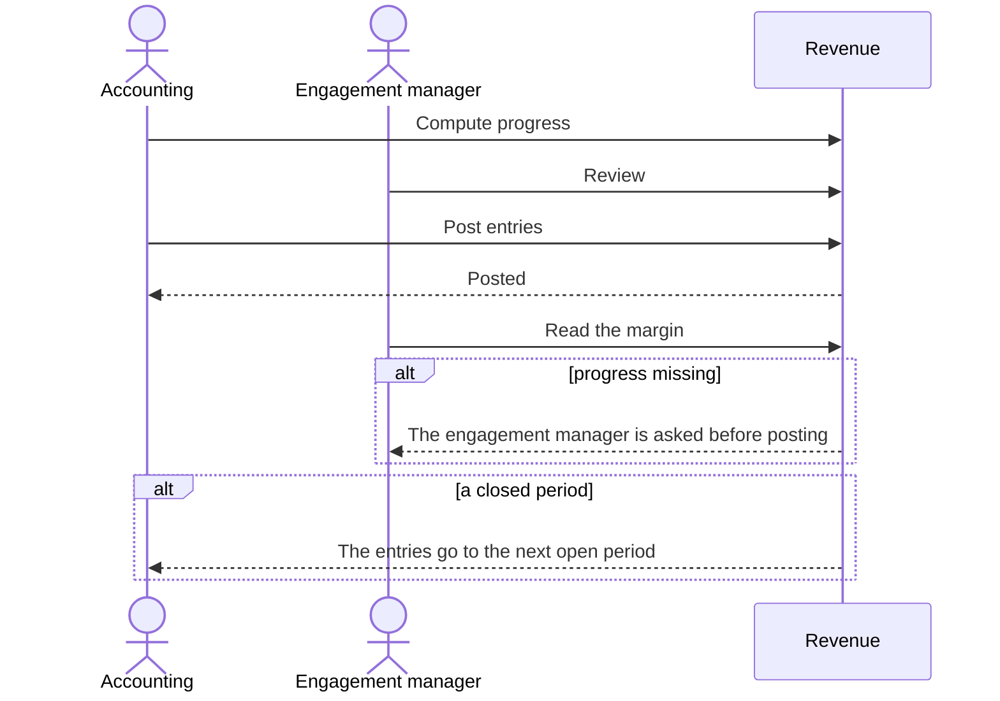

🏠 [Specs](../../../../README.md) › 🏷️ [Sectors](../../../README.md) › 💼 [SC03 Services](../../README.md) ›
📝 [Use cases](../README.md) › 📝 [Use cases: FL-SC03-04 Bill and recognise](README.md) ›
📝 UC-SC03-08 Follow work in progress and recognise revenue

# 📝 UC-SC03-08 Follow work in progress and recognise revenue

**Status:** ✅ specified

## Summary

At month end accounting computes each engagement's progress, work in progress and deferred revenue, reviews them with
the engagement manager and posts the entries.

## Personas

- [U05 Accounting](../../../../01-users/personas/u05-accounting.md)
- [U24 Engagement manager](../../../../01-users/personas/u24-engagement-manager.md)

## Goal

Revenue that follows delivery, not billing.

## Trigger

Month end.

## Frequency

Monthly.

## Preconditions

- The SC03 sector pack is installed for the company,
  [UC-F14-02](../../../../02-functional/f14-plugin-store/use-cases/01-find-and-install/uc-f14-02-install-a-plugin-or-sector-pack.md),
  and its users have their roles,
  [UC-F1-06](../../../../02-functional/f01-administration/use-cases/04-edit-a-role/uc-f01-06-edit-a-role-and-its-record-rules.md).

## Postconditions

- **Success:** the entries are posted for the month,
  [UC-F8-16](../../../../02-functional/f08-accounting/use-cases/06-benchmark-additions/uc-f08-16-recognise-revenue-under-ifrs-15.md).
- **Failed:** the month stays open for revenue.

## Main flow

1. Accounting computes progress per engagement on
   [S-SC03-08 Revenue](../../screens/04-bill-and-recognise/s-sc03-08-revenue.md)
   ([BR-SC03-07](../../business-rules/br-sc03-07-revenue-follows-delivery.md)).
2. The engagement manager confirms or corrects the progress.
3. Accounting posts work in progress and deferred revenue.
4. The engagement manager reads the recognised margin per engagement for the month
   ([UC-SC03-10](uc-sc03-10-follow-the-engagement-s-budget-and-margin.md)).

## Alternative flows

- 2a. A loss-making engagement: a provision for the whole loss is proposed.

## Error flows

- 2e. Progress missing: the engagement manager is asked before posting.
- 3e. A closed period: the entries go to the next open period.
- Any step: a call to a service or an outside system fails: it is retried first
  ([BR-F3-32](../../../../02-functional/f03-assistant/business-rules/br-f03-32-retry-before-an-error.md)), then the
  error message pattern ([D122](../../../../06-decisions/ux/d122-error-message-standard.md)) says what failed; what was
  typed is kept.

## Business rules

- [BR-SC03-07 Revenue follows delivery](../../business-rules/br-sc03-07-revenue-follows-delivery.md)
- [BR-F8-11 Revenue follows performance obligations](../../../../02-functional/f08-accounting/business-rules/br-f08-11-revenue-follows-performance-obligations.md)

## Entities

- [E-SC03-09 Revenue position](../../data/e-sc03-09-revenue-position.md)

## Permissions

The accounting and engagement manager roles; the record rules of their role and site apply,
[UC-F1-06](../../../../02-functional/f01-administration/use-cases/04-edit-a-role/uc-f01-06-edit-a-role-and-its-record-rules.md).

## Notifications

None beyond the in-app updates of the records concerned.

## Audit events

Every creation, change and state change of revenue position records, with who, when and the values before and after
(T3).

## AI involvement

The AI assistant answers questions on the revenue position records of this use case, with links, and prepares them as
drafts the user confirms. It works within the user's rights,
[BR-F3-34](../../../../02-functional/f03-assistant/business-rules/br-f03-34-every-capability-is-reachable-from-the-assistant.md),
and never deletes or does anything irreversible without the user's confirmation,
[BR-F3-07](../../../../02-functional/f03-assistant/business-rules/br-f03-07-no-deletes-no-irreversible-acts.md).

## API, MCP and A2A exposure

Through the API and webhooks (T5) and the MCP and A2A gateway (T6), with the caller's rights,
[BR-F3-34](../../../../02-functional/f03-assistant/business-rules/br-f03-34-every-capability-is-reachable-from-the-assistant.md),
reading, creating and changing the records of this use case; nothing irreversible without a person's confirmation.

## Screens

- [S-SC03-08 Revenue](../../screens/04-bill-and-recognise/s-sc03-08-revenue.md)

## Flowchart

See [FL-SC03-04 Bill and recognise](../../flows/fl-sc03-04-bill-and-recognise.md#flowchart).

## Sequence diagram

## Acceptance criteria

1. **Given** the example consulting firm's E-207 at 120,000 EUR, 60 % done and 60,000 EUR billed **when** November is
   closed **then** 12,000 EUR of work in progress is posted.
2. **Given** E-207 without November progress **when** accounting posts **then** the engagement manager is asked before
   posting.

## Non-functional notes

[D408](../../../../06-decisions/technical/d408-performance-and-profiles.md)'s targets
([performance](../../../../05-non-functional/performance.md)): 95 % of screens within 1 second; lists paged on the
server, the first page within 1 second; reports within 5 seconds or in the background. WCAG 2.2 AA and RGAA
([D46](../../../../06-decisions/ux/d46-accessibility-standard.md)).

## Regulatory references

None specific to this use case; the sector's legal rules are listed in [SC03 regulatory](../../regulatory.md).

## Related use cases

- [UC-SC03-07 Bill fixed price by milestones and retainers](uc-sc03-07-bill-fixed-price-by-milestones-and-retainers.md)

## Open questions

None.

---

⬅️ [UC-SC03-07](uc-sc03-07-bill-fixed-price-by-milestones-and-retainers.md) · ⬆️ [Up](README.md) ·
➡️ [UC-SC03-09](../03-deliver-and-record/uc-sc03-09-engage-freelancers-and-subcontractors.md)
