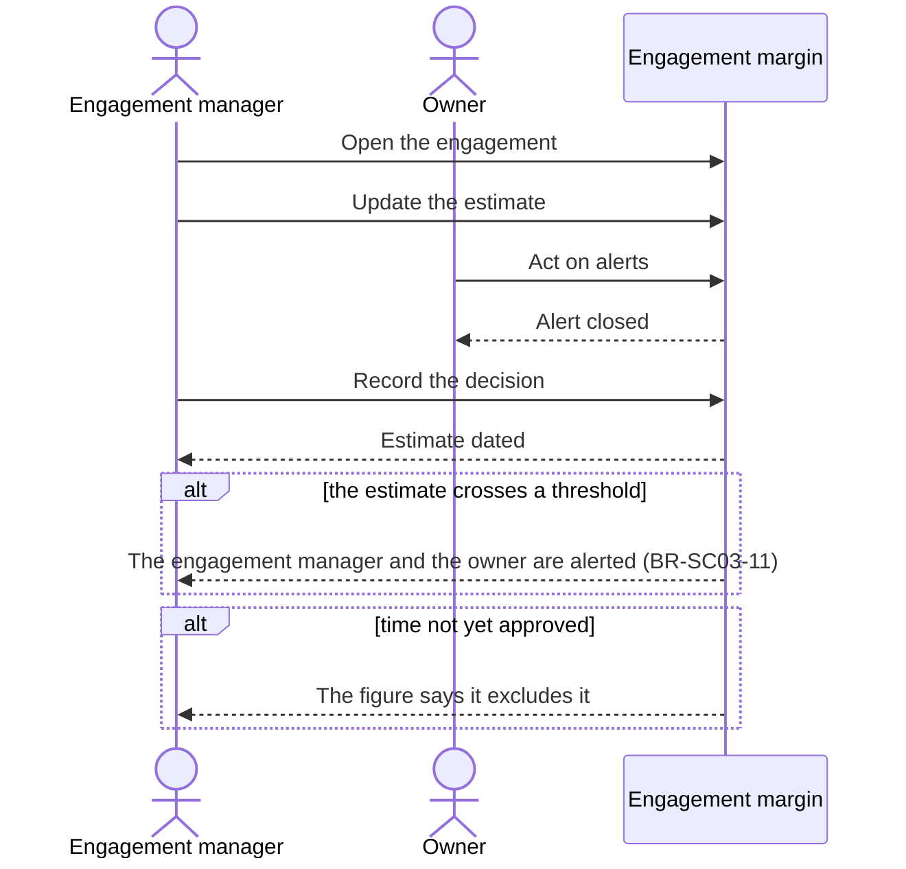

🏠 [Specs](../../../../README.md) › 🏷️ [Sectors](../../../README.md) › 💼 [SC03 Services](../../README.md) ›
📝 [Use cases](../README.md) › 📝 [Use cases: FL-SC03-04 Bill and recognise](README.md) ›
📝 UC-SC03-10 Follow the engagement's budget and margin

# 📝 UC-SC03-10 Follow the engagement's budget and margin

**Status:** ✅ specified

## Summary

The engagement manager and the owner follow budget, consumed, estimate at completion and margin, and act on alerts.

## Personas

- [U24 Engagement manager](../../../../01-users/personas/u24-engagement-manager.md)
- [U13 Owner](../../../../01-users/personas/u13-owner.md)

## Goal

No engagement loses money unnoticed.

## Trigger

Weekly review, or an alert.

## Frequency

Weekly.

## Preconditions

- The SC03 sector pack is installed for the company,
  [UC-F14-02](../../../../02-functional/f14-plugin-store/use-cases/01-find-and-install/uc-f14-02-install-a-plugin-or-sector-pack.md),
  and its users have their roles,
  [UC-F1-06](../../../../02-functional/f01-administration/use-cases/04-edit-a-role/uc-f01-06-edit-a-role-and-its-record-rules.md).

## Postconditions

- **Success:** the estimate is updated and alerts handled.
- **Failed:** the last estimate stays with its date.

## Main flow

1. The engagement manager opens
   [S-SC03-10 Engagement margin](../../screens/04-bill-and-recognise/s-sc03-10-engagement-margin.md): budget, consumed,
   estimate at completion, margin.
2. The engagement manager updates the remaining days.
3. The owner acts on alerts: a change request, a staffing change,
   [UC-F8-20](../../../../02-functional/f08-accounting/use-cases/06-benchmark-additions/uc-f08-20-analyse-profitability.md).
4. The engagement manager records the decision and the new estimate's date.

## Alternative flows

- 3a. A change request: the signed change raises the budget
  ([UC-SC03-01](../01-win-and-price/uc-sc03-01-win-an-engagement-and-write-its-statement-of-work.md)).

## Error flows

- 2e. The estimate crosses a threshold: the engagement manager and the owner are alerted
  ([BR-SC03-11](../../business-rules/br-sc03-11-budget-alerts.md)).
- 1e. Time not yet approved: the figure says it excludes it.
- Any step: a call to a service or an outside system fails: it is retried first
  ([BR-F3-32](../../../../02-functional/f03-assistant/business-rules/br-f03-32-retry-before-an-error.md)), then the
  error message pattern ([D122](../../../../06-decisions/ux/d122-error-message-standard.md)) says what failed; what was
  typed is kept.

## Business rules

- [BR-SC03-11 Budget alerts](../../business-rules/br-sc03-11-budget-alerts.md)

## Entities

- [E-SC03-01 Engagement](../../data/e-sc03-01-engagement.md)

## Permissions

The engagement manager and owner roles; the record rules of their role and site apply,
[UC-F1-06](../../../../02-functional/f01-administration/use-cases/04-edit-a-role/uc-f01-06-edit-a-role-and-its-record-rules.md).

## Notifications

None beyond the in-app updates of the records concerned.

## Audit events

Every creation, change and state change of engagement records, with who, when and the values before and after (T3).

## AI involvement

The AI assistant answers questions on the engagement records of this use case, with links, and prepares them as drafts
the user confirms. It works within the user's rights,
[BR-F3-34](../../../../02-functional/f03-assistant/business-rules/br-f03-34-every-capability-is-reachable-from-the-assistant.md),
and never deletes or does anything irreversible without the user's confirmation,
[BR-F3-07](../../../../02-functional/f03-assistant/business-rules/br-f03-07-no-deletes-no-irreversible-acts.md).

## API, MCP and A2A exposure

Through the API and webhooks (T5) and the MCP and A2A gateway (T6), with the caller's rights,
[BR-F3-34](../../../../02-functional/f03-assistant/business-rules/br-f03-34-every-capability-is-reachable-from-the-assistant.md),
reading, creating and changing the records of this use case; nothing irreversible without a person's confirmation.

## Screens

- [S-SC03-10 Engagement margin](../../screens/04-bill-and-recognise/s-sc03-10-engagement-margin.md)

## Flowchart

See [FL-SC03-04 Bill and recognise](../../flows/fl-sc03-04-bill-and-recognise.md#flowchart).

## Sequence diagram

## Acceptance criteria

1. **Given** the example consulting firm's E-207 with a 100 % threshold **when** its estimate reaches 128,000 EUR for
   120,000 EUR **then** the manager and the owner are alerted.
2. **Given** E-207's estimate at 128,000 EUR for a 120,000 EUR budget **when** the estimate is saved **then** the
   engagement manager and the owner are alerted ([BR-SC03-11](../../business-rules/br-sc03-11-budget-alerts.md)).

## Non-functional notes

[D408](../../../../06-decisions/technical/d408-performance-and-profiles.md)'s targets
([performance](../../../../05-non-functional/performance.md)): 95 % of screens within 1 second; lists paged on the
server, the first page within 1 second; reports within 5 seconds or in the background. WCAG 2.2 AA and RGAA
([D46](../../../../06-decisions/ux/d46-accessibility-standard.md)).

## Regulatory references

None specific to this use case; the sector's legal rules are listed in [SC03 regulatory](../../regulatory.md).

## Related use cases

- [UC-SC03-08 Follow work in progress and recognise revenue](uc-sc03-08-follow-work-in-progress-and-recognise-revenue.md)

## Open questions

None.

---

⬅️ [UC-SC03-09](../03-deliver-and-record/uc-sc03-09-engage-freelancers-and-subcontractors.md) · ⬆️ [Up](README.md) ·
➡️ [UC-SC03-11](../05-client-and-people/uc-sc03-11-share-with-the-client-in-the-portal.md)
