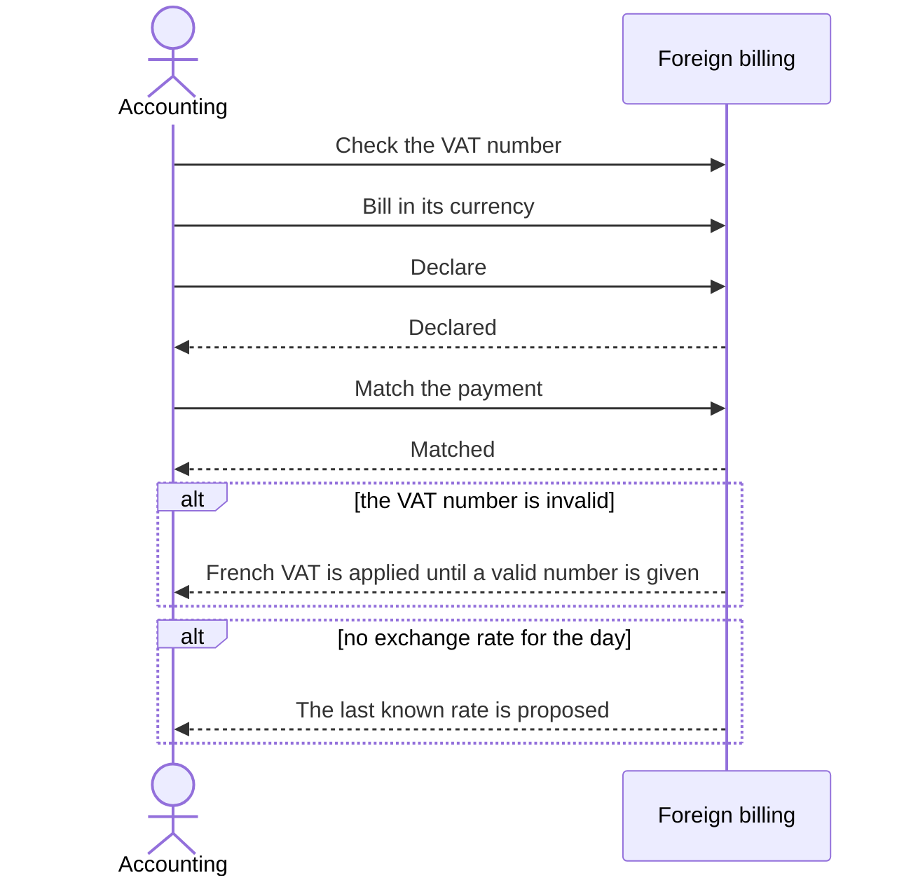

🏠 [Specs](../../../../README.md) › 🏷️ [Sectors](../../../README.md) › 💼 [SC03 Services](../../README.md) ›
📝 [Use cases](../README.md) › 📝 [Use cases: FL-SC03-04 Bill and recognise](README.md) ›
📝 UC-SC03-14 Bill foreign clients

# 📝 UC-SC03-14 Bill foreign clients

**Status:** ✅ specified

## Summary

Accounting checks a foreign client's VAT number, bills in its currency with the place-of-supply rules and mentions, and
declares the services in the European statement.

## Personas

- [U05 Accounting](../../../../01-users/personas/u05-accounting.md)
- [U24 Engagement manager](../../../../01-users/personas/u24-engagement-manager.md)

## Goal

Correct VAT and mentions on every foreign bill.

## Trigger

A bill to a client abroad.

## Frequency

Monthly per foreign client.

## Preconditions

- The SC03 sector pack is installed for the company,
  [UC-F14-02](../../../../02-functional/f14-plugin-store/use-cases/01-find-and-install/uc-f14-02-install-a-plugin-or-sector-pack.md),
  and its users have their roles,
  [UC-F1-06](../../../../02-functional/f01-administration/use-cases/04-edit-a-role/uc-f01-06-edit-a-role-and-its-record-rules.md).

## Postconditions

- **Success:** the bill is sent with the right VAT and mentions and declared.
- **Failed:** the bill is held.

## Main flow

1. Accounting checks the client's VAT number on
   [S-SC03-14 Foreign billing](../../screens/04-bill-and-recognise/s-sc03-14-foreign-billing.md) through the EU service
   (T12).
2. Accounting bills in the client's currency with the reverse-charge mention
   ([BR-SC03-10](../../business-rules/br-sc03-10-vat-follows-the-client-country.md)).
3. The bill goes to the European services statement,
   [UC-F8-07](../../../../02-functional/f08-accounting/use-cases/04-tax-assets-and-analytics/uc-f08-07-manage-vat-and-file-returns.md).
4. The foreign payment is matched with its exchange difference posted,
   [UC-F8-06](../../../../02-functional/f08-accounting/use-cases/03-bank-and-collect/uc-f08-06-connect-banks-and-reconcile.md).

## Alternative flows

- 2a. A client outside the EU: no VAT and no European statement; the mention says why.

## Error flows

- 1e. The VAT number is invalid: French VAT is applied until a valid number is given.
- 2e. No exchange rate for the day: the last known rate is proposed.
- Any step: a call to a service or an outside system fails: it is retried first
  ([BR-F3-32](../../../../02-functional/f03-assistant/business-rules/br-f03-32-retry-before-an-error.md)), then the
  error message pattern ([D122](../../../../06-decisions/ux/d122-error-message-standard.md)) says what failed; what was
  typed is kept.

## Business rules

- [BR-SC03-10 VAT follows the client's country](../../business-rules/br-sc03-10-vat-follows-the-client-country.md)

## Entities

- [E-SC03-07 Billing proposal](../../data/e-sc03-07-billing-proposal.md)

## Permissions

The accounting and engagement manager roles; the record rules of their role and site apply,
[UC-F1-06](../../../../02-functional/f01-administration/use-cases/04-edit-a-role/uc-f01-06-edit-a-role-and-its-record-rules.md).

## Notifications

None beyond the in-app updates of the records concerned.

## Audit events

Every creation, change and state change of billing proposal records, with who, when and the values before and after
(T3).

## AI involvement

The AI assistant answers questions on the billing proposal records of this use case, with links, and prepares them as
drafts the user confirms. It works within the user's rights,
[BR-F3-34](../../../../02-functional/f03-assistant/business-rules/br-f03-34-every-capability-is-reachable-from-the-assistant.md),
and never deletes or does anything irreversible without the user's confirmation,
[BR-F3-07](../../../../02-functional/f03-assistant/business-rules/br-f03-07-no-deletes-no-irreversible-acts.md).

## API, MCP and A2A exposure

Through the API and webhooks (T5) and the MCP and A2A gateway (T6), with the caller's rights,
[BR-F3-34](../../../../02-functional/f03-assistant/business-rules/br-f03-34-every-capability-is-reachable-from-the-assistant.md),
reading, creating and changing the records of this use case; nothing irreversible without a person's confirmation.

## Screens

- [S-SC03-14 Foreign billing](../../screens/04-bill-and-recognise/s-sc03-14-foreign-billing.md)

## Flowchart

See [FL-SC03-04 Bill and recognise](../../flows/fl-sc03-04-bill-and-recognise.md#flowchart).

## Sequence diagram

## Acceptance criteria

1. **Given** the example consulting firm's German client with a valid VAT number **when** it is billed 9,500 EUR
   **then** the bill has no VAT, the reverse-charge mention, and goes to the European statement.
2. **Given** a German client with an invalid VAT number **when** the bill is built **then** French VAT is applied until
   a valid number is given.

## Non-functional notes

[D408](../../../../06-decisions/technical/d408-performance-and-profiles.md)'s targets
([performance](../../../../05-non-functional/performance.md)): 95 % of screens within 1 second; lists paged on the
server, the first page within 1 second; reports within 5 seconds or in the background. WCAG 2.2 AA and RGAA
([D46](../../../../06-decisions/ux/d46-accessibility-standard.md)).

## Regulatory references

Legal values from the France country pack:
[CR-FR-100 VAT on services to clients abroad](../../../../10-country-packs/france/tax-and-vat/cr-fr-100-vat-on-services-abroad.md).

## Related use cases

- [UC-SC03-06 Bill time and materials](uc-sc03-06-bill-time-and-materials.md)

## Open questions

None.

---

⬅️ [UC-SC03-13](../05-client-and-people/uc-sc03-13-manage-consultants-skills-and-certifications.md) ·
⬆️ [Up](README.md) · ➡️ [UC-SC03-15](../03-deliver-and-record/uc-sc03-15-ask-the-assistant-about-an-engagement.md)
