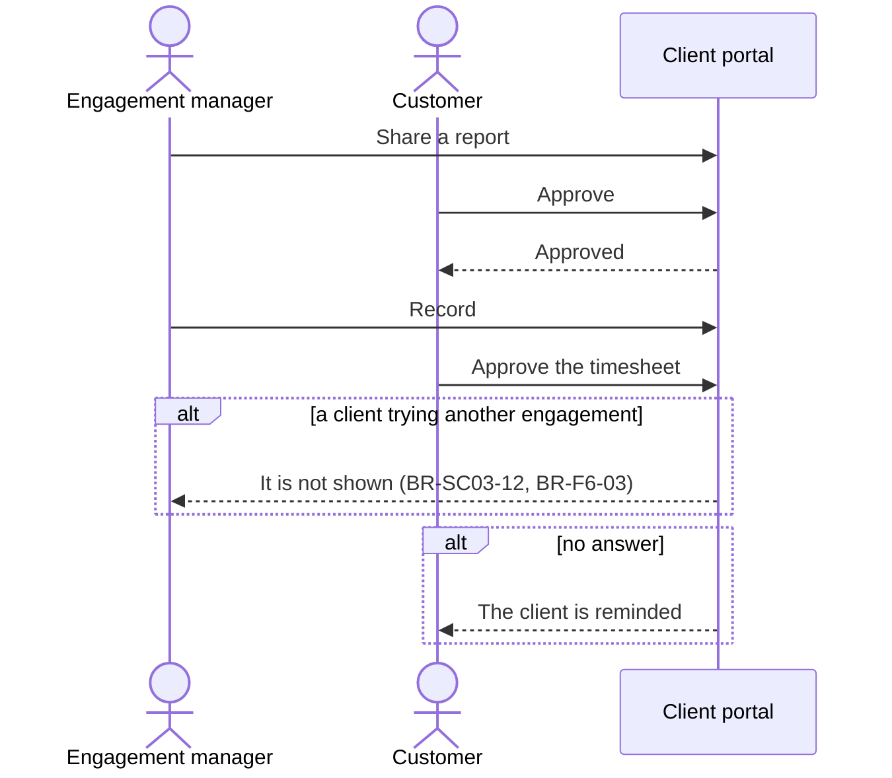

🏠 [Specs](../../../../README.md) › 🏷️ [Sectors](../../../README.md) › 💼 [SC03 Services](../../README.md) ›
📝 [Use cases](../README.md) › 📝 [Use cases: FL-SC03-05 Client and people](README.md) ›
📝 UC-SC03-11 Share with the client in the portal

# 📝 UC-SC03-11 Share with the client in the portal

**Status:** 🔄 waiting for the owner

## Summary

The engagement manager shares reports and deliverables with the client in the portal; the client approves deliverables
and timesheets; it is recorded on the engagement.

## Personas

- [U09 Customer](../../../../01-users/personas/u09-customer.md)
- [U24 Engagement manager](../../../../01-users/personas/u24-engagement-manager.md)

## Goal

Approvals proved, without emails back and forth.

## Trigger

A report or deliverable to share.

## Frequency

Weekly per engagement.

## Preconditions

- The SC03 sector pack is installed for the company,
  [UC-F14-02](../../../../02-functional/f14-plugin-store/use-cases/01-find-and-install/uc-f14-02-install-a-plugin-or-sector-pack.md),
  and its users have their roles,
  [UC-F1-06](../../../../02-functional/f01-administration/use-cases/04-edit-a-role/uc-f01-06-edit-a-role-and-its-record-rules.md).

## Postconditions

- **Success:** the item is shared and approved, and recorded.
- **Failed:** the item waits for the client.

## Main flow

1. The engagement manager shares a report on
   [S-SC03-11 Client portal](../../screens/05-client-and-people/s-sc03-11-client-portal.md),
   [UC-F9-31](../../../../02-functional/f09-hr-and-projects/use-cases/11-capacity-rounds-and-partners/uc-f09-31-follow-a-project-as-a-customer.md).
2. The client reads and approves or comments.
3. The approval is recorded on the engagement and can trigger a milestone
   ([UC-SC03-07](../04-bill-and-recognise/uc-sc03-07-bill-fixed-price-by-milestones-and-retainers.md)).
4. When asked, the client approves the consultants' week too
   ([UC-SC03-05](../03-deliver-and-record/uc-sc03-05-record-and-approve-time-and-expenses.md)).

## Alternative flows

- 2a. Comments on a deliverable: the comment goes back to the engagement manager.

## Error flows

- 1e. A client trying another engagement: it is not shown,
  [BR-SC03-12](../../business-rules/br-sc03-12-client-sees-only-their-engagements.md),
  [BR-F6-03](../../../../02-functional/f06-customers-and-sales/business-rules/br-f06-03-portal-shows-only-the-customer-s-own.md).
- 2e. No answer: the client is reminded ((Proposed) after 5 working days).
- Any step: a call to a service or an outside system fails: it is retried first
  ([BR-F3-32](../../../../02-functional/f03-assistant/business-rules/br-f03-32-retry-before-an-error.md)), then the
  error message pattern ([D122](../../../../06-decisions/ux/d122-error-message-standard.md)) says what failed; what was
  typed is kept.

## Business rules

- [BR-SC03-12 Clients see only their engagements](../../business-rules/br-sc03-12-client-sees-only-their-engagements.md)
- [BR-F6-03 The portal shows only the customer's own](../../../../02-functional/f06-customers-and-sales/business-rules/br-f06-03-portal-shows-only-the-customer-s-own.md)

## Entities

- [E-SC03-12 Shared item](../../data/e-sc03-12-shared-item.md)

## Permissions

The customer and engagement manager roles; the record rules of their role and site apply,
[UC-F1-06](../../../../02-functional/f01-administration/use-cases/04-edit-a-role/uc-f01-06-edit-a-role-and-its-record-rules.md).

## Notifications

None beyond the in-app updates of the records concerned.

## Audit events

Every creation, change and state change of shared item records, with who, when and the values before and after (T3).

## AI involvement

The AI assistant answers questions on the shared item records of this use case, with links, and prepares them as drafts
the user confirms. It works within the user's rights,
[BR-F3-34](../../../../02-functional/f03-assistant/business-rules/br-f03-34-every-capability-is-reachable-from-the-assistant.md),
and never deletes or does anything irreversible without the user's confirmation,
[BR-F3-07](../../../../02-functional/f03-assistant/business-rules/br-f03-07-no-deletes-no-irreversible-acts.md).

## API, MCP and A2A exposure

Through the API and webhooks (T5) and the MCP and A2A gateway (T6), with the caller's rights,
[BR-F3-34](../../../../02-functional/f03-assistant/business-rules/br-f03-34-every-capability-is-reachable-from-the-assistant.md),
reading, creating and changing the records of this use case; nothing irreversible without a person's confirmation.

## Screens

- [S-SC03-11 Client portal](../../screens/05-client-and-people/s-sc03-11-client-portal.md)

## Flowchart

See [FL-SC03-05 Client and people](../../flows/fl-sc03-05-client-and-people.md#flowchart).

## Sequence diagram

## Acceptance criteria

1. **Given** the example consulting firm's report on E-207 shared with Acme **when** Acme approves **then** E-207 shows
   the report approved.
2. **Given** Acme's user **when** he opens another client's engagement **then** it is not shown,
   [BR-SC03-12](../../business-rules/br-sc03-12-client-sees-only-their-engagements.md),
   [BR-F6-03](../../../../02-functional/f06-customers-and-sales/business-rules/br-f06-03-portal-shows-only-the-customer-s-own.md).

## Non-functional notes

[D408](../../../../06-decisions/technical/d408-performance-and-profiles.md)'s targets
([performance](../../../../05-non-functional/performance.md)): 95 % of screens within 1 second; lists paged on the
server, the first page within 1 second; reports within 5 seconds or in the background. WCAG 2.2 AA and RGAA
([D46](../../../../06-decisions/ux/d46-accessibility-standard.md)).

## Regulatory references

None specific to this use case; the sector's legal rules are listed in [SC03 regulatory](../../regulatory.md).

## Related use cases

- [UC-SC03-07 Bill fixed price by milestones and retainers](../04-bill-and-recognise/uc-sc03-07-bill-fixed-price-by-milestones-and-retainers.md)
- [UC-SC03-12 Measure client satisfaction](uc-sc03-12-measure-client-satisfaction.md)

## Open questions

None open; the items marked (Proposed) wait for the owner in the [waiting list](../../../../09-waiting/README.md).

---

⬅️ [UC-SC03-10](../04-bill-and-recognise/uc-sc03-10-follow-the-engagement-s-budget-and-margin.md) · ⬆️ [Up](README.md) ·
➡️ [UC-SC03-12 Measure client satisfaction](uc-sc03-12-measure-client-satisfaction.md)
