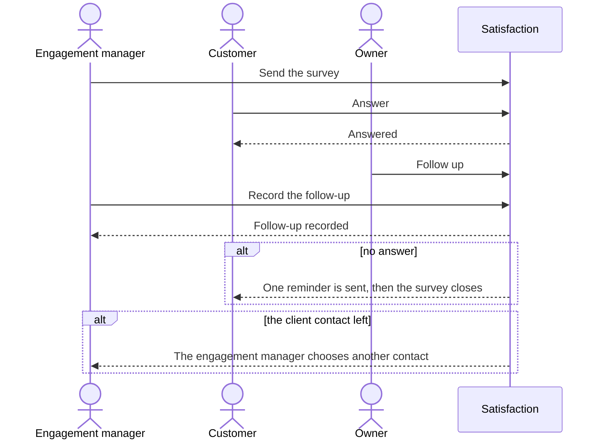

🏠 [Specs](../../../../README.md) › 🏷️ [Sectors](../../../README.md) › 💼 [SC03 Services](../../README.md) ›
📝 [Use cases](../README.md) › 📝 [Use cases: FL-SC03-05 Client and people](README.md) ›
📝 UC-SC03-12 Measure client satisfaction

# 📝 UC-SC03-12 Measure client satisfaction

**Status:** ✅ specified

## Summary

The engagement manager sends a survey at milestones and closing; the owner reads the answers and follows up.

## Personas

- [U24 Engagement manager](../../../../01-users/personas/u24-engagement-manager.md)
- [U13 Owner](../../../../01-users/personas/u13-owner.md)
- [U09 Customer](../../../../01-users/personas/u09-customer.md)

## Goal

Know how clients feel, and act on it.

## Trigger

A milestone or the closing of an engagement.

## Frequency

At each milestone.

## Preconditions

- The SC03 sector pack is installed for the company,
  [UC-F14-02](../../../../02-functional/f14-plugin-store/use-cases/01-find-and-install/uc-f14-02-install-a-plugin-or-sector-pack.md),
  and its users have their roles,
  [UC-F1-06](../../../../02-functional/f01-administration/use-cases/04-edit-a-role/uc-f01-06-edit-a-role-and-its-record-rules.md).

## Postconditions

- **Success:** answers are recorded and follow-ups done.
- **Failed:** the survey is closed without answer.

## Main flow

1. The engagement manager sends the survey on
   [S-SC03-12 Satisfaction](../../screens/05-client-and-people/s-sc03-12-satisfaction.md),
   [UC-F5-12](../../../../02-functional/f05-social-media/use-cases/08-pages-forms-surveys-and-whatsapp/uc-f05-12-run-surveys-and-live-polls.md).
2. The client answers.
3. The owner reads the score and follows up a low one.
4. The engagement manager records the follow-up action on the engagement.

## Alternative flows

- 1a. A recurring survey for retainers: it is sent each quarter.

## Error flows

- 2e. No answer: one reminder is sent, then the survey closes.
- 1e. The client contact left: the engagement manager chooses another contact.
- Any step: a call to a service or an outside system fails: it is retried first
  ([BR-F3-32](../../../../02-functional/f03-assistant/business-rules/br-f03-32-retry-before-an-error.md)), then the
  error message pattern ([D122](../../../../06-decisions/ux/d122-error-message-standard.md)) says what failed; what was
  typed is kept.

## Business rules

- [BR-SC03-12 Clients see only their engagements](../../business-rules/br-sc03-12-client-sees-only-their-engagements.md)

## Entities

- [E-SC03-13 Satisfaction survey](../../data/e-sc03-13-satisfaction-survey.md)

## Permissions

The engagement manager, owner and customer roles; the record rules of their role and site apply,
[UC-F1-06](../../../../02-functional/f01-administration/use-cases/04-edit-a-role/uc-f01-06-edit-a-role-and-its-record-rules.md).

## Notifications

None beyond the in-app updates of the records concerned.

## Audit events

Every creation, change and state change of satisfaction survey records, with who, when and the values before and after
(T3).

## AI involvement

The AI assistant answers questions on the satisfaction survey records of this use case, with links, and prepares them as
drafts the user confirms. It works within the user's rights,
[BR-F3-34](../../../../02-functional/f03-assistant/business-rules/br-f03-34-every-capability-is-reachable-from-the-assistant.md),
and never deletes or does anything irreversible without the user's confirmation,
[BR-F3-07](../../../../02-functional/f03-assistant/business-rules/br-f03-07-no-deletes-no-irreversible-acts.md).

## API, MCP and A2A exposure

Through the API and webhooks (T5) and the MCP and A2A gateway (T6), with the caller's rights,
[BR-F3-34](../../../../02-functional/f03-assistant/business-rules/br-f03-34-every-capability-is-reachable-from-the-assistant.md),
reading, creating and changing the records of this use case; nothing irreversible without a person's confirmation.

## Screens

- [S-SC03-12 Satisfaction](../../screens/05-client-and-people/s-sc03-12-satisfaction.md)

## Flowchart

See [FL-SC03-05 Client and people](../../flows/fl-sc03-05-client-and-people.md#flowchart).

## Sequence diagram

## Acceptance criteria

1. **Given** the example consulting firm's survey on E-207 answered with 9 and "clear reports" **when** the owner opens
   it **then** the score and comment show on E-207.
2. **Given** the E-207 survey sent on 12 November **when** no answer by the reminder date **then** one reminder is sent,
   then the survey closes.

## Non-functional notes

[D408](../../../../06-decisions/technical/d408-performance-and-profiles.md)'s targets
([performance](../../../../05-non-functional/performance.md)): 95 % of screens within 1 second; lists paged on the
server, the first page within 1 second; reports within 5 seconds or in the background. WCAG 2.2 AA and RGAA
([D46](../../../../06-decisions/ux/d46-accessibility-standard.md)).

## Regulatory references

None specific to this use case; the sector's legal rules are listed in [SC03 regulatory](../../regulatory.md).

## Related use cases

- [UC-SC03-11 Share with the client in the portal](uc-sc03-11-share-with-the-client-in-the-portal.md)

## Open questions

None.

---

⬅️ [UC-SC03-11 Share with the client in the portal](uc-sc03-11-share-with-the-client-in-the-portal.md) ·
⬆️ [Up](README.md) · ➡️ [UC-SC03-13](uc-sc03-13-manage-consultants-skills-and-certifications.md)
