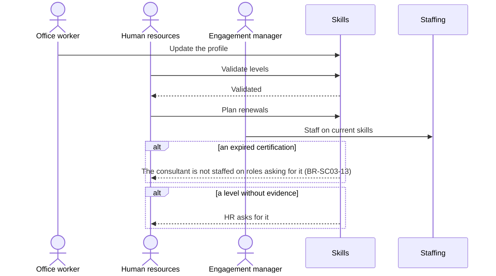

🏠 [Specs](../../../../README.md) › 🏷️ [Sectors](../../../README.md) › 💼 [SC03 Services](../../README.md) ›
📝 [Use cases](../README.md) › 📝 [Use cases: FL-SC03-05 Client and people](README.md) ›
📝 UC-SC03-13 Manage consultants' skills and certifications

# 📝 UC-SC03-13 Manage consultants' skills and certifications

**Status:** ✅ specified

## Summary

Consultants update their skills; HR validates levels and plans the renewal of certifications so that staffing uses only
current ones.

## Personas

- [U16 Office worker](../../../../01-users/personas/u16-office-worker.md)
- [U06 Human resources](../../../../01-users/personas/u06-hr.md)
- [U24 Engagement manager](../../../../01-users/personas/u24-engagement-manager.md)

## Goal

Staffing on current, validated skills.

## Trigger

A new skill, a certification, or an expiry.

## Frequency

Quarterly per consultant.

## Preconditions

- The SC03 sector pack is installed for the company,
  [UC-F14-02](../../../../02-functional/f14-plugin-store/use-cases/01-find-and-install/uc-f14-02-install-a-plugin-or-sector-pack.md),
  and its users have their roles,
  [UC-F1-06](../../../../02-functional/f01-administration/use-cases/04-edit-a-role/uc-f01-06-edit-a-role-and-its-record-rules.md).

## Postconditions

- **Success:** levels are validated and renewals planned.
- **Failed:** the skill stays unvalidated and is not used for staffing.

## Main flow

1. The consultant updates skills and certifications on
   [S-SC03-13 Skills](../../screens/05-client-and-people/s-sc03-13-skills.md).
2. HR validates levels,
   [UC-F9-11](../../../../02-functional/f09-hr-and-projects/use-cases/04-grow/uc-f09-11-run-appraisals-and-track-skills.md).
3. HR plans renewals before expiry,
   [UC-F9-25](../../../../02-functional/f09-hr-and-projects/use-cases/09-train-and-protect/uc-f09-25-run-the-training-plan-with-opco-funding.md).
4. The staffing search uses only validated, current skills
   ([UC-SC03-03](../02-staff-and-plan/uc-sc03-03-staff-the-engagement.md)).

## Alternative flows

- 1a. Skills from past engagements: the AI assistant proposes skills from the roles held.

## Error flows

- 3e. An expired certification: the consultant is not staffed on roles asking for it
  ([BR-SC03-13](../../business-rules/br-sc03-13-skills-kept-current.md)).
- 2e. A level without evidence: HR asks for it.
- Any step: a call to a service or an outside system fails: it is retried first
  ([BR-F3-32](../../../../02-functional/f03-assistant/business-rules/br-f03-32-retry-before-an-error.md)), then the
  error message pattern ([D122](../../../../06-decisions/ux/d122-error-message-standard.md)) says what failed; what was
  typed is kept.

## Business rules

- [BR-SC03-13 Skills kept current](../../business-rules/br-sc03-13-skills-kept-current.md)

## Entities

- [E-SC03-11 Skill](../../data/e-sc03-11-skill.md)

## Permissions

The office worker, human resources and engagement manager roles; the record rules of their role and site apply,
[UC-F1-06](../../../../02-functional/f01-administration/use-cases/04-edit-a-role/uc-f01-06-edit-a-role-and-its-record-rules.md).

## Notifications

None beyond the in-app updates of the records concerned.

## Audit events

Every creation, change and state change of skill records, with who, when and the values before and after (T3).

## AI involvement

The AI assistant answers questions on the skill records of this use case, with links, and prepares them as drafts the
user confirms. It works within the user's rights,
[BR-F3-34](../../../../02-functional/f03-assistant/business-rules/br-f03-34-every-capability-is-reachable-from-the-assistant.md),
and never deletes or does anything irreversible without the user's confirmation,
[BR-F3-07](../../../../02-functional/f03-assistant/business-rules/br-f03-07-no-deletes-no-irreversible-acts.md).

## API, MCP and A2A exposure

Through the API and webhooks (T5) and the MCP and A2A gateway (T6), with the caller's rights,
[BR-F3-34](../../../../02-functional/f03-assistant/business-rules/br-f03-34-every-capability-is-reachable-from-the-assistant.md),
reading, creating and changing the records of this use case; nothing irreversible without a person's confirmation.

## Screens

- [S-SC03-13 Skills](../../screens/05-client-and-people/s-sc03-13-skills.md)
- [S-SC03-03 Staffing](../../screens/02-staff-and-plan/s-sc03-03-staffing.md)

## Flowchart

See [FL-SC03-05 Client and people](../../flows/fl-sc03-05-client-and-people.md#flowchart).

## Sequence diagram

## Acceptance criteria

1. **Given** the example consulting firm's S. B., cloud architecture level 4 until 2027-06-30 **when** HR plans renewals
   **then** a renewal is planned before 2027-06-30.
2. **Given** S. B.'s cloud certification ending 2027-06-30 **when** it is 2027-07-01 **then** the consultant is not
   staffed on roles asking for it ([BR-SC03-13](../../business-rules/br-sc03-13-skills-kept-current.md)).

## Non-functional notes

[D408](../../../../06-decisions/technical/d408-performance-and-profiles.md)'s targets
([performance](../../../../05-non-functional/performance.md)): 95 % of screens within 1 second; lists paged on the
server, the first page within 1 second; reports within 5 seconds or in the background. WCAG 2.2 AA and RGAA
([D46](../../../../06-decisions/ux/d46-accessibility-standard.md)).

## Regulatory references

None specific to this use case; the sector's legal rules are listed in [SC03 regulatory](../../regulatory.md).

## Related use cases

- [UC-SC03-03 Staff the engagement](../02-staff-and-plan/uc-sc03-03-staff-the-engagement.md)

## Open questions

None.

---

⬅️ [UC-SC03-12 Measure client satisfaction](uc-sc03-12-measure-client-satisfaction.md) · ⬆️ [Up](README.md) ·
➡️ [UC-SC03-14 Bill foreign clients](../04-bill-and-recognise/uc-sc03-14-bill-foreign-clients.md)
