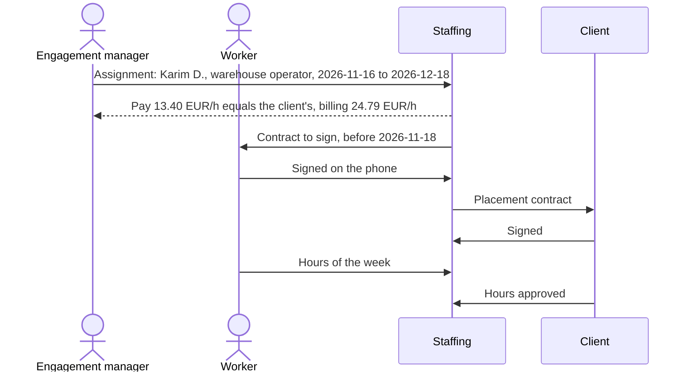

🏠 [Specs](../../../../README.md) › 🏷️ [Sectors](../../../README.md) › 💼 [SC03 Services](../../README.md) ›
📝 [Use cases](../README.md) ›
📝 [Use cases: FL-SC03-06 Staffing, agencies, certification and tender library](README.md) ›
📝 UC-SC03-16 Place temporary workers

# 📝 UC-SC03-16 Place temporary workers

**Status:** 🔄 waiting for the owner

## Summary

A staffing agency places temporary workers with client companies. For each assignment the agency holds two contracts:
the worker's assignment contract and the placement contract with the client. The engagement manager prepares both, the
worker signs on the phone, and the worker's contract must be signed within two working days of the start. The hours
worked feed the worker's pay and the client's invoice.

## Personas

- [U24 Engagement manager](../../../../01-users/personas/u24-engagement-manager.md)
- [U14 Field worker](../../../../01-users/personas/u14-field-worker.md)

## Goal

Every temporary worker starts under a written contract signed in time, paid at least what the client's own employees in
the same job are paid, and every hour is billed to the right client.

## Trigger

A client asks for a worker, a candidate is placed, or an assignment is extended or ends.

## Frequency

Dozens of assignments a week in an agency; each lasts a few days to several months.

## Preconditions

- The worker is an employee record
  ([E-F9-01](../../../../02-functional/f09-hr-and-projects/data/e-f09-01-employee-record.md)) with a valid identity and
  right to work.
- The client company is a customer
  ([E-F6-01](../../../../02-functional/f06-customers-and-sales/data/e-f06-01-customer-record.md)) with its job's pay
  scale for the same position.

## Postconditions

- **Succeeded:** the assignment contract is saved
  ([E-SC03-17 Assignment contract](../../data/e-sc03-17-assignment-contract.md)) signed by the worker and by the client;
  the hours feed pay and billing.
- **Failed:** the contract stays Draft, Sent or Overdue; the worker is not paid as placed and the client is not invoiced
  until it is signed.

## Main flow

1. The engagement manager opens the staffing assignments screen
   ([S-SC03-16](../../screens/06-staffing-agencies-and-certification/s-sc03-16-staffing-assignments.md)) and creates an
   assignment for a worker and a client: the reason for use, the dates, the job and the pay.
2. SimpleERP checks the pay against the client's pay for the same job and the legal minimum, and computes the billing
   rate from the agency's coefficient.
3. The contract and the placement are sent: the worker receives theirs on the phone and the client theirs by email, and
   the deadline to sign is set
   ([BR-SC03-16](../../business-rules/br-sc03-16-assignment-contracts-are-signed-in-two-working-days.md)).
4. The worker signs on the phone; the client signs the placement; the assignment becomes Signed.
5. The worker declares hours on the phone each week
   [UC-F9-16](../../../../02-functional/f09-hr-and-projects/use-cases/03-time/uc-f09-16-record-and-validate-timesheets.md);
   the client approves them.
6. At the end, the end-of-assignment papers and indemnities are prepared
   ([UC-F13-15](../../../../02-functional/f13-payroll/use-cases/04-events/uc-f13-15-end-a-contract.md)) and the contract
   is Ended.

## Alternative flows

- 4a. The assignment is extended or renewed: an amendment is created and the total length is checked against the legal
  maximum for the reason.
- 5a. The client does not approve the hours: they go back to the worker with the reason and the invoice waits.
- 2a. The client's pay for the same job is higher than the planned pay: the pay is raised to the client's level and the
  billing rate follows.

## Error flows

- 3e. The worker's contract is not signed on the second working day after the start: the contract becomes Overdue, the
  engagement manager is alerted and the risk is shown.
- 2e. The pay is below the client's pay for the same job: the contract cannot be sent until it is corrected.
- 4e. The renewal would exceed the legal maximum length for the reason: the amendment is refused and the limit is shown.
- Any step: a service does not answer; the call is retried first
  ([BR-F3-32](../../../../02-functional/f03-assistant/business-rules/br-f03-32-retry-before-an-error.md)), then the
  message follows the error pattern ([D122](../../../../06-decisions/ux/d122-error-message-standard.md)) and what the
  user typed stays on the screen.

## Business rules

- [BR-SC03-16](../../business-rules/br-sc03-16-assignment-contracts-are-signed-in-two-working-days.md)
- [BR-SC03-14](../../business-rules/br-sc03-14-payment-terms-in-the-law.md)

## Entities

- [E-SC03-17 Assignment contract](../../data/e-sc03-17-assignment-contract.md): created, changed
- [E-SC03-04 Staffing assignment](../../data/e-sc03-04-staffing-assignment.md): read, the staffing of the client's need
- [E-F9-02 Contract](../../../../02-functional/f09-hr-and-projects/data/e-f09-02-contract.md): created, the worker's
  contract record
- [E-F13-02](../../../../02-functional/f13-payroll/data/e-f13-02-employee-pay-profile.md): read, the pay profile

## Permissions

Engagement manager creates and follows assignments; the worker signs and declares hours on the phone. The
client sees their own placements and approves hours through the portal.

## Notifications

The worker, by SMS and in the app: contract to sign, hours to declare. The engagement manager: a contract is Overdue, an
assignment ends in 3 days.

## Audit events

Each contract created, sent, signed or overdue with its date and time; each pay and rate check; each renewal; who and
when.

## AI involvement

No AI step of its own. The AI assistant may open the screen and prefill it from the user's words; the user checks and
confirms
[BR-F3-07](../../../../02-functional/f03-assistant/business-rules/br-f03-07-no-deletes-no-irreversible-acts.md).

## API, MCP and A2A exposure

T5 operations of the capability for the personas above: create, read, update and list. The MCP tool of the
capability may read and propose, never confirm alone. No A2A skill.

## Screens

- [S-SC03-16](../../screens/06-staffing-agencies-and-certification/s-sc03-16-staffing-assignments.md)

## Flowchart

See
[FL-SC03-06 Staffing, agencies, certification and tender library](../../flows/fl-sc03-06-staffing-agencies-and-certification.md#flowchart).

## Sequence diagram

## Acceptance criteria

1. **Given** an assignment starting Monday 2026-11-16 **when** the contract is sent **then** the deadline to sign is
   Wednesday 2026-11-18.
2. **Given** a contract not signed by the end of 2026-11-18 **when** the deadline passes **then** the contract becomes
   Overdue and the engagement manager is alerted.
3. **Given** a client paying 13.40 EUR/h for the job and a planned pay of 12.90 EUR/h **when** the engagement manager
   sends the contract **then** it is refused until the pay is at least 13.40 EUR/h.
4. **Given** a pay of 13.40 EUR/h and a coefficient of 1.85 **when** the billing rate is computed **then** it is 24.79
   EUR/h.

## Non-functional notes

The screen answers within 2 seconds for 10,000 records; every change is audited.

## Regulatory references

A temporary-work agency employs the worker and places them with a client: the worker's contract is written,
states the reason for use, the job, the pay and the end, and is handed over within two working days of the start; the
pay is at least that of a client's employee in the same job; the reasons for use and the total length are limited by
law; indemnities are due at the end. The France-pack rule is listed below. Related:
[CR-FR-041](../../../../10-country-packs/france/labour/cr-fr-041-fixed-term-contracts.md),
[CR-FR-098](../../../../10-country-packs/france/labour/cr-fr-098-lawful-staff-lending.md),
[CR-FR-037](../../../../10-country-packs/france/labour/cr-fr-037-dpae-before-the-first-day.md),
[CR-FR-186](../../../../10-country-packs/france/payroll/cr-fr-186-end-of-contract-documents.md),
[CR-FR-185](../../../../10-country-packs/france/payroll/cr-fr-185-minimum-wage.md).

- France-pack rule, (Proposed) until its law is read:
  [CR-FR-229 Temporary-work assignment contracts](../../../../10-country-packs/france/labour/cr-fr-229-temporary-work-contracts.md)

## Related use cases

- [UC-SC03-17](uc-sc03-17-get-creative-work-approved-and-rebill-media.md)
- [UC-SC03-03 Staff the engagement](../02-staff-and-plan/uc-sc03-03-staff-the-engagement.md)
- [UC-SC03-09](../03-deliver-and-record/uc-sc03-09-engage-freelancers-and-subcontractors.md)

## Open questions

None.

---

⬅️ [UC-SC03-15](../03-deliver-and-record/uc-sc03-15-ask-the-assistant-about-an-engagement.md) · ⬆️ [Up](README.md) ·
➡️ [UC-SC03-17 Get creative work approved and rebill media](uc-sc03-17-get-creative-work-approved-and-rebill-media.md)
