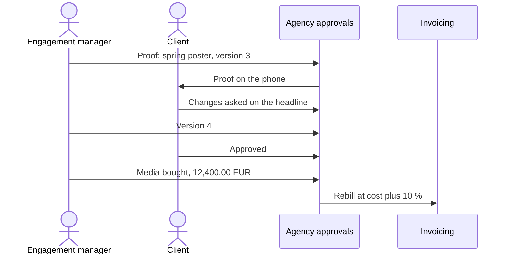

🏠 [Specs](../../../../README.md) › 🏷️ [Sectors](../../../README.md) › 💼 [SC03 Services](../../README.md) ›
📝 [Use cases](../README.md) ›
📝 [Use cases: FL-SC03-06 Staffing, agencies, certification and tender library](README.md) ›
📝 UC-SC03-17 Get creative work approved and rebill media

# 📝 UC-SC03-17 Get creative work approved and rebill media

**Status:** 🔄 waiting for the owner

## Summary

A marketing agency gets its creative work approved by the client, version by version, and rebills the media it buys for
the client at cost plus the agreed fee. The engagement manager sends a proof; the client approves or asks for changes
from the phone; nothing is produced or bought before the approval; the media invoice shows the cost and the fee apart.

## Personas

- [U24 Engagement manager](../../../../01-users/personas/u24-engagement-manager.md)
- [U09 Customer](../../../../01-users/personas/u09-customer.md)

## Goal

Every creative piece goes out only with the client's recorded approval, and every media purchase is rebilled at its real
cost plus the fee agreed, with nothing hidden.

## Trigger

A designer finishes a version, a client answers a proof, or the agency buys media for a campaign.

## Frequency

Several proofs a week per campaign; media bought and rebilled monthly.

## Preconditions

- The engagement and its statement of work exist ([E-SC03-01 Engagement](../../data/e-sc03-01-engagement.md),
  [E-SC03-02 Statement of work](../../data/e-sc03-02-statement-of-work.md)).
- The statement of work states the media fee (a percentage) for the engagement.

## Postconditions

- **Succeeded:** the proof is saved ([E-SC03-18 Creative proof](../../data/e-sc03-18-creative-proof.md)) with its
  approval; the media cost is recorded as a rebillable cost
  ([E-SC03-06 Rebillable cost](../../data/e-sc03-06-rebillable-cost.md)) and invoiced at cost plus fee.
- **Failed:** the proof stays Sent or Revising, nothing is produced or bought, and the media cost is not invoiced.

## Main flow

1. The engagement manager opens the agency approvals screen
   ([S-SC03-17](../../screens/06-staffing-agencies-and-certification/s-sc03-17-agency-approvals.md)) and uploads a proof
   for a deliverable (a poster, a film, a campaign page).
2. The client receives the proof on the phone, reads it and approves it, or asks for changes with comments on the image.
3. Each answer creates a new version or the approval; only an approved proof can be sent to production or to the media
   ([BR-SC03-17](../../business-rules/br-sc03-17-media-are-rebilled-at-cost-plus-the-agreed-fee.md)).
4. The agency buys the media (space, slots, ads) for the approved campaign and records each purchase with its supplier
   invoice
   [UC-F7-04](../../../../02-functional/f07-purchasing-and-stock/use-cases/01-procure/uc-f07-04-capture-and-match-supplier-invoices.md).
5. simple-ERP rebills each media purchase to the client at its cost plus the fee of the statement of work
   ([UC-SC03-06](../04-bill-and-recognise/uc-sc03-06-bill-time-and-materials.md)).
6. The client sees the proofs, their approvals and the media invoice with its cost lines in the portal
   ([UC-SC03-11](../05-client-and-people/uc-sc03-11-share-with-the-client-in-the-portal.md)).

## Alternative flows

- 2a. Several people at the client must approve: each answer is recorded and the proof is Approved only when all have
  answered.
- 4a. The media is bought for several clients in a package: the cost is split by the shares agreed and each share is
  rebilled.
- 5a. A media cost is later credited by the supplier: the credit is passed on to the client in the next invoice.

## Error flows

- 3e. Someone tries to send a proof to production before its approval: the action is blocked with the missing approval.
- 5e. A media purchase has no supplier invoice: it cannot be rebilled until the invoice is attached.
- 2e. The client has not answered within the time of the statement of work: the engagement manager is reminded and the
  schedule is flagged.
- Any step: a service does not answer; the call is retried first
  ([BR-F3-32](../../../../02-functional/f03-assistant/business-rules/br-f03-32-retry-before-an-error.md)), then the
  message follows the error pattern ([D122](../../../../06-decisions/ux/d122-error-message-standard.md)) and what the
  user typed stays on the screen.

## Business rules

- [BR-SC03-17](../../business-rules/br-sc03-17-media-are-rebilled-at-cost-plus-the-agreed-fee.md)
- [BR-SC03-05](../../business-rules/br-sc03-05-time-approved-before-billing.md)
- [BR-SC03-06](../../business-rules/br-sc03-06-billing-follows-the-pricing-model.md)

## Entities

- [E-SC03-18 Creative proof](../../data/e-sc03-18-creative-proof.md): created, changed
- [E-SC03-06 Rebillable cost](../../data/e-sc03-06-rebillable-cost.md): created, the media cost to rebill
- [E-SC03-02 Statement of work](../../data/e-sc03-02-statement-of-work.md): read, the fee and the deliverables
- [E-SC03-12 Shared item](../../data/e-sc03-12-shared-item.md): created, the proof shared with the client

## Permissions

Engagement manager sends proofs and rebills media; the client approves or asks for changes through the portal.
The client sees only their own proofs and media costs.

## Notifications

The client, by email and on the phone: a proof waits for an answer. The engagement manager: an answer arrived, an
approval is late.

## Audit events

Each proof version, each approval or request for changes with who, when and the text; each media cost and the fee
applied.

## AI involvement

No AI step of its own. The AI assistant may open the screen and prefill it from the user's words; the user checks and
confirms
[BR-F3-07](../../../../02-functional/f03-assistant/business-rules/br-f03-07-no-deletes-no-irreversible-acts.md).

## API, MCP and A2A exposure

T5 operations of the capability for the personas above: create, read, update and list. The MCP tool of the
capability may read and propose, never confirm alone. No A2A skill.

## Screens

- [S-SC03-17](../../screens/06-staffing-agencies-and-certification/s-sc03-17-agency-approvals.md)

## Flowchart

See
[FL-SC03-06 Staffing, agencies, certification and tender library](../../flows/fl-sc03-06-staffing-agencies-and-certification.md#flowchart).

## Sequence diagram

## Acceptance criteria

1. **Given** a proof in Sent **when** someone sends it to production **then** the action is blocked until the proof is
   Approved.
2. **Given** a proof where the client asks for changes **when** the designer uploads version 4 **then** the proof
   returns to Sent as version 4 and version 3 stays in the history.
3. **Given** a media purchase of 12,400.00 EUR and a fee of 10 % **when** it is rebilled **then** the invoice shows
   12,400.00 EUR of cost, 1,240.00 EUR of fee and 13,640.00 EUR in total.
4. **Given** a media purchase with no supplier invoice **when** the engagement manager tries to rebill it **then** it is
   refused until the invoice is attached.

## Non-functional notes

The screen answers within 2 seconds for 10,000 records; every change is audited.

## Regulatory references

An agency that buys advertising space for a client acts with a written mandate and the media purchase is
shown to the client with its real price and the agency's fee apart. This duty is not in the France-pack waiting list
yet; it is written when its law is read. Related:
[CR-FR-198](../../../../10-country-packs/france/consumer/cr-fr-198-comparative-advertising.md).

- France-pack rule, (Proposed) until its law is read:
  [CR-FR-254 Advertising agent mandate and media prices](../../../../10-country-packs/france/professional-firms/cr-fr-254-advertising-agent-mandate.md)

## Related use cases

- [UC-SC03-16 Place temporary workers](uc-sc03-16-place-temporary-workers.md)
- [UC-SC03-18 Run certification audits](uc-sc03-18-run-certification-audits.md)
- [UC-SC03-06](../04-bill-and-recognise/uc-sc03-06-bill-time-and-materials.md)
- [UC-SC03-11](../05-client-and-people/uc-sc03-11-share-with-the-client-in-the-portal.md)

## Open questions

None.

---

⬅️ [UC-SC03-16 Place temporary workers](uc-sc03-16-place-temporary-workers.md) · ⬆️ [Up](README.md) ·
➡️ [UC-SC03-18 Run certification audits](uc-sc03-18-run-certification-audits.md)
