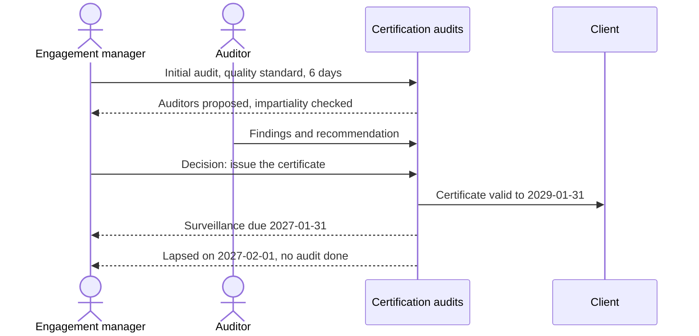

🏠 [Specs](../../../../README.md) › 🏷️ [Sectors](../../../README.md) › 💼 [SC03 Services](../../README.md) ›
📝 [Use cases](../README.md) ›
📝 [Use cases: FL-SC03-06 Staffing, agencies, certification and tender library](README.md) ›
📝 UC-SC03-18 Run certification audits

# 📝 UC-SC03-18 Run certification audits

**Status:** 🔄 waiting for the owner

## Summary

A certification body audits its clients and issues certificates. The engagement manager plans the initial audit, assigns
qualified auditors, and after a positive decision issues the certificate. The certificate lives three years with a
surveillance audit each year; a certificate whose surveillance audit is not done by its due date lapses.

## Personas

- [U24 Engagement manager](../../../../01-users/personas/u24-engagement-manager.md)
- [U36 Professional](../../../../01-users/personas/u36-professional.md)

## Goal

Every certificate is backed by an audit done by a qualified, impartial auditor, and no certificate stays valid without
its surveillance audit.

## Trigger

A client asks for certification, a surveillance audit comes due, or an audit finds a nonconformity.

## Frequency

A few audits a week in a certification body; one certificate per client and standard.

## Preconditions

- The client is a customer with a signed statement of work
  ([E-SC03-02 Statement of work](../../data/e-sc03-02-statement-of-work.md)).
- The auditors' qualifications are recorded ([E-SC03-11 Skill](../../data/e-sc03-11-skill.md)) with the standards they
  may audit.

## Postconditions

- **Succeeded:** the certificate is saved ([E-SC03-19 Certificate](../../data/e-sc03-19-certificate.md)) with its scope,
  validity and next surveillance date; its audits are billed as time
  ([UC-SC03-06](../04-bill-and-recognise/uc-sc03-06-bill-time-and-materials.md)).
- **Failed:** no certificate is issued or the existing one lapses; the reason is recorded.

## Main flow

1. The engagement manager opens the certification audits screen
   ([S-SC03-18](../../screens/06-staffing-agencies-and-certification/s-sc03-18-certification-audits.md)) and plans the
   initial audit for a client and a standard: days, dates and auditors.
2. simple-ERP proposes auditors who hold the qualification for the standard and checks that none has advised the client
   in the recent past.
3. The auditor, on their desktop, records the findings, the nonconformities and the recommendation
   [UC-F9-11](../../../../02-functional/f09-hr-and-projects/use-cases/04-grow/uc-f09-11-run-appraisals-and-track-skills.md).
4. The engagement manager takes the certification decision; on a positive decision the certificate is issued for three
   years with its yearly surveillance dates.
5. Each surveillance audit is planned and done before its due date; the certificate stays Issued.
6. Without the surveillance audit by its due date the certificate lapses and the client is told
   ([BR-SC03-18](../../business-rules/br-sc03-18-certificates-lapse-without-their-surveillance-audit.md)).

## Alternative flows

- 4a. A major nonconformity is found: the decision waits for the client's corrective action and a follow-up visit.
- 6a. A lapsed certificate can return to Issued after a catch-up audit passes.
- 3a. A client asks to extend the scope: the audit days are recomputed and the scope updated on the certificate.

## Error flows

- 2e. The only qualified auditor advised the client: the audit cannot be assigned to them and the impartiality reason is
  shown.
- 4e. The audit report is incomplete: no decision can be taken until it is.
- 6e. A surveillance audit is moved past its due date by the client: the client is warned that the certificate will
  lapse on the due date.
- Any step: a service does not answer; the call is retried first
  ([BR-F3-32](../../../../02-functional/f03-assistant/business-rules/br-f03-32-retry-before-an-error.md)), then the
  message follows the error pattern ([D122](../../../../06-decisions/ux/d122-error-message-standard.md)) and what the
  user typed stays on the screen.

## Business rules

- [BR-SC03-18](../../business-rules/br-sc03-18-certificates-lapse-without-their-surveillance-audit.md)
- [BR-SC03-13 Skills kept current](../../business-rules/br-sc03-13-skills-kept-current.md)

## Entities

- [E-SC03-19 Certificate](../../data/e-sc03-19-certificate.md): created, changed
- [E-SC03-11 Skill](../../data/e-sc03-11-skill.md): read, the auditors' qualifications
- [E-SC03-01 Engagement](../../data/e-sc03-01-engagement.md): read, the engagement of the audit
- [E-SC03-04 Staffing assignment](../../data/e-sc03-04-staffing-assignment.md): created, the auditors' staffing

## Permissions

Engagement manager plans audits and decides; the auditor (professional) records findings. The client sees
their own certificate and audits through the portal.

## Notifications

The client, by email: the audit date, the decision, the surveillance due in 60 days, the lapse. The engagement manager:
a certificate lapses in 30 days without its audit.

## Audit events

Each audit planned, done and decided; each certificate issued, lapsed, caught up or withdrawn; each impartiality check;
who and when.

## AI involvement

No AI step of its own. The AI assistant may open the screen and prefill it from the user's words; the user checks and
confirms
[BR-F3-07](../../../../02-functional/f03-assistant/business-rules/br-f03-07-no-deletes-no-irreversible-acts.md).

## API, MCP and A2A exposure

T5 operations of the capability for the personas above: create, read, update and list. The MCP tool of the
capability may read and propose, never confirm alone. No A2A skill.

## Screens

- [S-SC03-18](../../screens/06-staffing-agencies-and-certification/s-sc03-18-certification-audits.md)

## Flowchart

See
[FL-SC03-06 Staffing, agencies, certification and tender library](../../flows/fl-sc03-06-staffing-agencies-and-certification.md#flowchart).

## Sequence diagram

## Acceptance criteria

1. **Given** a certificate issued on 2026-02-01 for three years **when** it is saved **then** it is valid to 2029-01-31
   with a surveillance audit due on 2027-01-31.
2. **Given** a surveillance audit not done by 2027-01-31 **when** the day after the due date comes **then** the
   certificate becomes Lapsed and the client is told.
3. **Given** a lapsed certificate and a catch-up audit that passes **when** the decision is taken **then** the
   certificate returns to Issued.
4. **Given** the only qualified auditor advised the client last year **when** the audit is assigned **then** the
   assignment is refused with the impartiality reason.

## Non-functional notes

The screen answers within 2 seconds for 10,000 records; every change is audited.

## Regulatory references

A certification body works under an accreditation that requires qualified and impartial auditors, a decision
separate from the audit, and a surveillance programme between certifications. This is not in the France-pack waiting
list yet; it is written when its law is read.

- France-pack rule, (Proposed) until its law is read:
  [CR-FR-255 Certification body accreditation](../../../../10-country-packs/france/professional-firms/cr-fr-255-certification-accreditation.md)

## Related use cases

- [UC-SC03-17](uc-sc03-17-get-creative-work-approved-and-rebill-media.md)
- [UC-SC03-19](uc-sc03-19-answer-a-tender-from-the-answer-library.md)
- [UC-SC03-13](../05-client-and-people/uc-sc03-13-manage-consultants-skills-and-certifications.md)
- [UC-SC03-03 Staff the engagement](../02-staff-and-plan/uc-sc03-03-staff-the-engagement.md)

## Open questions

None.

---

⬅️ [UC-SC03-17 Get creative work approved and rebill media](uc-sc03-17-get-creative-work-approved-and-rebill-media.md) ·
⬆️ [Up](README.md) ·
➡️ [UC-SC03-19 Answer a tender from the answer library](uc-sc03-19-answer-a-tender-from-the-answer-library.md)
