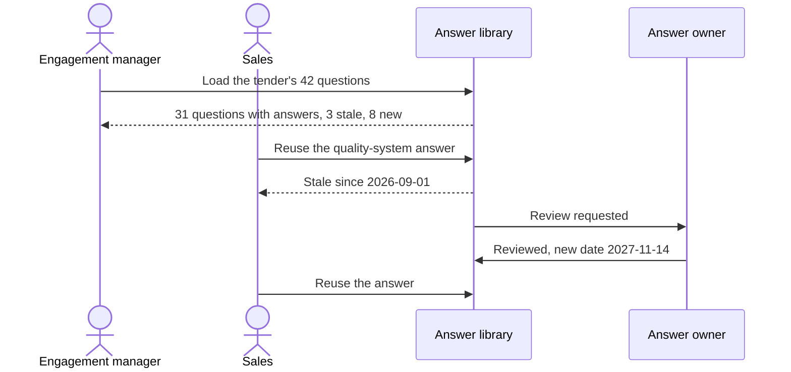

🏠 [Specs](../../../../README.md) › 🏷️ [Sectors](../../../README.md) › 💼 [SC03 Services](../../README.md) ›
📝 [Use cases](../README.md) ›
📝 [Use cases: FL-SC03-06 Staffing, agencies, certification and tender library](README.md) ›
📝 UC-SC03-19 Answer a tender from the answer library

# 📝 UC-SC03-19 Answer a tender from the answer library

**Status:** ✅ specified

## Summary

A services firm answers tenders from a library of approved answers: standard texts on its method, its references, its
quality system, its security. The engagement manager and sales search the library, reuse an answer in a tender and adapt
it; every answer carries its owner and its review date, and an answer past its review date is not reused without a
review.

## Personas

- [U24 Engagement manager](../../../../01-users/personas/u24-engagement-manager.md)
- [U03 Sales](../../../../01-users/personas/u03-sales.md)

## Goal

A tender is answered faster with texts that are correct, current and approved, and out-of-date answers are never sent by
mistake.

## Trigger

A tender or a request for proposal arrives, or an answer's review date comes.

## Frequency

A tender a week in a firm that answers many; a review of each answer once a year.

## Preconditions

- The library holds approved answers with their tags ([E-SC03-20 Answer](../../data/e-sc03-20-answer.md)).
- The tender is an opportunity or an engagement being won
  ([UC-SC03-01](../01-win-and-price/uc-sc03-01-win-an-engagement-and-write-its-statement-of-work.md)).

## Postconditions

- **Succeeded:** the tender's answers are drafted from the library; each reused answer keeps its link to the library
  text, its version and its review date.
- **Failed:** no stale answer is reused; the questions without an answer are listed for a person to write.

## Main flow

1. The engagement manager opens the answer library screen
   ([S-SC03-19](../../screens/06-staffing-agencies-and-certification/s-sc03-19-answer-library.md)) and loads the
   tender's questions.
2. simple-ERP proposes, for each question, the best-matching answers of the library, with their owner, language and
   review date; the AI assistant may rank them and the user decides.
3. The engagement manager or sales picks an answer and adapts it; the adapted text is kept in the tender and linked to
   the library text.
4. An answer past its review date is shown as Stale and cannot be reused until its owner reviews it
   ([BR-SC03-19](../../business-rules/br-sc03-19-library-answers-carry-their-review-date.md)).
5. The owner reviews an answer: they update it or confirm it, and a new review date is set.
6. When the tender is won or lost, the answers that helped are marked and the library is improved.

## Alternative flows

- 2a. No answer matches a question: it is listed as new; once written and approved, it can be added to the library.
- 4a. The owner has left the firm: the answer goes to the engagement manager to reassign.
- 3a. The tender asks for the answer in another language: the library shows the languages available.

## Error flows

- 4e. A Stale answer is added to a tender: the action is refused with the review date.
- 2e. The tender's file is unreadable: the questions are entered by hand.
- 5e. A review lapses with no owner: the answer is Retired after the second missed review.
- Any step: a service does not answer; the call is retried first
  ([BR-F3-32](../../../../02-functional/f03-assistant/business-rules/br-f03-32-retry-before-an-error.md)), then the
  message follows the error pattern ([D122](../../../../06-decisions/ux/d122-error-message-standard.md)) and what the
  user typed stays on the screen.

## Business rules

- [BR-SC03-19](../../business-rules/br-sc03-19-library-answers-carry-their-review-date.md)
- [BR-SC03-02](../../business-rules/br-sc03-02-work-only-under-a-signed-statement.md)

## Entities

- [E-SC03-20 Answer](../../data/e-sc03-20-answer.md): created, changed
- [E-SC03-02 Statement of work](../../data/e-sc03-02-statement-of-work.md): read, the statement of work the tender may
  become
- [E-SC03-01 Engagement](../../data/e-sc03-01-engagement.md): read, the engagement the tender belongs to

## Permissions

Engagement manager and sales read and reuse approved answers; an answer's owner edits and reviews it. Answers
marked confidential are hidden from users outside the engagement.

## Notifications

The owner of an answer, in the app: the review is due in 30 days. The engagement manager: a stale answer is in a tender
in progress.

## Audit events

Each answer created, edited, reviewed, reused and retired, with who and when and the tender it was used in.

## AI involvement

No AI step of its own. The AI assistant may open the screen and prefill it from the user's words; the user checks and
confirms
[BR-F3-07](../../../../02-functional/f03-assistant/business-rules/br-f03-07-no-deletes-no-irreversible-acts.md).

## API, MCP and A2A exposure

T5 operations of the capability for the personas above: create, read, update and list. The MCP tool of the
capability may read and propose, never confirm alone. No A2A skill.

## Screens

- [S-SC03-19](../../screens/06-staffing-agencies-and-certification/s-sc03-19-answer-library.md)

## Flowchart

See
[FL-SC03-06 Staffing, agencies, certification and tender library](../../flows/fl-sc03-06-staffing-agencies-and-certification.md#flowchart).

## Sequence diagram

## Acceptance criteria

1. **Given** an answer reviewed on 2026-03-01 with a review every 12 months **when** the date 2027-03-02 comes **then**
   the answer becomes Stale.
2. **Given** a Stale answer **when** sales adds it to a tender **then** it is refused with its review date.
3. **Given** a Stale answer reviewed by its owner **when** the owner confirms it **then** it returns to Approved with a
   review date 12 months later.
4. **Given** an answer with no review for two periods **when** the second review is missed **then** it becomes Retired.

## Non-functional notes

The screen answers within 2 seconds for 10,000 records; every change is audited.

## Regulatory references

An answer to a tender may contain trade secrets of the firm and of its clients; confidential answers are
shown only to the people of the engagement. Related:
[CR-FR-192 Trade secrets](../../../../10-country-packs/france/trade/cr-fr-192-trade-secrets.md).

## Related use cases

- [UC-SC03-18 Run certification audits](uc-sc03-18-run-certification-audits.md)
- [UC-SC03-01](../01-win-and-price/uc-sc03-01-win-an-engagement-and-write-its-statement-of-work.md)
- [UC-F6-03](../../../../02-functional/f06-customers-and-sales/use-cases/01-lead-to-quote/uc-f06-03-create-and-send-a-quote.md)

## Open questions

None.

---

⬅️ [UC-SC03-18 Run certification audits](uc-sc03-18-run-certification-audits.md) · ⬆️ [Up](README.md)
