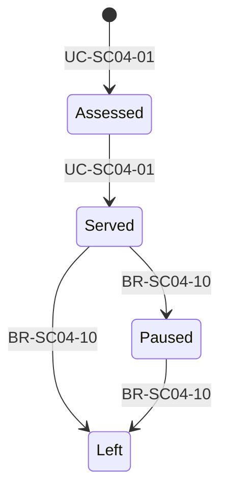

🏠 [Specs](../../../README.md) › 🏷️ [Sectors](../../README.md) › 🏠 [SC04 Home care](../README.md) ›
🗃️ [Data](README.md) › 🗃️ E-SC04-01 Care recipient

# 🗃️ E-SC04-01 Care recipient

**Status:** 🔄 waiting for the owner

## Purpose

A person receiving care at home.

## Fields

| Name | Type | Required | Validation | Default | Example | Personal data | Custom fields |
|---|---|---|---|---|---|---|---|
| name, address, access | text | yes | - | - | M. Petit, Lyon, code 4471 | yes | no |
| contacts | family, doctor | no | - | - | daughter | yes | no |
| consents | sharing, location | no | BR-SC04-10 | - | family access | yes | no |
| state | assessed, served, paused, left | yes | - | assessed | served | no | no |

## Relations

(Proposed) As its use cases.

## Lifecycle

## Indexes and search

(Proposed) By number, date, partner.

## Retention

While the recipient is served, then deleted:
[CR-FR-052 Personal data kept no longer than needed](../../../10-country-packs/france/data-protection/cr-fr-052-storage-limitation.md);
health details on certified hosting:
[CR-FR-055 Health data hosting](../../../10-country-packs/france/data-protection/cr-fr-055-health-data-hosting.md).

## Audit

Every change.

## Import and export

(Proposed) CSV, FEC where relevant.

## Used by

- [UC-SC04-01](../use-cases/01-take-on-a-recipient/uc-sc04-01-register-a-care-recipient-and-their-funding.md)
- [UC-SC04-07](../use-cases/05-people-and-quality/uc-sc04-07-give-the-family-access.md)

## Open questions

None.

---

⬆️ [Up](README.md) · ➡️ [E-SC04-02 Care funding](e-sc04-02-care-funding.md)
