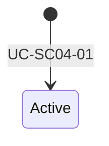

🏠 [Specs](../../../README.md) › 🏷️ [Sectors](../../README.md) › 🏠 [SC04 Home care](../README.md) ›
🗃️ [Data](README.md) › 🗃️ E-SC04-02 Care funding

# 🗃️ E-SC04-02 Care funding

**Status:** 🔄 waiting for the owner

## Purpose

The home-care side of a funder agreement: the allowance's hours for a recipient, linked to the care plan. The agreement
itself (funder, share, cap, period) is the shared
[E-F6-14 Funder agreement](../../../02-functional/f06-customers-and-sales/data/e-f06-14-funder-agreement.md) of the
multi-payer invoicing,
[UC-F6-20](../../../02-functional/f06-customers-and-sales/use-cases/07-special-invoicing/uc-f06-20-invoice-several-payers-with-funders-and-caps.md).

## Fields

| Name | Type | Required | Validation | Default | Example | Personal data | Custom fields |
|---|---|---|---|---|---|---|---|
| recipient, funder | records | yes | - | - | M. Petit, département | no | no |
| hours, share | number, percent | yes | BR-SC04-11 | - | 20 h, 80 % | no | no |
| valid | dates | yes | - | - | 2026 | no | no |

## Relations

(Proposed) As its use cases.

## Lifecycle

## Indexes and search

(Proposed) By number, date, partner.

## Retention

Kept for the period of its kind of record in the country pack (D293), or else its kind's default in the
[retention schedule](../../../05-non-functional/data-retention.md).

## Audit

Every change.

## Import and export

(Proposed) CSV, FEC where relevant.

## Used by

- [UC-SC04-01](../use-cases/01-take-on-a-recipient/uc-sc04-01-register-a-care-recipient-and-their-funding.md)

## Open questions

None.

---

⬅️ [E-SC04-01 Care recipient](e-sc04-01-care-recipient.md) · ⬆️ [Up](README.md) ·
➡️ [E-SC04-03 Care plan](e-sc04-03-care-plan.md)
