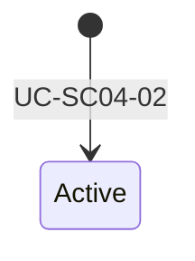

🏠 [Specs](../../../README.md) › 🏷️ [Sectors](../../README.md) › 🏠 [SC04 Home care](../README.md) ›
🗃️ [Data](README.md) › 🗃️ E-SC04-03 Care plan

# 🗃️ E-SC04-03 Care plan

**Status:** ✅ specified

## Purpose

The agreed help.

## Fields

| Name | Type | Required | Validation | Default | Example | Personal data | Custom fields |
|---|---|---|---|---|---|---|---|
| recipient, version | records | yes | - | 1 | M. Petit, v2 | no | no |
| tasks, frequency | list | yes | - | - | meals, 5 x week | yes | no |
| signed | date | no | BR-SC04-03 | - | 2 Nov | yes | no |

## Relations

As its use cases.

## Lifecycle

## Indexes and search

By number, date, partner.

## Retention

While the recipient is served, then deleted:
[CR-FR-052 Personal data kept no longer than needed](../../../10-country-packs/france/data-protection/cr-fr-052-storage-limitation.md);
health details on certified hosting:
[CR-FR-055 Health data hosting](../../../10-country-packs/france/data-protection/cr-fr-055-health-data-hosting.md).

## Audit

Every change.

## Import and export

CSV, FEC where relevant.

## Used by

- [UC-SC04-02](../use-cases/01-take-on-a-recipient/uc-sc04-02-assess-needs-and-write-the-care-plan.md)

## Open questions

None.

---

⬅️ [E-SC04-02 Care funding](e-sc04-02-care-funding.md) · ⬆️ [Up](README.md) · ➡️ [E-SC04-04 Visit](e-sc04-04-visit.md)
