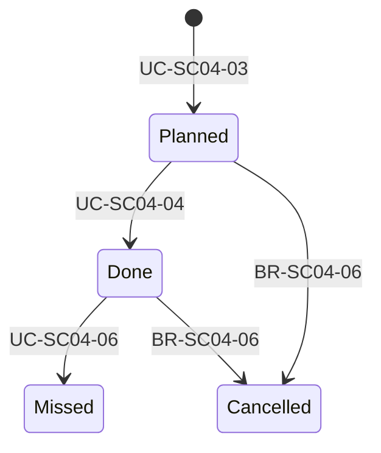

🏠 [Specs](../../../README.md) › 🏷️ [Sectors](../../README.md) › 🏠 [SC04 Home care](../README.md) ›
🗃️ [Data](README.md) › 🗃️ E-SC04-04 Visit

# 🗃️ E-SC04-04 Visit

**Status:** 🔄 waiting for the owner

## Purpose

A planned or done visit.

## Fields

| Name | Type | Required | Validation | Default | Example | Personal data | Custom fields |
|---|---|---|---|---|---|---|---|
| recipient, carer, slot | records | yes | BR-SC04-06 | - | M. Petit, N. R., Mon 09:00 | yes | no |
| check-in, check-out | times | no | BR-SC04-07 | - | 09:02, 10:05 | no | no |
| state | planned, done, missed, cancelled | yes | - | planned | done | no | no |

## Relations

(Proposed) As its use cases.

## Lifecycle

## Indexes and search

(Proposed) By number, date, partner.

## Retention

Kept for the period of its kind of record in the country pack (D293), or else its kind's default in the
[retention schedule](../../../05-non-functional/data-retention.md).

## Audit

Every change.

## Import and export

(Proposed) CSV, FEC where relevant.

## Used by

- [UC-SC04-03](../use-cases/02-plan-the-rounds/uc-sc04-03-plan-visits-and-optimise-rounds.md)
- [UC-SC04-04](../use-cases/03-visit/uc-sc04-04-visit-on-the-carer-s-phone.md)
- [UC-SC04-06](../use-cases/02-plan-the-rounds/uc-sc04-06-replace-an-absent-carer.md)
- [UC-SC04-15](../use-cases/03-visit/uc-sc04-15-ask-the-assistant-about-the-rounds.md)

## Open questions

None.

---

⬅️ [E-SC04-03 Care plan](e-sc04-03-care-plan.md) · ⬆️ [Up](README.md) · ➡️ [E-SC04-05 Round](e-sc04-05-round.md)
