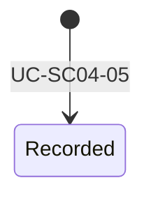

🏠 [Specs](../../../README.md) › 🏷️ [Sectors](../../README.md) › 🏠 [SC04 Home care](../README.md) ›
🗃️ [Data](README.md) › 🗃️ E-SC04-06 Care log entry

# 🗃️ E-SC04-06 Care log entry

**Status:** ✅ specified

## Purpose

A note of a visit.

## Fields

| Name | Type | Required | Validation | Default | Example | Personal data | Custom fields |
|---|---|---|---|---|---|---|---|
| visit | visit | yes | - | - | V-3311 | no | no |
| text, shared | text, yes or no | yes | BR-SC04-10 | not shared | ate well | yes | no |

## Relations

As its use cases.

## Lifecycle

## Indexes and search

By number, date, partner.

## Retention

While the recipient is served, then deleted:
[CR-FR-052 Personal data kept no longer than needed](../../../10-country-packs/france/data-protection/cr-fr-052-storage-limitation.md);
health details on certified hosting:
[CR-FR-055 Health data hosting](../../../10-country-packs/france/data-protection/cr-fr-055-health-data-hosting.md).

## Audit

Every change.

## Import and export

CSV, FEC where relevant.

## Used by

- [UC-SC04-05](../use-cases/03-visit/uc-sc04-05-keep-the-care-log-and-report-incidents.md)
- [UC-SC04-07](../use-cases/05-people-and-quality/uc-sc04-07-give-the-family-access.md)

## Open questions

None.

---

⬅️ [E-SC04-05 Round](e-sc04-05-round.md) · ⬆️ [Up](README.md) ·
➡️ [E-SC04-07 Care incident](e-sc04-07-care-incident.md)
