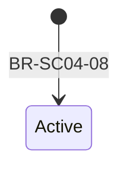

🏠 [Specs](../../../README.md) › 🏷️ [Sectors](../../README.md) › 🏠 [SC04 Home care](../README.md) ›
🗃️ [Data](README.md) › 🗃️ E-SC04-07 Care incident

# 🗃️ E-SC04-07 Care incident

**Status:** 🔄 waiting for the owner

## Purpose

Something worrying during a visit.

## Fields

| Name | Type | Required | Validation | Default | Example | Personal data | Custom fields |
|---|---|---|---|---|---|---|---|
| visit, kind | records | yes | BR-SC04-08 | - | V-3311, fall | yes | no |
| seriousness, actions | level, text | yes | - | - | high, doctor called | yes | no |

## Relations

(Proposed) As its use cases.

## Lifecycle

## Indexes and search

(Proposed) By number, date, partner.

## Retention

While the recipient is served, then deleted:
[CR-FR-052 Personal data kept no longer than needed](../../../10-country-packs/france/data-protection/cr-fr-052-storage-limitation.md);
health details on certified hosting:
[CR-FR-055 Health data hosting](../../../10-country-packs/france/data-protection/cr-fr-055-health-data-hosting.md).

## Audit

Every change.

## Import and export

(Proposed) CSV, FEC where relevant.

## Used by

- [UC-SC04-05](../use-cases/03-visit/uc-sc04-05-keep-the-care-log-and-report-incidents.md)

## Open questions

None.

---

⬅️ [E-SC04-06 Care log entry](e-sc04-06-care-log-entry.md) · ⬆️ [Up](README.md) ·
➡️ [E-SC04-08 Care invoice](e-sc04-08-care-invoice.md)
