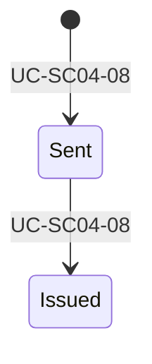

🏠 [Specs](../../../README.md) › 🏷️ [Sectors](../../README.md) › 🏠 [SC04 Home care](../README.md) ›
🗃️ [Data](README.md) › 🗃️ E-SC04-08 Care invoice

# 🗃️ E-SC04-08 Care invoice

**Status:** ✅ specified

## Purpose

A monthly invoice to one payer.

## Fields

| Name | Type | Required | Validation | Default | Example | Personal data | Custom fields |
|---|---|---|---|---|---|---|---|
| payer, month | records | yes | BR-SC04-11 | - | M. Petit, Nov | yes | no |
| hours, amount | numbers | yes | - | - | 10 h, 260 EUR | no | no |
| advance request | state | no | BR-SC04-13 | - | validated | no | no |

## Relations

As its use cases.

## Lifecycle

## Indexes and search

By number, date, partner.

## Retention

As an accounting record:
[CR-FR-002 Accounting records kept 10 years](../../../10-country-packs/france/accounting/cr-fr-002-accounting-records-kept-ten-years.md).

## Audit

Every change.

## Import and export

CSV, FEC where relevant.

## Used by

- [UC-SC04-08](../use-cases/04-bill-and-fund/uc-sc04-08-bill-recipients-and-funders.md)
- [UC-SC04-10](../use-cases/04-bill-and-fund/uc-sc04-10-use-the-immediate-advance.md)

## Open questions

None.

---

⬅️ [E-SC04-07 Care incident](e-sc04-07-care-incident.md) · ⬆️ [Up](README.md) ·
➡️ [E-SC04-09 Tax-credit certificate](e-sc04-09-tax-credit-certificate.md)
