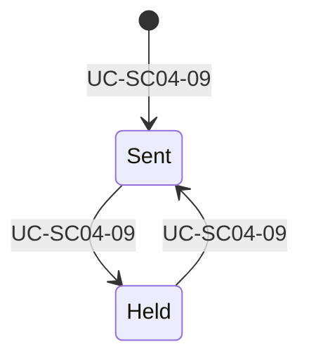

🏠 [Specs](../../../README.md) › 🏷️ [Sectors](../../README.md) › 🏠 [SC04 Home care](../README.md) ›
🗃️ [Data](README.md) › 🗃️ E-SC04-09 Tax-credit certificate

# 🗃️ E-SC04-09 Tax-credit certificate

**Status:** 🔄 waiting for the owner

## Purpose

The yearly certificate of a client.

## Fields

| Name | Type | Required | Validation | Default | Example | Personal data | Custom fields |
|---|---|---|---|---|---|---|---|
| client, year | records | yes | unique pair | - | M. Petit, 2026 | yes | no |
| amount paid, services | amount, list | yes | BR-SC04-12 | - | 3 120 EUR | no | no |
| sent | date | no | before 31 March | - | 2027-02-10 | no | no |

## Relations

(Proposed) As its use cases.

## Lifecycle

## Indexes and search

(Proposed) By number, date, partner.

## Retention

As an accounting record:
[CR-FR-002 Accounting records kept 10 years](../../../10-country-packs/france/accounting/cr-fr-002-accounting-records-kept-ten-years.md).

## Audit

Every change.

## Import and export

(Proposed) CSV, FEC where relevant.

## Used by

- [UC-SC04-09](../use-cases/04-bill-and-fund/uc-sc04-09-issue-the-yearly-tax-credit-certificate.md)

## Open questions

None.

---

⬅️ [E-SC04-08 Care invoice](e-sc04-08-care-invoice.md) · ⬆️ [Up](README.md) ·
➡️ [E-SC04-10 Complaint](e-sc04-10-complaint.md)
